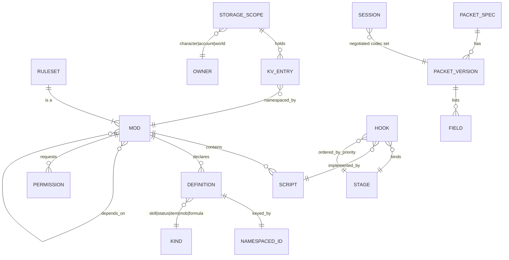
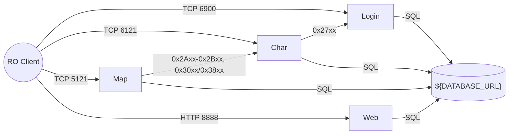

# rathena-engine: Behavior Contract and Spec (assembled)

Assembled for the scaffold workflow from three sources. Edit the sources in `analysis/rathena/`, not this file.
Order: (1) engine delta spec, (2) BR-RULESET rules, (3) inherited base spec (191 rules BR-LOGIN/CHAR/MAP/INTER/WEB, interfaces, entities). Where the base spec describes the old multi-process or in-place-refactor design, the architecture in `REIMAGINED_ARCHITECTURE.md` wins.

---
# rAthena — Engine + Luau Mods: Specification Delta

**System:** `rathena` (legacy source: repo root, HEAD `d2c5a95`)
**Target vision:** A moddable Ragnarok Online server. The native core is an engine with no game rules. The game lives in a Luau scripting layer that mods build on.
**Status:** Phase A done. HITL #1 answered. Architecture in `REIMAGINED_ARCHITECTURE_ENGINE.md` awaits HITL #2.
**Relationship to the earlier run:** `AI_NATIVE_SPEC.md` (191 rules, BR-LOGIN/CHAR/MAP/INTER/WEB, 26 capabilities, entity model, interface catalog) is **inherited unchanged** as the base spec. It was written for a different vision (in-place C++20 refactor). This file adds only what the engine + Luau vision needs. Where the two disagree, this file wins for the new system.
**Brief:** none (`analysis/rathena/MODERNIZATION_BRIEF.md` does not exist). No phase constraints apply.

Credentials are masked everywhere. Connection details appear as env-var placeholders.

---

## 1. HITL #1 decisions (recorded 2026-10-18)

- **Reuse the existing spec, fork the outputs.** Old artifacts under `analysis/rathena/` and `modernized/rathena-reimagined/` stay untouched. New outputs go to `*_ENGINE.md` and `modernized/rathena-engine/`.
- **P0 = both rulesets.** The first milestone ships the engine, the Luau runtime, the mod system, the legacy `.txt` NPC runtime, the test harness, the YAML migrator, **and both the renewal and pre-renewal packages.**
- Scope for everything else follows the user's default: pre-existing P1s (guilds, mail, web API, chat, GM tools) stay P1. Auction and battlegrounds were offered as drops in the default; the user chose "Both rulesets are P0", which was a variant of that default, so they are **dropped from the first milestone** (recorded as an assumption in §8, Q-A).

## 2. New and changed capabilities

| ID | Capability | Priority |
|---|---|---|
| CAP-E01 | **Rule-free engine core.** Entity store, map grid, spatial queries, pathfinding, tick loop, timers, sessions, persistence. No reference to any skill, item, status, job or formula. | P0 |
| CAP-E02 | **Generated packet codecs.** Wire formats come from a machine-readable spec keyed by semantic name, version and client flavour. | P0 |
| CAP-E03 | **Luau runtime.** Ordered, cancellable, prioritized event bus; coroutine dialogue; hot reload; instruction budgets; sandbox; typed API definitions. | P0 |
| CAP-E04 | **Namespaced persistent storage.** Per-mod storage on character, account and world scopes. Replaces sigil variables. | P0 |
| CAP-E05 | **Mod system.** `mods/` packages with manifest (name, version, dependencies, load order, permissions) and namespaced IDs. | P0 |
| CAP-E06 | **Ruleset packages.** `ruleset.renewal` and `ruleset.prerenewal` as two separate script packages. Damage pipeline of named stages. Declarative status contributions. | P0 |
| CAP-E07 | **Native fast paths.** Mob AI and default damage calculation, used only when no script hooks that stage. | P0 |
| CAP-E08 | **Legacy NPC script compatibility.** Runs existing `.txt` scripts against the new API. | P0 |
| CAP-E09 | **Headless test harness.** Simulated players cast skills and assert outcomes. | P0 |
| CAP-E10 | **YAML database migrator.** Converts `db/{re,pre-re,import}` to ruleset package data. | P0 |
| CAP-E11 | **Topology simplification.** Replaces the login/char/map split if the evidence supports it (see §7). | P0 |

Inherited capabilities CAP-01…CAP-26 keep their meaning. Their *implementation home* changes: rules move out of C++ into packages. See the traceability map in the architecture.

## 3. Behavior contract additions

**119 rules `BR-RULESET-001…119`** were mined from `battle.cpp`, `status.cpp`, `skill.cpp`, `pc.cpp` and `script.cpp`. They are the acceptance tests for the two ruleset packages. The full text with citations, renewal/pre-renewal flags and worked examples E-1…E-10 is preserved verbatim in **`analysis/rathena/BR_RULESET.md`** (written alongside this file). Summary:

| Range | Subject | Count | Native or script |
|---|---|---|---|
| 001–050 | Damage pipeline: weapon, magic and misc paths; card fix; element; RES/MDEF; reflection; map-mode rates; skill-damage DB | 50 | stage tables native, formulas and per-skill hooks script |
| 051–077 | Status effects: record schema, start gating, resistance (PRE vs RE), stacking, strip, end semantics, stat contributions, periodic ticks | 27 | declarative script data |
| 078–097 | Skills: `skill_db` fields, dispatch, cast lifecycle, requirements, delay/cooldown, ground units, combos | 20 | script |
| 098–110 | Items: `bonus` vocabulary (~506 `SP_*` cases), equip parse order, refine, combos, consume, heal | 13 | script |
| 111–119 | Native/script contract: fast paths, numeric fidelity, effect queue, hook surface, package manifest, golden-trace verification | 9 | contract |

### Findings that shape the architecture

1. **Renewal is not one switch.** `src/config/renewal.hpp:37-74` has six independent sub-flags (CAST, DROP, EXP, LVDMG, ASPD, STAT). Databases are separate sets: `skill_db` 1,228 (pre-re) vs 1,635 (re); `status` 699 vs 1,018; items 6,169 vs 29,356. The ruleset manifest must carry sub-flags, not a boolean.
2. **Stage order differs between renewal and pre-renewal**, not just constants (BR-RULESET-018 vs 019). A single pipeline with different stage *registration order* per package is therefore needed. Fixed-order with constant tables is not enough.
3. **Hook points already exist** in legacy: nine `SkillImpl` virtuals (`src/map/skills/skill_impl.hpp:7-62`) and `ScriptHost` as the single VM entry for item/equip/combo scripts. `status.yml` already has a declarative schema. About 120 `rules::` call sites already separate pure rule functions.
4. **Side effects inside calculation** (Magma Flow, Reject Sword, Poison React, Aeterna consumption). Scripts must **return an ordered effect queue** that native code applies after the result is final. Scripts never mutate the world during calculation (BR-RULESET-116).
5. **Numeric fidelity.** Legacy math is int64 with float32 steps and fixed RNG draw counts. Luau numbers are doubles. The runtime must supply integer-division, float32-rounding and int64 helpers (BR-RULESET-115).
6. **Possible legacy defects to decide, not copy blindly:** Burnt +666% inside the Dark Crow block (`battle.cpp:1803`); `rnd()%(max-min)` never returns max; always-true condition at `battle.cpp:5137`; several `!TODO: Confirm` formulas.

## 4. Engine interface contracts (new)

### 4.1 Packet specification (`netproto`)

Legacy has five unsynchronised artifacts (`clif_packetdb.hpp` 1,376 definitions; `clif_shuffle.hpp` 4,134 definitions in 155 per-build blocks; two typed-struct headers; hand-written `RFIFO*/WFIFO*` in `clif.cpp`). 1,910 `#if PACKETVER` lines across 50 files. `PACKETVER` is compile-time, one client per binary.

The spec must capture, per packet:

| Aspect | Requirement |
|---|---|
| Identity | Stable semantic name (`CZ_REQUEST_MOVE`), direction (CZ, ZC, inter), category |
| Opcode | Per (date, flavour) pair. One name maps to several opcodes, and one opcode to several names across versions (`0x0072` is WantToConnection, DropItem and UseItem at different times) |
| Version axis | `(date, flavour)` where flavour ∈ {main, re, zero}. Conditions like `MAIN>=X \|\| RE>=Y \|\| ZERO>=Z` |
| Fields | name, offset, type, width, array length, presence condition. Widths change by version (weapon u16→u32; nameid u16/u32) |
| Length | fixed, or variable with length-prefix offset and repeat group |
| Sub-encodings | packed 3-byte x/y/dir; 6-byte src/dst |
| Obfuscation | rolling opcode XOR key per session. Decoding is **stateful**, not pure |
| Gating | session-phase rules: pre-session only `WantToConnection`; pre-map-load only `LoadEndAck`; unknown opcode disconnects; 3 packets per socket per cycle |

Runtime shape: one process serves **many client versions at once** by loading the codec table for each session's negotiated `(date, flavour)`. Legacy's one-binary-per-client is dropped.

### 4.2 Spatial and pathing semantics to preserve

- **Grid:** cell flags (terrain walkable/shootable/water; dynamic: npc, basilica, landprotector, novending, nochat, maelstrom, icewall…). Last row and column count as solid (`map.cpp` edge quirk). 8×8 block buckets. Mobs in a separate bucket array.
- **Area iteration:** snapshot-then-call (list copied, callback skipped if the object was removed). Non-mobs first, then mobs. LIFO order within bucket. Square (Chebyshev) range. Optional wall-check via `path_search_long`.
- **A\*:** Manhattan×10 heuristic (inadmissible on purpose, matches the client), diagonal 14, no corner-cutting, fixed neighbor order. Limits `MAX_WALKPATH 32`, hash collision fails the search (legacy FIXME). Official walkpath rule: `path_len>14` also needs `path_search_long`.
- **Distances:** Chebyshev for rules, `floor(sqrt(dx²+dy²)-0.1)` for client-visible range.
- **Timers:** single-thread min-heap, 20 ms floor, 1000 ms ceiling poll, late-timer catch-up rules. Walk is one timer per cell (~6.7 firings/s per moving unit).
- **Rules inside spatial primitives:** `map_moveblock` embeds skill and status handling. The engine needs an **on-move hook** instead.

### 4.3 Script host interface (compatibility layer)

| Item | Fact |
|---|---|
| Corpus | 1,138 `.txt` files, 807,612 lines. Renewal loads 835 files (721,592 lines). Pre-renewal loads 527 (383,587) |
| Commands | 671 script-visible names. 388 appear in `npc/`; 283 never do |
| Declarations | 9,986 `script`, 11,788 `duplicate`, 10,365 `monster`, 4,695 `warp`, 6,138 `mapflag`, 469 shops, 195 `function`. Barters are YAML |
| Yielding commands | `next`, `close2`, `menu`, `select`, `prompt`, `input`, `sleep`, `sleep2`, `progressbar`, `progressbar_npc`. `close` ends the script. `mes`, `callshop`, `waitingroom` do not yield |
| Variables | `name` char/persist, `@` char/temp, `$` world/persist, `$@` world/temp, `#` account (char-server scope), `##` account (login-wide), `.` NPC, `.@` call frame, `'` instance. Arrays are sparse, 32-bit index. Key < 33 chars, string value < 255 |
| Param variables | `Zeny`, `BaseLevel`, etc. are not variables: read/write through `pc_readparam` / `pc_setparam` |
| Dynamic dispatch | Computed event names (`donpcevent` ~1,380 uses); `getd`/`setd` (560 uses); `getvariableofnpc` (75) shows `.` vars are not private; `unloadnpc` (157); `attachrid` (19); `atcommand` (19); `query_sql` (4, custom only); `freeloop` (34) |
| Safety | `check_cmdcount = 65535` plus `check_gotocount = 2048`; `freeloop` is the escape |
| Events | 9 engine-fired player events, touch events, shop events, timer/clock events (`OnTimer<ms>`, `OnClock<hhmm>`…), WoE/agit, instance, whisper, `bindatcmd`. User-defined labels for mob death, idle, walk-end, chat room, battleground. Player queue holds 2 events with a 100 ms dequeue |
| Zero use in corpus | `eval`, dynamic `callfunc`/`callsub` targets, `charcommand`, `cmdothernpc`, script-level `rerun` |

The `ScriptHost` facade and the headless buildin corpus in `tools/ci/script_corpus/` already exist and can seed the compatibility work.

### 4.4 Data (YAML) migration inputs

- `db/*.yml` are stubs (`Header`, optional `Body`, `Footer.Imports`). Data is in `db/re/` and `db/pre-re/`; overrides in `db/import/` (created at install from `db/import-tmpl/`).
- Override semantics are **per-field "last file wins"** inside each DB's `parseBodyNode`, not in the loader. Lists may use an `Index` key. CSV-style DBs go through `sv_readdb`. The migrator must reproduce field-merge semantics. Only the mob DB was read in detail; the item, skill, status and quest DBs may have special cases (see Q-D).
- Embedded script strings in the data: `Script` 29,585, `UnEquipScript` 384, `EquipScript` 20, achievement `Condition` 183. All are rAthena script, not Luau, so the migrator **translates or wraps** them through the same compatibility layer as NPC scripts.
- Sizes (re / pre-re): items 29,356 / 6,169; mobs 2,675 / 1,004; skills 1,635 / 1,228; statuses 1,018 / 699; quests 4,821 / 2,879; item groups 2,996 / 62; combos 5,114 / 105. `mob_skill_db.txt` 14,514 / 5,494 rows.

## 5. Non-functional requirements (inferred)

| NFR | Basis |
|---|---|
| Single map process handles ≥ 1,000 CCU | `PERFORMANCE.md`: legacy at 1,000 CCU is 0.7 ms p99 tick spread, 7.9 ms in a 31×31 crowd (no combat, skills or NPCs). Target: no regression |
| Tick floor 20 ms, poll ceiling 1,000 ms | `timer.cpp:24-25` |
| Mob AI hard tick 100 ms, lazy 1,000 ms | `mob.cpp:7020-7021` |
| Script budget | Legacy: 65,535 commands per run. New: per-script instruction budget with a `freeloop`-equivalent opt-out requiring a permission |
| Mass logout | A one-off 670 ms iteration at 1,000 simultaneous saves must not stall the tick: persistence runs off the tick thread |
| Hot reload | A script change takes effect without disconnecting players |
| Determinism | Seeded replay must match legacy golden traces (`RATHENA_GOLDEN_TRACE`) for both rulesets, including float32 steps and RNG draw counts |
| Socket limit | Default build caps at 1,024 fds (`select`). New engine uses epoll/io_uring/IOCP |

## 6. Domain model additions

Inherited entities stay. New entities:



## 7. Topology evidence (login / char / map)

- ~280 hand-framed inter-server message types: login↔char 31 ids, map→char ~111, char→map ~101. The largest payload is a raw `memcpy` of `struct mmo_charstatus` (ABI-coupled).
- `MAX_MAP_SERVERS` is **2** by default. No repo evidence of more than one map process.
- Map already writes 46 SQL call sites directly, so "char owns persistence" is already crossed.
- With one map process, parties/guilds/whispers/ticket/online tracking are loopback. Real remaining work: character select, ticket auth, persistence, cross-player aggregates (guild 1,966 lines, party 957, mail 756, storage 539, auction 514).
- Login is stateless apart from accounts and an online table. It is the weakest case for a separate process.
- The 3-port redirect (login→char→map IP/port in client packets) is client-protocol-driven but a merged process can answer with its own address.

## 8. Open questions (carried into the architecture as explicit decisions)

| ID | Question | Source |
|---|---|---|
| Q-A | Confirm auction and battlegrounds are out of the first milestone | HITL #1 variant |
| Q-B | Bit-exact legacy parity (float32, RNG draw counts) or statistical parity? | BR-RULESET-115 |
| Q-C | Must the six renewal sub-flags be independently selectable? | BR-RULESET-118 |
| Q-D | Do any DBs besides mobs have custom merge rules? | engine report |
| Q-E | Is mob AI scriptable at all, or native with only mob-skill conditions scripted? | BR-RULESET-113 |
| Q-F | Can status `val1..val4` become named fields (save-format migration)? | BR-RULESET-051 |
| Q-G | Ship legacy defects (Burnt, `rnd%(max-min)`) as-is behind a `legacy_quirks` flag, or fix? | BR-RULESET §0 |
| Q-H | Are `.` NPC variables shared by `duplicate()` clones? Inferred yes (`script_code` object), not traced | script report |
| Q-I | Does any operator rely on the 283 never-used commands, `query_sql`, `atcommand`, `setunitdata`? | script report |
| Q-J | Is the exact 2-slot event-queue drop and 100 ms dequeue a contract? | script report |
| Q-K | Does a deployment run more than one map process? | topology |
| Q-L | Does the earlier architecture's decision K2 (keep the legacy NPC VM) stay superseded? This vision replaces it with Luau + a compat layer | rules report Q9 |

## 9. Provenance and data-handling notes

All three mining agents reported no instruction-shaped text aimed at automated analysis in the files they read. No credentials were encountered. The `// BR-MAP-0xx (map-rules)` comments in legacy source are provenance only; rules were confirmed against code.

---

# BR-RULESET: rules a Luau script ruleset must own (not in AI_NATIVE_SPEC.md)

Scope: `src/map/battle.cpp`, `status.cpp`, `skill.cpp`, `pc.cpp`, `script.cpp`, `mob.cpp`, and the `db/` schemas. All paths are under `/home/user/reAthena`. I did not write any files.

Priority scale:
- **P0**: needed for any playable combat parity.
- **P1**: needed for full class coverage.
- **P2**: tail or niche.

Mode column: **B** = both modes (the rule text names any constants that differ), **RE** = renewal only, **PRE** = pre-renewal only.

Confidence column: H = High, M = Medium. No rule is rated Low. Open questions are in section 7.

## 0. Findings that change how to read this list

1. **Overlap with the existing spec.** The base stat and defense formulas are already BR-MAP-004..020 (MaxHP, MATK, HIT/FLEE/CRI, soft DEF/MDEF, crit chance, hit chance, crowd penalties, defense formulas, element table, size table, ASPD). Cast time and delay are BR-MAP-051..053. The rules below cover only what those do not: modifiers, ordering, status effects, skill lifecycle and item bonuses.
   - The source already carries `rules::combat::*` and `rules::skills::*` calls, with comments like `BR-MAP-014 (map-rules)`, for hit, crit, defense and cast. Those are pure-function seams, so they are good native-core candidates.
2. **Hook points already exist in the legacy code.**
   - `src/map/skills/` has about 1,297 per-skill `SkillImpl` classes. The hook set is `castendNoDamageId`, `castendDamageId`, `castendPos2`, `calculateSkillRatio`, `modifyHitRate`, `applyAdditionalEffects`, `applyCounterAdditionalEffects`, `modifyDamageData` and `modifyElement` (`src/map/skills/skill_impl.hpp:7-62`). It is the obvious template for the Luau skill contract.
   - `ScriptHost` (`src/map/script_host.hpp:86-102`) is already the single entry point for item, equip and combo scripts.
   - `db/*/status.yml` already has a declarative schema (CalcFlags, States, Flags, Fail, EndOnStart, EndReturn, EndOnEnd, Script).
3. **Renewal is not one switch.**
   - `src/config/renewal.hpp:37-74` has independent sub-flags: RENEWAL_CAST, DROP, EXP, LVDMG, ASPD and STAT.
   - Pre-renewal and renewal also have separate DBs: `db/pre-re` and `db/re`. `skill_db` has 1,228 vs 1,635 entries, and `status.yml` has 699 vs 1,018.
   - A ruleset package manifest must therefore carry sub-flags, not a boolean.
4. **Scale of the status schema.**
   - `status_calc_*` (status.cpp 6773-8750) references 269 distinct SC_ types. `battle_calc_damage` references 52 more. `battle.cpp` as a whole references 240.
   - Status values are untyped `val1..val4`, whose meaning is defined per status in code. A schema must name them.
5. **Possible legacy defect.** `battle.cpp:1803-1804` puts the `SC_BURNT` "+666% vs fire" line inside the `SC_DARKCROW` block, so it only fires while the target also has Dark Crow. See Q1 below.
6. **Architecture conflict to decide.** `analysis/rathena/REIMAGINED_ARCHITECTURE.md` (approved HITL #2) chose an in-place C++20 refactor and keeps the legacy NPC script VM (K2). It has no Luau layer. The vision in this task diverges, so it needs an ADR.
7. **Injection check.** I saw no instruction-shaped text aimed at automated analysis in the files read. `// BR-MAP-0xx (map-rules)` comments are provenance only. I confirmed the rules against code, not comments. No credentials were encountered.

## 1. Damage pipeline: ordered stages

**Entry point**
- `battle_calc_attack` dispatches to `battle_calc_weapon_attack`, `battle_calc_magic_attack` or `battle_calc_misc_attack`, then normalises misses (BR-RULESET-001).

**Weapon path**
- Renewal and pre-renewal differ in the order of stages, not just in constants.
- Stage names, in order:

| # | Stage | PRE | RE |
|---|---|---|---|
| S0 | Init, lucky dodge, multi-hit roll, crit roll, hit roll | same | same |
| S1 | Base attack | `battle_calc_base_damage` (min = DEX-based, max = weapon ATK; size fix; + batk) | ATK parts: status / weapon / equip / mastery / percent, each with its own element and card fix |
| S2 | Attacker card and SC multipliers | after masteries, on the whole damage | on parts, before summing |
| S3 | Skill ratio | multiply, then constant add | sum parts, P.ATK, crit_atk_rate, then ratio, then constant add |
| S4 | RES | none | % reduction before DEF |
| S5 | Defense | `100−DEF`% then `− vitDEF` (random) | `ATK×(4000+DEF)/(4000+10·DEF) − softDEF` |
| S6 | Post-defense | refine bonus, min 1, masteries | min 1 |
| S7 | Skill ATK bonus | before DEF | after DEF |
| S8 | Element | `battle_attr_fix`, then star crumbs / EDP / element endow | PC element already applied per part; ×1.4 crit here |
| S9 | Target card fix | for all targets that are PCs | only for non-PC attackers |
| S10 | Div-fix, hands | same | same |
| S11 | Target and caster SC modifiers (`battle_calc_damage`), GvG/BG/PK rates | same | same |
| S12 | Final modifiers, reflect | same | same |

**Magic path**
- Order: MATK roll, split, skill ratio, skill ATK bonus, MDEF, element, card fix (pre-renewal), then the `battle_calc_damage` stage.
- In renewal the card fix runs first, then S.MATK, then the ratio (BR-RULESET-044).

**Misc path**
- Fixed formulas per skill (BR-RULESET-047).

## 2. Damage pipeline rules

| ID | Rule | Citation | Mode | Pri | Conf |
|---|---|---|---|---|---|
| BR-RULESET-001 | The calculator is chosen by attack type (weapon, magic, misc). If total damage < 1 the result is MISS, `div` becomes 1 for players, and Weapon Blocking can trigger on a miss. Otherwise the damage level is DEF. Vanish-on-hit applies when total damage > 1. | battle.cpp:6782-6825 | B | P0 | H |
| BR-RULESET-002 | Context init: `div` comes from the skill's hit count. Ground skills get `amotion` 0. Flags are WEAPON plus SKILL if a skill or splash flag exists, else NORMAL. Range is long for arrow or Soul Attack basic attacks, otherwise short. Blow count includes the player blow bonus. | battle.cpp:5308-5354 | B | P0 | H |
| BR-RULESET-003 | Lucky dodge: a basic attack (or Sacrifice) against a target with `flee2` > 0 is fully avoided when `rnd%1000 < flee2`. | battle.cpp:5454-5461 | B | P0 | H |
| BR-RULESET-004 | The multi-hit roll happens before crit, and a crit cannot happen on a double-attack hit when Double Attack or Chain Action lack the crit flag. **Double Attack** needs a dagger (or a flagged source) and a non-fist weapon. Chance = max(lv × 5 (PRE) / lv × 7 (RE), `bonus.double_rate`). Kagemusya gives `val1×10`. **Chain Action** (revolver) is 5%/lv. **Fear Breeze** gives cumulative 12/9/6/3% for 2/3/4/5 hits, capped by ammo. | battle.cpp:4273-4348, 3038-3044 | B (5 vs 7 per lv) | P0 | H |
| BR-RULESET-005 | Crit eligibility: skills need the crit flag, except always-crit skills. `cri` gets arrow bonuses, +100 per Camouflage second (max 10), and +200 (PRE) / +300 (RE) for Sharpshooting. Kirikage adds 250+50·lv. Some skills halve `cri`, and some need a specific weapon or status. Target crit-defense scales it down, then `rnd%1000 < cri`. The base chance is BR-MAP-010. | battle.cpp:3021-3161 | B | P0 | H |
| BR-RULESET-006 | Hit determination is checked in a fixed order. Auto-hit cases: crit, perfect-hit %, Fusion, Splasher without splash, Crusader spirit Shield Boomerang, target in a non-stone/burning opt1 state, skill ignores flee. Otherwise Neutral Barrier blocks ranged non-magic. Hitrate is 80 (PRE) or 0 (RE) + hit − flee, with modifiers (Fog Wall −50, arrow hit, RE Vulture's Eye +lv, Double Attack +lv on a 2-hit, Weaponry Research, Sword Training). It is clamped, Rapid Smiting adds +20 after the clamp, then `rnd%100`. Formula basis is BR-MAP-011. | battle.cpp:3234-3324 | B | P0 | H |
| BR-RULESET-007 | Plant / infinite-defense targets take 1 damage per hit, skipping the pipeline. Camouflage ends unless the skill is Sharpshooting or Arrow Storm. | battle.cpp:5483-5496, 5793-5796, 4982-5045, 2894 | B | P1 | H |
| BR-RULESET-008 | **PRE base damage** (and non-PC in RE). PC max = weapon ATK, min = DEX × (80 + 20·weaponLv)%, capped at max. Bows: min = min×max/100. Maximize Power: min = max. Non-crit rolls `rnd%(max−min)+min`, so the top value is never rolled. Crit uses max. Add bow `arrow_atk`. Apply the size modifier (unless Weapon Perfection). Then add `batk`. | battle.cpp:2519-2639 | PRE (mobs in both) | P0 | H |
| BR-RULESET-009 | **RE ATK parts.** Players: statusAtk = batk, element-adjusted as Neutral (or weapon element under Mild Wind), then doubled for the right hand. weaponAtk = variance roll, then element. equipAtk = eatk + arrow ATK, then element. percentAtk = (weapon+equip) × atk_rate/100. masteryAtk is element-free. Monsters, homunculi and pets use the PRE base-damage path. | battle.cpp:3895-3958 | RE | P0 | H |
| BR-RULESET-010 | RE weapon ATK roll. variance = 5·ATK·weaponLv/100. stat bonus = ATK·STAT/200 (STAT = DEX for bows, instruments, whips and guns, or STR if Soul Attack is learned). Range = [ATK − var + bonus, ATK + var + bonus]. Crit or Maximize takes the max. Then `weapon_damage_rate`, then size fix (skipped by Weapon Perfection). | battle.cpp:2447-2499 | RE | P0 | H |
| BR-RULESET-011 | Equip ATK = `status.eatk` + `bonus.arrow_atk` (not for cannonballs) for arrow skills. In PRE, `SP_BASE_ATK` adds to batk. | battle.cpp:3437-3452, 3940-3944; pc.cpp:3737-3746 | RE | P1 | H |
| BR-RULESET-012 | Some skills replace the base damage. Examples: Sacrifice = 9% max HP; Dragon Breath = (HP/50 + maxSP/4)·lv, scaled by level above 100 and trainings; Self-Destruction; Happo Kunai; Shield Boomerang / Rapid Smiting = batk + 4·refine + shield weight/10; Spiral Pierce uses weapon weight (PRE 80%·weight with a 50·lv ratio; RE weight/10 with ×0.7 and a size fix); PRE-only Ishhen = 40·STR + HP·8·lv/100. | battle.cpp:3983-4140 | B (per-skill splits) | P0 | H |
| BR-RULESET-013 | `NK_SPLASHSPLIT` skills divide ATK or MATK by the count of targets hit (`miscflag`). A zero count is an error. | battle.cpp:4185-4196, 6006-6011 | B | P1 | H |
| BR-RULESET-014 | PRE base-stage additions. A crit adds `crit_atk_rate`. A non-crit adds `non_crit_atk_rate` unless the skill is flagged to ignore it. TK_POWER adds 2·lv·(party members on the map − 1) % for PRE, or a flat 20·lv% for RE. Target `crit_def_rate` reduces crit damage. Acid Terror subtracts def2 (PRE). | battle.cpp:4198-4238 | B | P1 | H |
| BR-RULESET-015 | Skill ratio = 100 + `bonus.skill_ratio` + Overthrust + Max Overthrust + Berserk (+100 PRE / +200 RE). Plain-attack extras: Poison React (+30·lv, may poison), Crush Strike, Giant Growth (+250, or +125 on PvP maps). Then the per-skill `calculateSkillRatio` hook. | battle.cpp:4413-4479 | B | P0 | H |
| BR-RULESET-016 | ATK% from statuses (Curse −25, Provoke, Concentration, True Sight, Joint Beat, Bloodlust, Fleet and others, capped 0..65535). Only certain skills use it. **RE**: it seeds the skill ratio. **PRE**: it multiplies the damage after the ratio. | battle.cpp:4361-4402, 4427, 4579-4580 | B (placement) | P0 | H |
| BR-RULESET-017 | Constant additions after the ratio (e.g. Asura = 250 + 150·lv, Rapid Smiting's random bonus ≥ 100). They are added before the SC modifiers. | battle.cpp:4489-4530, 5499, 5601 | B | P1 | H |
| BR-RULESET-018 | **PRE order**: base → ratio → constant add → skill ATK bonus → DEF → refine → masteries → Aura Blade → min 1 → attacker card fix → target card fix → element → star crumbs / EDP. Shield Boomerang and Rapid Smiting apply DEF before the ratio. | battle.cpp:5485-5521, 5648-5659, 4925-4946, 5761-5790 | PRE | P0 | H |
| BR-RULESET-019 | **RE order**: parts → card fix per part → SC bonuses → sum → P.ATK → masteries → crit rate → ratio → constant → Advanced Katar Mastery (+10+2·lv%) → RES → DEF (if any hand is not ignored) → post-DEF → skill ATK bonus → element → ×1.4 crit → flat additions → non-PC target card fix → div → hands → GvG/BG → final modifiers. | battle.cpp:5502-5817 | RE | P0 | H |
| BR-RULESET-020 | Attacker card fix: multiplicative factors on a base of 1000, rounded down. Order: race, element, size, race2, class, `add_dmg`, then short/long rate. Arrow attacks use the arrow variants. Left-hand bonuses merge into the right when `left_cardfix_to_right`. PRE also folds in Adv. Katar Mastery. **Example E-3.** | battle.cpp:773-1091, 810 | B | P0 | H |
| BR-RULESET-021 | Defender card fix (weapon): element vs attack element, defender's own element, size, weapon-size, race / race2 / `subrace3`, class, `add_def`, near / far attack-defense rates, `SC_DEF_RATE`. A left-hand element is applied separately when it differs. | battle.cpp:1093-1158 | B | P0 | H |
| BR-RULESET-022 | Magic card fix. **RE**: sequential rounded steps in the order size → race2 → element → attack-element → race → class, with `APPLY_CARDFIX_RE` on percent values. **PRE**: one multiplicative product. Defender side includes element, size, race, class, magic defense rate and `SC_MDEF_RATE`. Near attack-defense also counts vs magic in PRE. | battle.cpp:813-939 | B | P0 | H |
| BR-RULESET-023 | Status-based elemental vulnerability applied as card fix: Magic Poison +50, and +100 Climax Bloom / Climax Earth, +15 Misty Frost, +5·lv Cloud Poison by the attack element. In RE magic it applies right after the element mods. For PC defenders in PRE it adds to the element fix. | battle.cpp:729-755, 842-844, 896, 1159-1164 | B | P1 | H |
| BR-RULESET-024 | Mastery damage by passive and weapon type. Examples: Demon Bane = lv·(baseLv/20 + 3) vs demons / undead mobs; Ranger Main, Research FE, Beast Bane, Sword / Two-hand mastery. In RE the mastery term starts at 0 and Weaponry Research applies to all weapons. A skill exclusion list decides which skills ignore masteries, refine and star crumbs. Some SC "masteries" (Camouflage, Cart Boost, Nibelungen) are added to masteryAtk. | battle.cpp:2281-2420, 3399-3436, 3787-3883 | B | P0 | H |
| BR-RULESET-025 | RES: when target RES > 0 and the skill does not use simple defense, damage −= RES/(RES+400) × 80%. The attacker's ignore-RES (Telum, Potent Venom, race bonuses) is capped at 50%. MRES is the same for magic with A_VITA. **Example E-2.** | battle.cpp:5611-5641, 6073-6100 | RE | P0 | H |
| BR-RULESET-026 | Defense modifiers beyond BR-MAP-013..016: Expiatio −5%/lv DEF, Camouflage −5%/s DEF, Force of Vanguard +2%/lv, Revitalize, Overed Boost. Mob attackers add the target's Divine Protection, Ranger Main and Research FE to vitDEF. `weapon_defense_type` moves hard DEF into vitDEF. | battle.cpp:4744-4788, 4829-4837, 4865-4868 | B | P1 | H |
| BR-RULESET-027 | DEF bypass and piercing. PRE crit ignores DEF. Fusion, per-skill weapon conditions, `ignore_def_*` card flags (by element, race or class), and the skill's ignore-defense flag also bypass it. Piercing: Investigate always; weapon-card `def_ratio_atk` (not on crit in PRE). Left-hand cards can pass to the right (`left_cardfix_to_right`). | battle.cpp:3171-3208, 3334-3390 | B | P0 | H |
| BR-RULESET-028 | Post-defense. PRE: add refine bonus (atk2), min 1, then masteries. Both: Aura Blade (PRE 20·lv; RE (3+lv)·baseLv, marked TODO), min 1. RE: Sonic Acceleration +90%. | battle.cpp:4925-4972 | B | P1 | M |
| BR-RULESET-029 | Element selection. Skill element, or weapon element (right / left hand) for ELE_WEAPON and basic attacks. Ammo element for bows. Endow overrides all. Goldene Ferse can force Holy. Spirit charm × 10 endows. ELE_ENDOWED uses the status element, ELE_RANDOM picks randomly. Misc attacks treat weapon / endowed as Neutral. The per-skill `modifyElement` hook runs last. | battle.cpp:3466-3554 | B | P0 | H |
| BR-RULESET-030 | Element application. `NK_IGNOREELEMENT` skips it. Non-player basic attacks are Neutral when `attack_attr_none` covers their unit type. In RE, PCs already applied element per part. Some skills are forced Neutral after weapon element (Cart Revolution, Magic Crasher, Fallen Empire, Gate of Hell). Envenom and Throw Shuriken / Kunai apply the table twice in PRE. | battle.cpp:3651-3748 | B | P0 | H |
| BR-RULESET-031 | Statuses modify the element ratio. **PRE**: damage is first changed by a percentage, then multiplied by the table. **RE**: the percentage is added to the ratio, and the result is `dmg − dmg·(100−ratio)/100`. Includes Volcano, Violent Gale, Deluge, Spider Web (×2 vs Fire, then ends), Insignias, Burnt (+400), Oratio, Soul Curse. Also side effects: Earth damage frees Magnetic Field. **Example E-1.** | battle.cpp:515-721 | B (divergent) | P0 | H |
| BR-RULESET-032 | `attr_recover`: when 0, a negative element ratio is clamped to 0 (no healing). Damage is then capped at 0. | battle.cpp:709-719, 3775 | B | P1 | H |
| BR-RULESET-033 | Element endow bonuses. PRE: star crumbs, spirit spheres, EDP (+`val3`%), and `SC_WATK_ELEMENT` (a % of the normal-attack damage taken as that element), all applied after element and only to the right hand. RE: EDP = weapon and equip ATK × (2.5 + 0.3·lv), skipped by 5 skills. | battle.cpp:3711-3772, 4594-4612 | B | P1 | H |
| BR-RULESET-034 | RE crit damage: players × (1.4 + 0.01·`crate`), floored in float32. Non-players × 1.4. Target `crit_def_rate` then reduces it. In PRE crit means max damage and no multiplier. | battle.cpp:5676-5688; 2574-2577 | RE | P0 | H |
| BR-RULESET-035 | Flat skill additions after element: Taekwon kicks +10·Running when fists; Shield Press = VIT·refine; Tiger Cannon; Gate of Hell; homunculus skills (2500 / 4000 / 6000·lv + level); Max Pain. PRE also adds Weaponry Research +2/lv, Ground Drift, Hilt Binding +4, then the PRE attacker card fix. | battle.cpp:5690-5760 | B | P1 | H |
| BR-RULESET-036 | `div` fix: a negative `div` means "divide by it then multiply", which fixes the per-hit value. A total below `div` is raised to `div` for certain skills or when `skill_min_damage` flags it. | battle.cpp:4244-4263 | B | P1 | H |
| BR-RULESET-037 | Hands. Katar off-hand = main × (1+2·TF_DOUBLE)% for normal attacks only. Dual wield (Assassin, Kagerou/Oboro) scales right and left hands: right 50 + 10·lv, left 30 + 10·lv (Assassin); right 70 + 10·lv, left 50 + 10·lv (Kagerou/Oboro). Left-only wielders get unarmed right. Both hands min 1. **Example E-6.** | battle.cpp:5058-5107 | B (RE excludes katar from dual wield) | P1 | H |
| BR-RULESET-038 | `battle_calc_damage` (target side) in order: pre-gates (kill-steal protection, Maelstrom, `no_*_damage` special states, bypass skills); target increases; target reductions; caster-side effects. 52 statuses are involved. Details in BR-RULESET-039 and BR-RULESET-040. | battle.cpp:1672-2069 | B | P0 | H |
| BR-RULESET-039 | Target modifiers, in order. Barrier turns any positive damage into `div`. RE: Kaite ×4 vs melee. Ground Gravity +10%. Shield Chain Rush +10%. Aeterna ×2 (consumed, except special cases). RE: Raid +30% (+15% vs boss). Deep Sleep +50% (ends). Crystallize by weapon type. Sound of Destruction ×2. Dark Crow, Holy Oil, Rush Quake and Shadow Scar add percentages. Reductions: PRE Assumptio ×2/3 (vs-map) or ÷2; Shadow Clock −15%; Defender; Adjustment −20% ranged; Fog Wall (−25% skill / ÷4 ranged normal); Smoke Powder (−15% melee / −50% ranged); Water Barrier −20%; Energy Coat (SP-tiered 6% per 20%); Pain Killer flat; RE Steel Body ÷10 (min 1). | battle.cpp:1705-1963 | B | P0 | H |
| BR-RULESET-040 | Caster-side and tail. Breaking Limit multipliers, Bloodlust / Bloodsucker HP drain, Poisoning Weapon +10%, Deadly Infect spread, add-damage statuses. Then PK rates, `skill_min_damage`, Relieve, monster / elemental `damagetaken` %, and the "damage-to-0" statuses (`battle_status_block_damage`). | battle.cpp:1965-2068 | B | P0 | H |
| BR-RULESET-041 | Map-mode damage rates. GvG / BG: skills ×60% (weapon / magic / misc); basic attacks ×80% (short and long). PK: skills ×60%, basic short ×80% / long ×70%. Result min 1; skills with the ignore-reduction flag are exempt. GvG / BG target eligibility: Emperium needs the Guild Approval skill; max-castle guilds are blocked. Defaults are in `conf/battle`. | battle.cpp:2112-2248, 5133-5187 | B | P0 | H |
| BR-RULESET-042 | Final weapon modifiers. Reject Sword: for dagger / 1H sword / 2H sword attackers, `val2`% chance to reflect 50% back (`val3` uses). Poison React auto-casts Envenom lv5. Crescent Elbow counter. Fusion HP penalty. Enchant Blade adds MATK-based damage on plain attacks. Camouflage ends. Then the skill-damage DB adjustment. | battle.cpp:5197-5298 | B | P1 | H |
| BR-RULESET-043 | Damage reflection (`battle_calc_return_damage`). Status-blockers: White Imprisonment, Dark Crow, Kyomu. Short range: item `short_weapon_damage_return` or Reflect Shield `val2`%. Death Bound amplifies then splits 30 / 70. Long range: `long_weapon_damage_return`. GvG / BG / PK rates apply. Devotion may redirect the reflected damage by `devotion_rdamage` %. | battle.cpp:5365-5408, 5114-5123, 6835-6911 | B | P1 | H |
| BR-RULESET-044 | Magic damage, ordering. MATK is a random roll between min and max. Splash divides it. **PRE**: damage × skill ratio immediately. **RE**: card fix → two-hand staff bonus → S.MATK → ratio. Then the skill ATK bonus (PRE before, RE after MDEF), then the ignore-MDEF check, then MDEF, then element, then PRE card fix. Insignia level-3 adds +25 ratio. Option-spirit flat adds (Gust and others: 6 + INT/4 + max(DEX−10,0)/30). Result min 1. | battle.cpp:5899-6034, 6035-6071, 6149-6272 | B | P0 | H |
| BR-RULESET-045 | MDEF. **RE**: `mdef` is cut by the ignore-MDEF % (statuses, race / class / race2 bonuses, capped 0..100), clamped to ≥ 0, and `dmg = dmg·(1000+mdef)/(1000+10·mdef) − mdef2`. **PRE**: `mdef` reduced by ignore %, then `dmg·(100−mdef)/100 − mdef2` (or the `magic_defense_type` variant). | battle.cpp:6102-6147 | B | P0 | H |
| BR-RULESET-046 | Magic special bases. Turn Undead / Resurrection instakill chance (per-mille, cap 700): **RE** 10·lv + LUK + INT + baseLv + 300 − 300·HP/maxHP; **PRE** 20·lv … + 200 − 200·HP/maxHP; it fails on status-immune targets. Otherwise RE = MATK·lv, PRE = baseLv + INT + 10·lv. Grand Cross: PRE ATK + MATK, RE (ATK+MATK)/2, then the ratio; a self-cast halves for players. Earthquake, Soul Burn (2×SP), Aspersio (40), Renovatio, Dark Breath. | battle.cpp:5921-6000, 6201-6290 | B | P1 | H |
| BR-RULESET-047 | Misc (BF_MISC) attacks use fixed formulas. Throw Stone 50 / 30. Traps: PRE Land Mine lv·(DEX+75)·(100+INT)/100, Blast Mine lv·(DEX/2+50)·(100+INT)/100, Claymore lv·(DEX/2+75)·(100+INT)/100; RE all = lv·DEX·(3 + baseLv/100)·(1 + INT/35) ±10% + 40·Research Trap. Blitz Beat PRE (DEX/10 + INT/2 + 3·Steel Crow + 40)·2 vs RE 20·lv + 6·SteelCrow + AGI + DEX/5. | battle.cpp:6321-6430 | B (divergent) | P1 | H |
| BR-RULESET-048 | Heal amount (`skill_calc_heal`). **PRE**: (baseLv+INT)/8·(4+8·lv), +2%·Meditatio per level. **RE**: (baseLv+INT)/5·30·lv/10, with additive % bonuses. Casting on undead or damaging mode halves it. Cap by `max_heal_lv` / `max_heal`. Specific skills (Sanctuary 100·lv / 777, Highness Heal, Mediale) have their own formulas. **Example E-5.** | skill.cpp:523-640 | B (divergent) | P0 | H |
| BR-RULESET-049 | Non-player attackers. Mobs, pets and homunculi attack Neutral (`attack_attr_none` = 14 by default). With `cardfix_monster_physical` the attacker's cards count as weapon even for mobs. Mob `cri` is scaled by `mob_critical_rate`; others by `critical_rate`. Elementals get +20% under the matching Insignia. | battle.cpp:3675, 804-807, 2587-2623; status.cpp:2775-2792 | B | P1 | H |
| BR-RULESET-050 | Skill damage DB (`skill_damage_db.txt`): per skill, a % adjustment by caster type, map mode (normal, PvP, GvG, BG, mapflag, restricted zone 1..7) and target class. Applied at the very end of weapon, magic and reflect. | battle.cpp:2787-2855; db/skill_damage_db.txt:1-40 | B | P1 | H |

## 3. Status effects: what a declarative "stat contribution" schema must express

| ID | Rule | Citation | Mode | Pri | Conf |
|---|---|---|---|---|---|
| BR-RULESET-051 | A status record carries: id, icon, default-duration skill, states (no-move, no-cast, no-attack…), calc flags (which stats it recalculates), opt1 / opt2 / opt3 / options, flags (see 074), min rate, min duration, Fail / EndOnStart / EndReturn / EndOnEnd lists, and an optional script. Script statuses run only for players. The two packages hold 1,018 (RE) and 699 (PRE) records. | db/status.yml:22-41; status.hpp:3274-3295; status.cpp:10186-10189 | B | P0 | H |
| BR-RULESET-052 | Start gating, in order. Dead targets are refused (except no-chat / jailed). Map-disabled statuses. Gravity Control blocks everything. Madogear-failing statuses. Boss / MVP resist flags. EndReturn cancels and returns true. The Fail list refuses (also when the same status was the last effect this attack). Then resistance. | status.cpp:10171-10236 | B | P0 | H |
| BR-RULESET-053 | **PRE resistance.** Per status, a `sc_def` (rate and duration) and `sc_def2` (flat rate, with a LUK / level-difference term), plus a separate duration reduction. Examples: Poison / Stun / Silence / Bleeding from VIT, Sleep from INT, Stone / Freeze from MDEF, Curse from LUK, Confusion STR + INT. Poison has different player vs monster duration math. Curse is immune if LUK is 0. **Example E-4.** | status.cpp:9682-9801 | PRE | P0 | H |
| BR-RULESET-054 | **RE resistance.** `levelAdv = (max(0, srcLv − tgtLv)²/5)·100`. Rate resistance is a stat × 100 − `levelAdv`; duration loses a fixed `tick_def2` (e.g. Stun −500 ms… Bleeding −12 s, Freeze −3 s). Different stats than PRE (Silence and Blind use INT, Sleep and Bleeding AGI, Confusion LUK, Stone and Freeze MDEF). **Example E-4.** | status.cpp:9678-9801 | RE | P0 | H |
| BR-RULESET-055 | Common resistance tail. Player and monster `sc_def_rate` scaling and caps (`pc_max_sc_def`, `mob_max_sc_def`). `SC_SCRESIST` / Siegfried add resistance. Rate is reduced by %, then flat, then item `reseff`, then rounded up to a multiple of 10. Clamped to the status' `min_rate`, then rolled out of 10000. Duration reduced the same way (RE also applies `reseff` to duration), minimum `min_duration`. Flags `NORATEDEF` / `NOTICKDEF` skip parts. | status.cpp:9886-9992 | B | P0 | H |
| BR-RULESET-056 | Immunity edge cases. Golden Thief Bug / Wand of Hermod (`status_isimmune`) block statuses from magic skills unless the skill has `IgnoreGTB`. Leech End / Oblivion Curse grant immunity to Blind & Stun, or Silence & Curse. | status.cpp:9658-9669, 9930-9941 | B | P1 | H |
| BR-RULESET-057 | Delayed application. If a delay is given, the status is stored and applied by timer. **RE** subtracts the delay from the duration (min 1); PRE keeps the full duration. Stone Wait uses the delay as the time before petrification. Bleeding always starts immediately. | status.cpp:10266-10320 | B | P1 | H |
| BR-RULESET-058 | Type rules before the delay: undead race / element is immune to Stone / Stone Wait / Freeze (unless forced); Burning is blocked on Fire level 2. | status.cpp:10252-10299 | B | P1 | H |
| BR-RULESET-059 | Post-delay immunities and prerequisites are per type: Signum Crucis only on demon / undead non-players; Kyrie not on mobs; Adrenaline needs the right weapon; Cloaking / Camouflage need walls at low level; strip statuses need an equippable slot and respect `unstripable_equip`; mercenary buffs only on mercenaries; Sacrament-style spirit links need the right class and level < 70. | status.cpp:10338-10683 | B | P1 | H |
| BR-RULESET-060 | Exclusion. A new opt1 status ends every other opt1 status. `EndOnStart` ends listed statuses. Hardcoded cures: Blessing ends Curse (then Stone) on players and does not apply; Impositio lower level replaces; Silence ends Gospel (self). The Toxin / Paralyse / Venom Bleed / Magic Mushroom / Death Hurt / Pyrexia / Leech End family does not stack: a target already afflicted refuses, and a caster-side bonus entry is removed. | status.cpp:10571-10587, 10685-10767 | B | P0 | H |
| BR-RULESET-061 | Overlap. If the status is already active, a lower or equal incoming `val1` is refused (returns true so animations still play) unless the status ignores level overlap. Exceptions per status: Adrenaline / Weapon Perfection / Overthrust compare `val2`; Gospel, Endure, guild auras, Joint Beat (ORs `val2` flags; Break Neck blocks), Jailed (keeps old data). | status.cpp:10769-10827 | B | P0 | H |
| BR-RULESET-062 | Food. A normal food stat buff is refused if the matching cash-food buff has a higher `val1`, and vice versa. | status.cpp:10485-10532 | B | P2 | H |
| BR-RULESET-063 | Strip statuses (weapon, shield, armor, helm, accessory, shadow gear) unequip the item on apply. They fail if nothing is equipped or the bonus `unstripable_equip` forbids it. Duration 1 means "strip only". | status.cpp:10394-10476, 10537-10554 | B | P1 | H |
| BR-RULESET-064 | End semantics. Ending a status with the stale timer id is ignored. Endure with `val4` is permanent (cannot be ended normally). Spider Web ends only after all its unit groups are gone. Ending runs the state recalc, display removal and `EndOnEnd`. Type-specific on-end effects exist (e.g. Granitic Armor deals `maxHP·val3/100`, never lethal). | status.cpp:13451-13560 | B | P0 | H |
| BR-RULESET-065 | Stat contributions (STR…CRT). Applied in code order as flat adds or `x·%/100` terms. Some statuses early-return and override all else (Harmonize returns before anything else). Result is clamped 0..65535. A schema needs add, mul and override with a defined order. | status.cpp:6773-7300 | B | P0 | H |
| BR-RULESET-066 | DEF / DEF2 contributions. Override statuses first (Berserk, Eternal Chaos RE → 0; Keeping → 90; Steel Body → 90 in PRE only; DefSet; Nyanggrass). Then additive and percent terms in code order. Some apply only to non-players (Provoke, Strip Shield, Poison ×0.75). PRE clamps `def2` to ≥ 1, RE allows negatives. | status.cpp:7769-7935 | B | P0 | H |
| BR-RULESET-067 | Speed model. Haste group = the maximum of the haste statuses and item speed; slow group = the maximum of the slows. Net speed rate = 100 − haste + slow, min 40. Then cart (+50 − 5·lv %), Paralysis, Steel Body (200), Defender / Armor (≥ 200), Walkspeed. Madogear ignores most statuses. Casting with Free Cast / Exceed Break changes the rate. **Example E-4b.** | status.cpp:8039-8246 | B | P0 | H |
| BR-RULESET-068 | ASPD contributions. **PRE** (`aspd_rate`): the best of the quicken family (max over Two-Hand Quicken, One-Hand, Merc Quicken, Adrenaline, Spear Quicken, Gatling Fever, Fleet, Invincible, Assassin Cross of Sunset on non-bow weapons), then Berserk −300, ASPD potions, and slow statuses added. **RE** (`RENEWAL_ASPD`): a percent bonus group with caps (Quicken family 7, Adrenaline Rush 2 = 6, Fleet 5, Berserk 15, Madness Cancel 20, potions added) and a fixed group (Gust / Blast option −50, Soul Shadow and others). This flag is independent of `RENEWAL`. | status.cpp:8258-8517 | B (flag-split) | P0 | H |
| BR-RULESET-069 | Same pattern for BATK, WATK, HIT, FLEE, FLEE2, CRI, MDEF, MDEF2, MAXHP / MAXSP / MAXAP, P.ATK, S.MATK, RES, MRES, H.PLUS, C.RATE, and the new-class stats. Each function is a flat list of status checks. Not read line by line: rated M. | status.cpp:7316-7765, 7944-8036, 8733+ | B | P0 | M |
| BR-RULESET-070 | Cast / delay / SP-cost contributions from statuses. Cast: Slow Cast, Poem of Bragi, Suffragium, Foresight (halves; counter decrements even when not applied), Izayoi, Insignia, and others, with PRE and RE-cast (`RENEWAL_CAST`) variants. Delay: Poem of Bragi, Wind Insignia, Magic Mushroom. SP cost: Laziness, Recognized Spell, Offertorium, Gloomy Day, Nibelungen, Adaptation. (Base formulas are BR-MAP-051..053.) | skill.cpp:10202-10216, 10350-10403, 10500-10507, 9835-9854 | B | P0 | H |
| BR-RULESET-071 | Statuses that override element, defense element, mode, size, race, range or look. They are tagged by calc flags `ATK_ELE`, `DEF_ELE`, `MODE`, `SIZE`, `RACE`, `RANGE` and recalculated through their own functions. | status.hpp:3132-3136; status.cpp:119-121 | B | P1 | M |
| BR-RULESET-072 | Periodic effects (tick handlers). Poison: players lose 2 + maxHP·3/200 (Deadly Poison 2 + maxHP/50); monsters 2 + maxHP/200 (/100); stops at 25% HP; blocked by Slow Poison. Bleeding: `rnd%600+200`, never lethal to monsters. Burning: 1000 + 3% maxHP fixed. Toxin: 1 damage + 3% SP drain on target, 1% SP regen on caster. Maximize Power / Cloaking drain SP. **Example E-8.** | status.cpp:14152-14308 | B | P0 | H |
| BR-RULESET-073 | States from `States:` (NoMove, NoCast, NoAttack, NoPickItem…) are computed from the active set, with conditional flags, by `status_calc_state`. | status.cpp:5531-5700; status.hpp:3078+ | B | P0 | H |
| BR-RULESET-074 | Status flags with behavior: NoDispell, NoClearance, NoBanishingBuster, NoClearBuff, NoSave, NoSaveInfinite, NoRemoveOnDead, RemoveOnDamaged, RemoveOnRefresh, RemoveOnChangeMap / MapWarp, RemoveOnUnequip (weapon / armor), RemoveOnHermode, RequireWeapon / Shield / NoWeapon, StopAttacking / Casting / Walking, BossResist, MvpResist, Debuff, OverlapIgnoreLevel, SpreadEffect, SendVal1..3. `status_change_clear` and the dispel paths depend on them. | status.hpp:3216-3271; status.cpp:13387 | B | P0 | H |
| BR-RULESET-075 | Scripted status effects: the `Script:` field runs during recalculation for every active status that defines one (e.g. Speedup0/1 use `bonus bSpeedRate`, Atkpotion uses `bonus bBaseAtk`). This is the existing precedent for "status contributes via script". | status.cpp:4213-4221; db/re/status.yml:748-766 | B | P0 | H |
| BR-RULESET-076 | Soul Link (Spirit) is class-gated. The `val2` link type must match the target's second-class mask; Soul Linker "High" link needs level < 70 and a first-class upper job. | status.cpp:10588-10680 | B | P2 | H |
| BR-RULESET-077 | Recalculation is partial and guarded. Calc flags select which stats are recomputed. The player recalculation aborts if reentered more than 10 levels deep. Scripts that retrigger recalculation abort the current pass. | status.cpp:3784, 6546-6600, 4018, 4051 | B | P0 | H |

## 4. Skill behavior

| ID | Rule | Citation | Mode | Pri | Conf |
|---|---|---|---|---|---|
| BR-RULESET-078 | `skill_db.yml` field semantics. Per level arrays (up to 13): Range, HitCount, Element, SplashArea, ActiveInstance, Knockback, GiveAp, CastTime, FixedCastTime, AfterCastActDelay, AfterCastWalkDelay, Duration1 / 2, Cooldown, and Requires (HP, SP, AP, rate costs where positive = current and negative = max, MaxHpTrigger, Zeny, Weapon, Ammo, State, Status, SpiritSphere, ItemCost, Equipment). Also Type (weapon / magic / misc), TargetType (passive / attack / ground / self / support / trap), DamageFlags (NoDamage, Splash, SplashSplit, IgnoreAtkCard / Element / Defense / Flee / DefCard, Critical, IgnoreLongCard, SimpleDefense), Hit type, CastCancel, CastDefenseReduction, NoNearNPC, CopyFlags, Unit block, Status link. | db/skill_db.yml:22-130; skill.hpp:62-86 | B | P0 | H |
| BR-RULESET-079 | The two packages differ per skill. `db/pre-re/skill_db.yml` has 1,228 skills and `db/re/skill_db.yml` has 1,635. Many pre-RE skills have different costs, ranges and delays than their RE namesakes, so these are separate data sets, not one set with flags. | db/pre-re/skill_db.yml; db/re/skill_db.yml; db/skill_db.yml:132-139 | B | P0 | H |
| BR-RULESET-080 | Dispatch. `skill_castend_id` (single target) calls `skill_castend_nodamage_id` or `skill_castend_damage_id` by cast type. `skill_castend_pos` (ground) calls `skill_castend_pos2`. A few target skills are redirected to ground (Wall of Thorn, Frost Misty, Spider Web, Resurrect Homunculus use a random offset). Each per-skill effect is a `SkillImpl` override. | skill.cpp:4874-5007, 5274, 5433, 4201, 4388 | B | P0 | H |
| BR-RULESET-081 | Cast-end lifecycle order: timer sanity; set attack delay; cooldown block check; target validity; special redirects; `skill_castend_id_check`; status check; out-of-range check (with `skill_add_range` and optional consume); walkpath check; castend condition check; consume requirements; give AP; skill-immune target check; merc / homun conditions; stop walking; set `canact_tick`; apply cooldown; special statuses (Brandish Spear, Grand Cross); walk delay; dispatch; auto-repeat; end Camouflage; clear skill-item state. On failure Asura Strike still consumes everything and zeroes SP. | skill.cpp:4874-5269 | B | P0 | H |
| BR-RULESET-082 | Pre-cast check (`castbegin`): GM bypass (but not for skill-items), menu-skill mutual exclusion, skill-item consumption, then state / weapon / ammo / spheres / status / equipment / item requirements, and partner-based reductions (e.g. −20% SP per Wizard / Mage party member). | skill.cpp:8270-8330, 8924, 9358 | B | P0 | M |
| BR-RULESET-083 | Requirement computation. HP and SP cost = flat + (positive rate × current, negative rate × max). Then `dsprate` and per-skill SP rate / flat bonuses; Reproduce +30%; clamp 0..32767; then SP statuses (Laziness, Recognized Spell +25%, Offertorium, Telekinesis, Adaptation, Gloomy Day, Crescive Bolt). Zeny +250·lv or 1000 under Unlucky. Ammo defaults to 1 for weapon-using skills. Trap items fall back to Alloy Trap / Trap when the player lacks them. | skill.cpp:9796-9959 | B | P0 | H |
| BR-RULESET-084 | Consume-on-fail semantics: out-of-range with `skill_out_range_consume` and failed walkpath still consume requirements; damage skills on skill-immune targets consume and then fail. | skill.cpp:5020-5039, 5084-5087 | B | P1 | H |
| BR-RULESET-085 | Delay and cooldown lifecycle. `canact_tick = max(tick + delay, canact_tick − SECURITY_CASTTIME)` (skipped for skill-items without delay). Cooldown: players get a bonus-adjusted cooldown; **RE** homunculi use the skill cooldown, **PRE** homunculi use the skill delay as cooldown; mercenaries use cooldown. A failed cast resets `canact_tick`. | skill.cpp:5103-5133, 5252-5256 | B (divergent) | P0 | H |
| BR-RULESET-086 | After-cast walk delay: skills without "move enabled" state set a walk delay (monsters: just the skill's; others: `default_walk_delay` + skill's). | skill.cpp:5168-5174 | B | P1 | H |
| BR-RULESET-087 | `skill_attack` pre-gates: skill-immune and Emperium targets, ground skill target re-check, Trick Dead, PRE Gravitation (only Gravitational Field and autocasts deal damage). Pet skill attacks use their own fixed damage with an element table. | skill.cpp:2735-2801 | B | P0 | H |
| BR-RULESET-088 | Magic reflection (Kaite and similar) swaps caster and target, with PRE vs RE differences in who recomputes the element and how Energy Coat and reflect-reduction apply. Magic Rod absorbs and gives SP. Hallucination Walk can negate. Wizard soul-link consumes a Crystal Fragment. | skill.cpp:2803-2902 | B | P1 | H |
| BR-RULESET-089 | Knockback. Blow count comes from the skill and bonuses. It is zeroed when the hit did less than `div` damage (except Palm Strike) or when reflected. Triangle Shot has a probabilistic push. | skill.cpp:2928-2940 | B | P1 | H |
| BR-RULESET-090 | Additional effects after a hit: only if the damage level is at least BLOCK. Taekwon stances proc a combo (15%, or 20% for Counter). Item `addeff` entries trigger by attack type and range (arrow rate adds for long range), on target or self. `addeff_onskill` triggers by skill. Shadow Weapon triggers Shadow Scar. | skill.cpp:1230-1350 | B | P0 | H |
| BR-RULESET-091 | Splash and area. Splash size comes from SplashArea (plus `splash_range` bonus); targets are filtered by enemy / ally mask. `miscflag` carries the target count for `SPLASHSPLIT`. | skill.cpp:3345-3700 | B | P0 | M |
| BR-RULESET-092 | Ground unit lifecycle: `skill_unitsetting` computes duration (map-dependent), layout, range, interval and target mask, then per-skill state (`val1..val3`, e.g. Safety Wall HP and count, Fire Wall hits 4+lv, Sanctuary heals, Wall of Fog). Traps are hidden according to `traps_setting`. `skill_unit_onplace` / `onout` apply effects. | skill.cpp:5781-5900, 6390 | B | P0 | M |
| BR-RULESET-093 | Unit-specific rules: Fire Pillar and Land Protector placement, Quagmire / Demonstration become hit-all in PvP / GvG with `vs_traps_bctall`, Meteor uses a passed duration, Warp Portal morphs to an active state after 2 s. | skill.cpp:5850-5900 | B | P2 | M |
| BR-RULESET-094 | Combo state: basic attacks with Taekwon ready-stances open a combo window of 2000 − 4·AGI − 2·DEX ms. | skill.cpp:1250-1277; skill.cpp:10453-10457 | B | P1 | H |
| BR-RULESET-095 | Delay reduction for combo skills (Triple Attack, Chain Combo, Combo Finish, Tiger Fist, Dragon Combo…): `1000 − 4·AGI − 2·DEX` when no delay is set. Spirit-linked Shield Boomerang and Sonic Blow halve their delay. | skill.cpp:10444-10457, 10484-10495 | B | P1 | H |
| BR-RULESET-096 | The native / script hook set must include at least the nine `SkillImpl` virtuals (see section 0 item 2). The skill factory maps skill id to an implementation; skills without one fall back to the generic switch code. | skills/skill_impl.hpp:7-62; skills/skill_factory.hpp | B | P0 | H |
| BR-RULESET-097 | Skill-items (cast from an item or autocast) skip requirements and delay; Hocus-Pocus and Abracadabra use the picked skill's own data. | skill.cpp:9780-9790, 5103, 5206 | B | P1 | H |

## 5. Item effects

| ID | Rule | Citation | Mode | Pri | Conf |
|---|---|---|---|---|---|
| BR-RULESET-098 | The item bonus API is `bonus`, `bonus2` … `bonus5`. Number of arguments picks `pc_bonus` .. `pc_bonus5`. Bonus types can take a skill name or id (validated). The dispatcher has about 506 `SP_*` cases. This is the main "item effect vocabulary" a script ruleset must define. | script.cpp:10029-10126; pc.cpp:3690, 4463, 5129, 5270, 5353 | B | P0 | H |
| BR-RULESET-099 | A hand flag (`lr_flag`) says which weapon, shield or ammo the script runs for. Hand-specific bonuses (ATK, element, range, card effects) go to the right or left weapon data. Most stat bonuses are ignored when the flag is "arrow". | pc.cpp:3705-3726, 3846-3870, 3908-3928 | B | P0 | H |
| BR-RULESET-100 | Stacking and clamps per bonus family. Stats are summed and clamped to 16 bits. PRE DEF / MDEF clamp to a signed byte, RE to 16 bits. `bSpeedRate` keeps the strongest (non-stackable); `bSpeedAddRate` stacks. ASPD adds ×10. FLEE2 and Critical are scaled ×10. Table bonuses merge by key, cap at `MAX_PC_BONUS`, and clamp rates to ±10000. | pc.cpp:3720-3806, 3929-3947, 3176-3249, 3481-3517 | B | P0 | H |
| BR-RULESET-101 | Defaults when a bonus omits flags: add-effect defaults to target, weapon, short + long range. Element add-damage defaults to weapon, normal + skill, short + long. Default duration comes from the status' linked skill at level 7. | pc.cpp:3183-3191, 3492-3501 | B | P1 | H |
| BR-RULESET-102 | RE vs PRE bonus meaning. `bBaseAtk` is a stackable `eatk` in RE and `batk` in PRE. `bAspdRate` is `aspd_rate −= 10·v` in PRE and `aspd_rate2 += v` in RE. Weapon-size modifiers come from `size_fix` by weapon type; mounted spear users get the Large modifier vs Medium. | pc.cpp:3737-3746, 3941-3947; status.cpp:4246-4265; db/*/size_fix.yml | B | P0 | H |
| BR-RULESET-103 | Equipment parse order in `status_calc_pc_sub`: reset → autobonus → per slot (equip-script on first calc, refine sanitise, weapon data and element, DEF refine, item script with hand flag, forged star crumbs) → item combos → card scripts → random options → status scripts → timed bonus scripts → pet bonus → final clamps. Order matters because several bonuses are "keep strongest". | status.cpp:3925-4265 | B | P0 | H |
| BR-RULESET-104 | Refine and forging. Refine data supplies the DEF / ATK bonus and the over-refine bonus. RE adds `refine·2` P.ATK / S.MATK (weapon) and RES / MRES (armor). Forged weapons add star crumbs (3 stars → +40) plus element and ranking bonus. | status.cpp:3948-4040; db/refine.yml | B | P0 | H |
| BR-RULESET-105 | Item combos run their script when every item of the set is equipped and none is restricted on the map. | status.cpp:4076-4112; db/item_combos.yml | B | P1 | H |
| BR-RULESET-106 | Equip and unequip scripts run on equip / unequip (and on login, first calc), unless the item is restricted on the map and the player lacks the all-equipment permission. Cards and slotted items do the same. | pc.cpp:12348-12361, 12446-12460, 1218; status.cpp:3941-3943, 4146 | B | P0 | H |
| BR-RULESET-107 | Consuming an item. Refused while sitting for delayed-consume items, in some opt1 states, while casting, or on item cooldown. On restricted maps the item may be consumed without effect. Non-delayed items are removed before the script runs. The script runs as a server NPC and then the previous script is restored. Ranked-alchemist potions set a +50% flag. | pc.cpp:6408-6535 | B | P0 | H |
| BR-RULESET-108 | Item heal. HP bonus = 100 + 2·VIT + 10·Recovery + 5·Potion Learning, then ranked-potion +50%, item-group and per-item `itemhealrate`, Recovery Potion. Penalties: Critical Wound, Death Hurt, No Recover (100%). Vitality Activation ×1.5; Water Insignia +10%; Bite Scar blocks HP. SP uses INT and Mana Recovery. **Example E-7.** | pc.cpp:10780-10868; script.cpp:6038-6080 | B | P0 | H |
| BR-RULESET-109 | Timed `bonus_script` entries and `autobonus` (chance-on-attack / hit bonus scripts with duration). They are saved per player and removed by flags (e.g. on Madogear). | pc.cpp:15093-15260; script.cpp:10128-10240 | B | P1 | M |
| BR-RULESET-110 | `item_db.yml` fields: Id, AegisName, Type, SubType, Buy / Sell, Weight (×10), Attack, MagicAttack, Defense, Range, Slots, Jobs, Classes, Gender, Locations, WeaponLevel, ArmorLevel, EquipLevelMin / Max, Refineable, Gradable, View, Flags (BuyingStore, DeadBranch, Container, UniqueId, BindOnEquip, NoConsume, DropEffect), Delay, Stack, NoUse, Trade, Script, EquipScript, UnEquipScript. PRE and RE have separate item DBs. | db/item_db.yml:22-100; db/pre-re/item_db_*.yml; db/re/item_db_*.yml | B | P0 | H |

## 6. Native fast paths and the native / script contract

| ID | Requirement | Citation (evidence) | Pri |
|---|---|---|---|
| BR-RULESET-111 | **Hot: default attack calculation** (BR-RULESET-001..010, 018 / 019, 021, 022, 036, 039..041). It runs per hit for every player, mob and AoE target, many times per tick. Keep native, driven by script-published tables: element matrix, size matrix, per-status modifier lists (condition mask + add / mul + order slot), card-fix buckets. Scripts override only through per-skill hooks and registered stage hooks. | battle.cpp:5418-5823 | P0 |
| BR-RULESET-112 | **Hot: stat recalculation** (BR-RULESET-065..069, 077, 103). It runs on every equip, buff or status change and re-executes every equipped item's script. Contract: scripts return a compiled, cacheable list of bonus deltas (not live memory writes); recompute is incremental by calc flag; recursion limit 10. | status.cpp:3775-4265, 6546 | P0 |
| BR-RULESET-113 | **Hot: mob AI** (100 ms hard tick, 1 s lazy tick). Aggro scan, chase, target change, loot, slave logic and berserk / angry / follow / rush states are driven by monster modes (`MD_*`), not by game rules a designer edits. Keep native. The script surface should be limited to: mob skill selection conditions, idle / kill events, and AI-mode tunables. | mob.cpp:1295-2337, 7020-7021; mob.hpp:35 | P0 |
| BR-RULESET-114 | **Hot: ground units and area scans** (unit tick, `skill_area_sub`, `battle_check_target`). Native iteration; per-unit effect callbacks (`onplace` / `onout`) are scriptable but must be batched per tick, with declarative effects (damage tick, apply status) fast-pathed. | skill.cpp:3345, 6390; battle.cpp:7898 | P1 |
| BR-RULESET-115 | **Numeric fidelity.** Legacy math uses int64 truncation, some float32 steps (`(float)` casts at battle.cpp:5563, 5679, 6098) and per-step rounding. Luau numbers are doubles. The runtime must provide integer division, float32 rounding and int64 helpers so scripts reproduce results exactly. RNG calls must follow legacy draw counts (BR-MAP-010 / 011 draw even when the chance is ≤ 0) so seeded replays match. | battle.cpp:3157, 3322, 5563, 5679 | P0 |
| BR-RULESET-116 | **Side effects inside calculation.** Rules trigger actions while computing damage: Magma Flow casts a skill, Reject Sword reflects, Poison React autocasts Envenom, Crescent Elbow counters, statuses are ended or started (Aeterna, Spider Web, Energy Coat SP charge). The contract needs an ordered effect queue returned from a calculation, applied by native code after the result is final, with a re-entrancy guard. Scripts must not mutate world state directly. | battle.cpp:1908-1909, 5208-5252, 5229-5236, 1894-1897, 600-603 | P0 |
| BR-RULESET-117 | **Hook surface** (minimum): skill hooks (the nine in BR-RULESET-096); damage-stage hooks (base, ratio, element, defense, final); status hooks (start gate, resist, calc contribution, tick, end); item hooks (bonus script, equip / unequip, use, combo); formula hooks (heal, cast, delay, SP cost). Each hook receives immutable unit snapshots (`status_data`, active statuses with `val1..val4`, equipment) and returns deltas plus an effect queue. | skills/skill_impl.hpp:7-62; script_host.hpp:86-102 | P0 |
| BR-RULESET-118 | **Ruleset package.** A manifest names the mode (renewal or pre-renewal), the sub-flags (CAST, DROP, EXP, LVDMG, ASPD, STAT, plus EDP), the DB set (`db/pre-re` vs `db/re`) and the battle-config defaults (the `conf/battle/*.conf` tunables used above: hit-rate bounds 5..100, crowd penalties, GvG / BG / PK rates, `max_res_mres_ignored` 50, `attack_attr_none` 14, `left_cardfix_to_right` yes, `cardfix_monster_physical` yes). Static tables stay data (YAML); only formulas and per-skill / per-status / per-item behavior become scripts. | config/renewal.hpp:37-74; conf/battle/*.conf | P0 |
| BR-RULESET-119 | **Verification.** Legacy already has a golden-trace harness (`RATHENA_GOLDEN_TRACE`) that records inputs and outputs of hit, crit, defense and delay calculations. Reuse it as the conformance suite for both packages, keyed by BR-RULESET ID. | battle.cpp:4739-4741, 4910-4914; skill.cpp:10421-10426, 10616-10627 | P0 |

## 7. Worked Given / When / Then examples

**E-1 (BR-RULESET-031) Status element boost, PRE vs RE**
- Given a Water attack of 1000 vs a Fire level-1 target (table ratio 150) and an attacker with Deluge `val3` = 15.
- When damage passes the element step:
  - **PRE:** damage becomes 1000 + 1000×15/100 = 1150, then ×150/100 = **1725**.
  - **RE:** ratio becomes 150 + 15 = 165, and damage = 1000 − 1000×(100−165)/100 = **1650**.

**E-2 (BR-RULESET-025) RES**
- Given RE, a physical hit of 1000 after skill ratio, and target RES 100 (no ignore).
- Then reduction = 100/(100+400) × 0.8 = 0.16, so damage = 1000 − 160 = **840**.
- With the attacker ignoring 50%: RES becomes 50, reduction 50/450 × 0.8, and damage = 1000 − 88 = **912**.

**E-3 (BR-RULESET-020) Card fix multiplies, it does not add**
- Given PRE, damage 1000, race card +20% and size card +15%.
- Then cardfix = 1000 × 120/100 = 1200, then ×115/100 = 1380, so damage = **1380** (not 1350).

**E-4 (BR-RULESET-053 / 054) Stun resistance**
- Given a target with VIT 50, LUK 30, level 80 vs an attacker of level 80, and Stun at 50% (rate 5000) for 5000 ms.
- **PRE:** `sc_def` = 5000, `sc_def2` = 300. Rate = 5000 − 2500 − 300 = 2200 (22%). Duration = 5000 − 2500 − 300 = **2200 ms**.
- **RE:** `levelAdv` = 0, so rate = 5000 − 2500 = 2500 (25%). Duration = 5000 − 2500 + 500 = **3000 ms**.

**E-4b (BR-RULESET-067) Speed**
- Given base speed 150, Quagmire (slow 50) and Increase AGI (haste 25).
- Then speed rate = 100 + 50 − 25 = 125, so speed = 150 × 125/100 = **187**.

**E-5 (BR-RULESET-048) Heal level 5**
- Given base level 99, INT 80, lv 5, no Meditatio.
- **PRE:** (99+80)/8 = 22, ×(4 + 5×8) = 22 × 44 = **968**.
- **RE:** (179/5) = 35, ×30×5/10 = **525** (MATK is added elsewhere).

**E-6 (BR-RULESET-037) Dual wield**
- Given an Assassin with right-hand and left-hand skill 5 each, and both hands at 1000 before scaling.
- Then right = 1000 × (50+50)/100 = **1000**, left = 1000 × (30+50)/100 = **800**.

**E-7 (BR-RULESET-108) Item heal**
- Given a potion of 150 HP, VIT 50, Recovery lv 5, Potion Learning 0.
- Then bonus = 100 + 100 + 50 = 250, so HP restored = 150 × 250/100 = **375**.

**E-8 (BR-RULESET-072) Poison tick**
- Given a player with maxHP 10000 poisoned (not Deadly Poison).
- Then each tick = 2 + 10000×3/200 = **152**; ticks stop once HP ≤ max(2500, 152).

**E-9 (BR-RULESET-010) RE weapon ATK range**
- Given weapon ATK 100, weapon level 4, STR 80 (melee).
- Then variance = 5×100×4/100 = 20 and stat bonus = 100×80/200 = 40, so the roll is uniform in **[120, 160]**. Crit or Maximize gives 160.

**E-10 (BR-RULESET-060) Blessing on a cursed player**
- Given a player with Curse who receives Blessing.
- Then Curse ends, Blessing is not applied, and the call returns true.

## 8. Open questions for SMEs

- **Q1** (BR-RULESET-039): is Burnt's +666% vs fire attackers meant to be unconditional? The code only applies it inside the Dark Crow block (battle.cpp:1803-1804). Ship as-is or fix?
- **Q2** (BR-RULESET-008): PRE base damage uses `rnd()%(max−min)+min`, which never returns max (battle.cpp:2575). Is that official behavior to keep?
- **Q3** (BR-RULESET-118): must the six renewal sub-flags be independently selectable in the new packages, or only two bundles (pre-renewal and renewal)? Today `RENEWAL_ASPD` etc. can differ from `RENEWAL`.
- **Q4** (BR-RULESET-028, 035, 042): several formulas are marked `!TODO: Confirm` (Aura Blade RE at battle.cpp:4954, homunculus skills at 5727-5733, Dark Crow, Shadow Scar). Port as-is, or confirm against official data first?
- **Q5** (BR-RULESET-051): can status `val1..val4` be replaced by named fields per status, accepting a save-format migration for saved statuses?
- **Q6** (BR-RULESET-115): does the new runtime need bit-exact legacy results (including float32 steps and RNG draw counts), or only statistical parity? This sets the cost of the Luau numeric helpers.
- **Q7** (BR-RULESET-113): is mob AI in scope for scripting at all, or fully native with only mob skill conditions scripted?
- **Q8** (BR-RULESET-043): `battle_calc_attack_gvg_bg` contains a condition `(!skill_id || skill_id || …)` that is always true (battle.cpp:5137). Intent: reflect on every attack? Confirm before encoding.
- **Q9** (section 0 item 6): the approved architecture keeps the legacy NPC script VM and has no Luau layer. Is the Luau ruleset a new decision that supersedes REIMAGINED_ARCHITECTURE K2, or a later phase on top of it?

## 9. Not covered (out of scope or only skimmed)

- Rule bodies I did not read line by line: per-status stat functions other than STR, AGI, DEF, DEF2, SPEED and ASPD; most `skill_castend_*` per-skill code; mob skill DB conditions; `skill_counter_additional_effect`.
- Mastery tables beyond the first weapon types in `battle_addmastery`.
- Items: exact per-bonus semantics for the full set of 506 `SP_*` cases (BR-RULESET-098 covers shape and ordering only).
---

# rAthena — Reimagined System Specification

**System:** `rathena` (legacy source: repo root `src/`, `conf/`, `db/`, `sql-files/` @ `d4b8e7b`)
**Target vision:** Modern C++20 refactor of the whole server suite (login, char, map, web)
**Status:** HITL #1 and #2 complete; architecture approved; Phase E scaffold in `modernized/rathena-reimagined/`.
**Brief:** none (`analysis/rathena/MODERNIZATION_BRIEF.md` does not exist). No phase constraints apply.

The legacy system is the **specification source**, not the structural template. All credential values are masked. Connection details appear only as env-var placeholders.

Legacy scale (C++ lines): map 296k · common 20k · char 16k · tool 8k · login 4.5k · web 2.3k · **~350k total**.

---

## 1. Capabilities

Capabilities are derived from 191 business rules (186 extracted; BR-CHAR-050 later split into six) and the interface catalog. Each capability has an ID (`CAP-NN`) that HITL #1 and the architecture refer to.

| ID | Capability | Legacy owner | Rules | Proposed priority |
|---|---|---|---|---|
| CAP-01 | **Account authentication.** Plaintext, MD5 challenge/response, SSO and OTP logins, with a fixed order of rejection checks. | login | BR-LOGIN-001…015, 038 | P0 |
| CAP-02 | **Account administration.** Ban, unban, state, sex, e-mail, VIP lifecycle, character-slot entitlement. | login | BR-LOGIN-026…032, 035 | P0 |
| CAP-03 | **Abuse prevention at the edge.** IP ban list, auto-ban after repeated wrong passwords, DNSBL, connection-flood guard, client hash check, group gating. | login, common | BR-LOGIN-013,014,016,022…024; BR-INTER-011 | P0 |
| CAP-04 | **Session handoff.** One-time auth ticket (30 s TTL) passed login → char → map, duplicate-login kick, online-state tracking. | login, char, map | BR-LOGIN-018,019,033; BR-CHAR-025…027,031; BR-INTER-004,008 | P0 |
| CAP-05 | **Character lifecycle.** Create (name, slot, starting stats/job), list, select, timed delete with full data cleanup, rename, slot move, character ban. | char | BR-CHAR-001…018 | P0 |
| CAP-06 | **PIN code (second password).** Complexity rules, lockout after failed attempts, packet gate until the PIN is verified. | char | BR-CHAR-019…022 | P1 |
| CAP-07 | **Persistence of player aggregates.** Character, inventory/cart/storage, skills, quests, achievements, registries, status changes, cooldowns. | char (system of record) | BR-CHAR-032, 050, 054; BR-LOGIN-036; BR-INTER-015 | P0 |
| CAP-08 | **Parties.** Create/join/leave, even-share eligibility, leader rules. | char, map | BR-CHAR-033…036; BR-MAP-028 | P0 |
| CAP-09 | **Guilds.** Create, positions, levels and skills, alliances, expulsion, guild storage, emblem, castles (War of Emperium). | char, map, web | BR-CHAR-037…045; BR-MAP-027; BR-WEB-002,004…008 | P1 |
| CAP-10 | **Clans.** Seeded clans, membership, inactivity cleanup. | char | BR-CHAR-051 | P2 |
| CAP-11 | **Mail (RODEX) and auction.** Inbox, attachments, return/expiry, recipient rules. Auction is a legacy feature. | char | BR-CHAR-046…049; BR-INTER-018 | P1 (auction P2) |
| CAP-12 | **Companions.** Pet, homunculus, mercenary, elemental. | char, map | (entity model §2.A4) | P1 |
| CAP-13 | **World simulation.** Maps, spatial grid, movement, area broadcast, NPC/script engine, mob spawn and AI, instances, battlegrounds. | map | BR-MAP-059,060 (+ subsystem) | P0 |
| CAP-14 | **Combat and stat formulas.** Derived stats, hit/flee/crit, renewal and pre-renewal damage pipelines, element/size modifiers, ASPD. | map | BR-MAP-004…020 | P0 |
| CAP-15 | **Progression.** Stat/skill points, base/job level-up, experience sources, guild tax, party share, level penalty, death penalty. | map | BR-MAP-021…034 | P0 |
| CAP-16 | **Skills.** Cast time, after-cast delay, cooldowns, ground skill units. | map | BR-MAP-051…055 | P0 |
| CAP-17 | **Items and economy.** Weight, equip and use constraints, stacking, zeny invariants, drops and loot priority, NPC shops/market/barter. | map | BR-MAP-001…003, 035…037, 045…050 | P0 |
| CAP-18 | **Player-to-player trade, vending and buying stores.** Two-phase commit, tax, exclusive player states, autotrade persistence. | map | BR-MAP-038…044, 061 | P0 |
| CAP-19 | **Chat and social.** Whisper, party/guild/clan/BG chat, channels, chat rooms, friends, broadcast. | map, char | BR-MAP-057 | P1 |
| CAP-20 | **Anti-cheat and packet integrity.** Framing, state gating, obfuscation, logout lock while in combat, captcha and macro detection. | map, common | BR-MAP-056…060; BR-INTER-012,013 | P0 |
| CAP-21 | **GM and admin tooling.** @commands, GM packets, server-side authority checks. | map, char | BR-CHAR-055 | P1 |
| CAP-22 | **Web companion API.** User, character and merchant config, emblem upload/download, party booking. | web | BR-WEB-001…017 | P1 |
| CAP-23 | **Static game data.** About 49 YAML databases (item, mob, skill, job…) with renewal/pre-renewal variants and import overrides. | map | (interfaces §5) | P0 |
| CAP-24 | **Client-version compatibility.** `PACKETVER` selection, opcode shuffle, obfuscation keys. | map, common | (interfaces §1.1) | P0 |
| CAP-25 | **Audit logging.** Login log, char log, item/zeny/chat/command logs (SQL or flat file). | all | BR-LOGIN-039 | P1 |
| CAP-26 | **Ops and observability.** Config with `import:` overlays, autosave, keepalives, version reporting, LAN subnet routing, server population display. | all | BR-LOGIN-020,021; BR-INTER-010 | P1 |

### 1.1 Capability decisions (HITL #1)

Recorded 2026-10-15 from the user's answer.

**P0 (gameplay core):**
- CAP-01 to CAP-05: account authentication, account administration, abuse prevention, session handoff, character lifecycle
- CAP-07: persistence
- CAP-08: parties
- CAP-13 to CAP-18: world, combat, progression, skills, items/economy, trade/vending
- CAP-20: anti-cheat
- CAP-23: static data
- CAP-24: client-version compatibility

**P1:**
- CAP-06: PIN code
- CAP-09: guilds
- CAP-11: mail (RODEX only)
- CAP-12: companions
- CAP-19: chat/social
- CAP-21: GM tooling
- CAP-22: web API
- CAP-25: audit logging
- CAP-26: ops

**P2:** CAP-10 clans.

**Deliberately dropped:**
1. **Legacy auction and pre-RODEX mail.** The auction table, the auction packet family (0x3050–0x3055 / 0x3850–0x3855, clif Auction_*) and pre-RODEX mail packets are not rebuilt. BR-CHAR-011 (legacy delete by e-mail) is retained; the pre-RODEX branch of BR-CHAR-049 is dropped.
2. **Unauthenticated web loads.** `/userconfig/load`, `/charconfig/load` and `/MerchantStore/load` require WebToken auth. BR-WEB-010 is inverted: its acceptance test asserts a missing or invalid token → 400. A load for an unknown account does not insert a row.
3. **Plaintext/MD5 passwords at rest.** Passwords are stored with Argon2id. Existing plaintext/MD5 hashes are upgraded on the next successful login. The MD5 challenge/response (BR-LOGIN-003) stays only as a wire-compatibility shim for old clients, which needs a plaintext-equivalent secret. Accounts on that path keep a separate challenge secret until their client is upgraded. `use_MD5_passwords` (BR-LOGIN-004) is removed.

**Retained:** pre-renewal mode stays supported. Both formula pipelines (BR-MAP-006/011/015/020/051) are in scope.

---

## 2. Domain Model

### 2.1 Ownership
- **login** owns `login`, `global_acc_reg_*` and `ipbanlist`.
- **char** is the system of record for every player aggregate.
- **map** owns all runtime state and the static YAML data. It also writes a small set of commerce/world tables directly: vendings, buyingstores, market, barter, sales, party_bookings, db_roulette, mapreg and guild_storage_log.
- **web** reads `login`, `char`, `guild` and `party`, and writes the `*_configs`, `guild_emblems` and `party_bookings` tables.
- Variable scopes:
  - `##` → login, stored in `global_acc_reg_*`
  - `#` → char, stored in `acc_reg_*`
  - plain → char, stored in `char_reg_*`
  - `$` → map, stored in `mapreg`

### 2.2 Entity classes
| Class | Entities |
|---|---|
| (a) Persistent aggregates | Account, AccountRegistry, AccountStorage, Character (+ Inventory, Cart, Skill, Quest, Achievement, Memo, Hotkey, Friend, SavedStatus, Cooldown, BonusScript, CharRegistry), Party, Guild (+ Member, Position, Skill, Alliance, Expulsion, Storage, StorageLog, Castle), Clan, Pet, Homunculus, Mercenary (+ MercenaryOwner), Elemental, Mail (+ Attachment), Auction, Vending (+ Items), BuyingStore (+ Items), Market/Barter/Sales stock, MapRegistry |
| (b) Static reference data | Item, Monster, Skill, SkillTree, Job (stats/exp/aspd), StatusChange, Quest, Achievement, Pet/Homun/Merc/Elemental class data, Castle, Refine, ItemCombo, ItemGroup, RandomOption, Instance, Battleground, SizeFix, AttrFix, LevelPenalty … (~49) |
| (c) Runtime only | BlockList (spatial base), PlayerSession, MobInstance, NpcInstance, companion instances, FloorItem, SkillUnit, ChatRoom, StatusChangeSet, DerivedStatus, MapData (cells/flags/grid), InstanceData, BattlegroundData, id indexes |

**Shared value type:** `Item` (`nameid`, `amount`, `equip`, `refine`, `card[4]`, `option[5]`, `bound`, `unique_id`, `enchantgrade`, …). Six tables repeat it: inventory, cart_inventory, storage, guild_storage, mail_attachments and auction. The target should model it as **one value type with one persistence mapping**.

### 2.3 ER diagram (core persistent model)

```mermaid
erDiagram
    LOGIN { int account_id PK
        string userid
        string sex
        int group_id
        int character_slots
        int vip_time }
    GLOBAL_ACC_REG { int account_id PK
        string key PK
        int index PK }
    ACC_REG { int account_id PK
        string key PK
        int index PK }
    STORAGE { int id PK
        int account_id FK
        int nameid
        int amount }
    CHAR { int char_id PK
        int account_id FK
        int char_num
        string name UK
        int class
        int base_level
        int zeny
        int party_id FK
        int guild_id FK
        int clan_id FK }
    CHAR_REG { int char_id PK
        string key PK }
    INVENTORY { int id PK
        int char_id FK
        int nameid
        int amount
        bigint unique_id }
    CART_INVENTORY { int id PK
        int char_id FK }
    SKILL { int char_id PK
        int id PK
        int lv }
    QUEST { int char_id PK
        int quest_id PK
        enum state }
    ACHIEVEMENT { int char_id PK
        bigint id PK }
    FRIENDS { int char_id PK
        int friend_id PK }
    SC_DATA { int char_id PK
        int type PK
        bigint tick }
    PARTY { int party_id PK
        string name
        int leader_char FK }
    GUILD { int guild_id PK
        int char_id FK
        string name
        int guild_lv }
    GUILD_MEMBER { int guild_id PK
        int char_id PK
        int position FK }
    GUILD_POSITION { int guild_id PK
        int position PK
        int mode }
    GUILD_ALLIANCE { int guild_id PK
        int alliance_id PK
        int opposition }
    GUILD_STORAGE { int id PK
        int guild_id FK }
    GUILD_CASTLE { int castle_id PK
        int guild_id FK }
    CLAN { int clan_id PK
        string name }
    PET { int pet_id PK
        int account_id FK
        int char_id FK
        int class }
    HOMUNCULUS { int homun_id PK
        int char_id FK
        int class }
    MERCENARY { int mer_id PK
        int char_id FK }
    MERCENARY_OWNER { int char_id PK
        int merc_id FK }
    ELEMENTAL { int ele_id PK
        int char_id FK }
    MAIL { bigint id PK
        int send_id FK
        int dest_id FK }
    MAIL_ATTACHMENTS { bigint id PK
        int index PK }
    AUCTION { bigint auction_id PK
        int seller_id FK }
    VENDINGS { int id PK
        int char_id FK }
    VENDING_ITEMS { int vending_id PK
        int index PK
        int cartinventory_id FK }

    LOGIN ||--o{ CHAR : has
    LOGIN ||--o{ GLOBAL_ACC_REG : "## vars"
    LOGIN ||--o{ ACC_REG : "# vars"
    LOGIN ||--o{ STORAGE : "account storage"
    LOGIN ||--o{ PET : owns
    CHAR ||--o{ CHAR_REG : vars
    CHAR ||--o{ INVENTORY : carries
    CHAR ||--o{ CART_INVENTORY : cart
    CHAR ||--o{ SKILL : learned
    CHAR ||--o{ QUEST : log
    CHAR ||--o{ ACHIEVEMENT : progress
    CHAR ||--o{ SC_DATA : "saved buffs"
    CHAR ||--o{ FRIENDS : lists
    PARTY ||--o{ CHAR : "char.party_id"
    GUILD ||--o{ CHAR : "char.guild_id"
    CLAN ||--o{ CHAR : "char.clan_id"
    GUILD ||--|{ GUILD_MEMBER : members
    GUILD ||--|{ GUILD_POSITION : ranks
    GUILD_POSITION ||--o{ GUILD_MEMBER : assigned
    GUILD ||--o{ GUILD_ALLIANCE : "ally/enemy"
    GUILD ||--o{ GUILD_STORAGE : items
    GUILD ||--o{ GUILD_CASTLE : holds
    CHAR ||--o| PET : "pet_id"
    CHAR ||--o| HOMUNCULUS : "homun_id"
    CHAR ||--o| ELEMENTAL : "elemental_id"
    CHAR ||--o| MERCENARY_OWNER : ranks
    MERCENARY_OWNER ||--o| MERCENARY : merc_id
    CHAR ||--o{ MAIL : "sends/receives"
    MAIL ||--o{ MAIL_ATTACHMENTS : "only real FK"
    CHAR ||--o{ AUCTION : "seller/buyer"
    CHAR ||--o| VENDINGS : autotrade
    VENDINGS ||--|{ VENDING_ITEMS : lists
    CART_INVENTORY ||--o| VENDING_ITEMS : cartinventory_id
```



### 2.4 Legacy model defects the rebuild must fix (not port)
| # | Defect | Evidence |
|---|---|---|
| D1 | MyISAM everywhere. Mail attachments is the only real FK, so referential integrity lives only in code. | `sql-files/main.sql:855-858` |
| D2 | Default table-name bug: `clan_table` is overwritten with `"clan_alliance"`, `clan_alliance_table` is left empty, and there is no default for `elemental_db`. | `src/char/char.cpp:2726` |
| D3 | C++/SQL type mismatches: zeny is int32 in C++ vs unsigned in SQL; item amount is int16 vs int/smallint; homun_id signedness differs. | `mmo.hpp:316,571`; `main.sql:219,660,720,1094` |
| D4 | The mercenary link lives outside `char` (`mercenary_owner`). | `main.sql:918-928` |
| D5 | Names are copied into guild, alliance, mail and auction rows, so a rename has to update several tables. | entity analysis §Findings 5 |
| D6 | The item schema is repeated in 6 tables, so every new attribute needs 6 migrations. | `mmo.hpp:313` |

---

## 3. Interface Contracts

### 3.1 Topology


**Hard compatibility constraint:** the client wire protocol must stay **byte-compatible**. Unmodified game clients (selected by `PACKETVER`, default `20211103`) are the main external consumer and cannot be changed. The inter-server protocols are internal and can be redesigned.

### 3.2 Client wire protocol (AsyncAPI fragment)

Framing: little-endian binary `cmd:u16 [len:u16] payload`. Variable-length packets must be 4–32768 bytes. Opcodes may be shuffled per client date and XOR-obfuscated with a rolling key.

```yaml
asyncapi: 2.6.0
info: { title: rAthena client protocol, version: "PACKETVER-20211103" }
servers:
  login: { url: "${LOGIN_BIND}:6900", protocol: tcp }
  char:  { url: "${CHAR_BIND}:6121",  protocol: tcp }
  map:   { url: "${MAP_BIND}:5121",   protocol: tcp }
channels:
  login/auth:
    subscribe: { message: { oneOf: [ {name: CA_LOGIN}, {name: CA_LOGIN2}, {name: CA_LOGIN3}, {name: CA_LOGIN4}, {name: CA_SSO_LOGIN_REQ}, {name: CA_REQ_HASH}, {name: CT_AUTH}, {name: CA_EXE_HASHCHECK}, {name: CA_CONNECT_INFO_CHANGED} ] } }
    publish:   { message: { oneOf: [ {name: AC_ACCEPT_LOGIN, summary: "login_id1/2, sex, server list, web token"}, {name: AC_REFUSE_LOGIN}, {name: SC_NOTIFY_BAN}, {name: AC_ACK_HASH}, {name: TC_RESULT} ] } }
  char/session:
    subscribe: { message: { oneOf: [ {name: CH_ENTER, payload: "0x65 aid, login_id1, login_id2, sex"}, {name: CH_CHARLIST_REQ}, {name: CH_SELECT_CHAR}, {name: CH_MAKE_CHAR}, {name: CH_DELETE_CHAR3_RESERVED}, {name: CH_DELETE_CHAR3}, {name: CH_DELETE_CHAR3_CANCEL}, {name: CH_REQ_CHANGE_CHARNAME}, {name: CH_REQ_CHANGE_CHARACTER_SLOT}, {name: CH_SECOND_PASSWD_ACK}, {name: CH_MAKE_SECOND_PASSWD}, {name: CH_EDIT_SECOND_PASSWD}, {name: HEADER_PING} ] } }
  map/world:
    description: "290 parse handlers in 20 families (connection, movement, chat, items/storage, skills/stats, NPC/shops, economy, party/guild/clan/BG, mail/auction, companions, progression UI, anti-bot, GM). Outbound ZC_* broadcast by area."
    x-source: src/map/clif_packetdb.hpp (1,384 entries, 774 parseable)
```

The packet DB (struct layouts in `src/map/packets.hpp`, `packets_struct.hpp`, `src/common/packets.hpp`) is part of this contract and is **carried over verbatim as data**, not re-derived.

### 3.3 Inter-server protocols (AsyncAPI fragment, internal; may be redesigned)
```yaml
channels:
  login<->char:
    x-handshake: "0x2710 {userid:24, passwd:24, ip:u32, port:u16, name:20, type:u16, new:u16} using ${INTER_SERVER_USER}/${INTER_SERVER_PASS} -> 0x2711"
    x-families: [auth-verify 2712/2713, account-data 2716/2717, ping 2719/2718, accinfo 2720/2721, email 2722, state 2724, ban/unban 2725/272a/2731, sex 2727/2723, global-reg 2728/272e/2726, online 272b/272c/272d/2737, kick 2734, ip-sync 2735/2736, pin 2738/2739, vip 2742/2743]
    x-timing: { reconnect: 10s, online_sync: 1h, user_count: 5s, link_drop: "2 x stall_time" }
  char<->map (chrif):
    x-handshake: "0x2af8 using ${INTER_SERVER_USER}/${INTER_SERVER_PASS} -> 0x2af9"
    x-families: [registration/maplists, auth-handoff 2b26->2afd/2b27, persistence 2b01->2b21, status/cooldown/bonus-script, presence, account-ops, social/fame, keepalive 2b23/2b24]
    x-timing: { reconnect: 10s, auth_cleanup: 30s, user_count: 10s, autosave: 300s }
  char<->map (intif):
    x-families: [broadcast/whisper 3000-3009/3800-3809, registry, storage, party 3020-302A, guild 3030-3042, mail 3048-304e, auction 3050-3055, quest/achievement, mercenary/elemental, pet, homunculus, clan]
```

### 3.4 Web HTTP API (OpenAPI fragment)
```yaml
openapi: 3.0.3
info: { title: rAthena web API, version: legacy }
servers: [ { url: "http://${WEB_BIND}:8888" } ]
components:
  securitySchemes:
    WebToken: { type: apiKey, in: formData, name: AuthToken, description: "Paired with AID; must equal login.web_auth_token with web_auth_token_enabled=1" }
  schemas:
    Error: { type: string, example: "Error" }
paths:
  /userconfig/load:   { post: { security: [ { WebToken: [] } ], summary: "auth required (BR-WEB-010 inverted, HITL #1); legacy was unauthenticated", requestBody: { content: { multipart/form-data: { schema: { properties: { AID: {type: integer}, WorldName: {type: string} } } } } }, responses: { "200": { description: JSON config } , "400": { $ref: "#/components/schemas/Error" } } } }
  /userconfig/save:   { post: { security: [ { WebToken: [] } ], summary: "merge; null deletes (BR-WEB-009)" } }
  /charconfig/load:   { post: { security: [ { WebToken: [] } ], summary: "auth required (HITL #1)" } }
  /charconfig/save:   { post: { security: [ { WebToken: [] } ], summary: "merge; null preserves (BR-WEB-011)" } }
  /MerchantStore/load: { post: { security: [ { WebToken: [] } ], summary: "auth required (HITL #1)" } }
  /MerchantStore/save: { post: { security: [ { WebToken: [] } ] } }
  /emblem/download:   { post: { security: [ { WebToken: [] } ], responses: { "200": { content: { image/bmp: {}, image/gif: {} } }, "404": {} } } }
  /emblem/upload:     { post: { security: [ { WebToken: [] } ], summary: "guild master only; BMP/GIF <= 50,000 bytes; version++" } }
  /party/add:    { post: { security: [ { WebToken: [] } ] } }
  /party/del:    { post: { security: [ { WebToken: [] } ] } }
  /party/get:    { post: { security: [ { WebToken: [] } ] } }
  /party/info:   { post: { security: [ { WebToken: [] } ] } }
  /party/list:   { post: { security: [ { WebToken: [] } ], responses: { "200": { description: '{"Type":1,"totalPage":n,"data":[...]}' } } } }
  /party/search: { post: { security: [ { WebToken: [] } ] } }
```
The game client calls these routes, so the request/response shapes stay compatible. Per HITL #1 the `*/load` routes now require WebToken (legacy left them unauthenticated).

### 3.5 Persistence, config and outbound
- **Database:** MySQL, one logical DB plus an optional log DB. Connections: `${LOGIN_DB_URL}`, `${CHAR_DB_URL}`, `${MAP_DB_URL}`, `${WEB_DB_URL}`, `${LOG_DB_URL}` (each defaults to `${DATABASE_URL}`). 66 tables across `main.sql`, `logs.sql` and `web.sql`. Table names can be overridden.
- **Inbound config:** `conf/*.conf` (`key: value` with `import:` overlays), `conf/battle/*.conf` (18 files), `conf/*.yml` (groups, atcommands, inter_server), `db/{re,pre-re,import}/*.yml` (about 49 DBs, `Header/Body/Footer.Imports`), and `npc/` scripts.
- **Binary assets:** GRF archives, map cache `.dat`, captcha BMPs, `GeoIP.dat`.
- **Outbound:** SQL or flat-file logs (`log_athena.conf`), console log, `save/packet.txt` unknown-packet dumps. There are **no third-party network calls**; besides the listeners, the only outbound traffic is DNS.

---

## 4. Non-functional requirements (inferred)

| NFR | Legacy value | Source |
|---|---|---|
| Session idle kill | `stall_time` 60 s (minimum 3) | `socket.cpp:235` |
| Client ping (map) | every 30 s, timeout 20 s | `conf/battle/client.conf:136-139` |
| Auth ticket TTL | 30 s | `login.hpp:150`, `char.hpp:222` |
| Server reconnect | 10 s (char→login, map→char) | `char_logif.cpp:848`, `chrif.cpp:1965` |
| Player autosave | 300 s, plus save on logout/map change | `map_athena.conf:91` |
| Mapreg autosave | 300 s | `mapreg.cpp:28` |
| Simulation ticks | skill units 100 ms; natural heal 500 ms; NPC clock 1 s; mob AI `MIN_MOBTHINKTIME` (lazy ×10) | `skill.cpp:55`, `map.hpp:75`, `mob.cpp:7363` |
| Party/guild/BG position push | configurable; guild 5 s | `guild.cpp:49` |
| Connection flood guard | 5 connections / 3000 ms, then lock for 600 s | `packet_athena.conf` |
| Packet size | 4–32768 bytes (variable-length) | `clif.cpp:~25764` |
| Capacity | up to `MAX_SERVERS` = 5 char servers per login; `max_connect_user` configurable | `login.hpp:62` |
| Background jobs | IP-ban purge 60 s; online cleanup 10 min; mail return/delete 1 min; clan cleanup 60 min; login online sync 1 h | multiple |
| Platforms | Linux (gcc/clang/CMake), Windows (MSVC); CI builds all four | `.github/workflows` |
| Threading | Single-threaded event loop per server; web server runs its own thread | `core.cpp`, `web.cpp:479` |
| Determinism | Combat RNG must follow the legacy distributions (rnd%1000 crits, etc.) | `battle.cpp` |

### 4.1 Security NFRs (new, from findings)
- **S1:** No credential literal is shipped in config. Inter-server and DB credentials come from env or a secret store (`${INTER_SERVER_USER}`, `${INTER_SERVER_PASS}`, `${*_DB_URL}`).
- **S2:** Web auth tokens are never logged (fixes `auth.cpp:48,79`).
- **S3:** All JSON is produced by a serializer; no string concatenation (fixes `partybooking_controller.cpp:48-62`).
- **S4:** Every parsed packet checks `declared_len ≥ header_len` (fixes a potential login-server stall from a length-0 SSO packet, `packets.hpp:732-747`).
- **S5:** A session with no auth data never reaches the char packet handlers (fixes the null-pointer dereference at `char_clif.cpp:1707`).
- **S6:** Passwords at rest use a modern KDF, with a migration path from plaintext/MD5. The legacy MD5 challenge stays available only as a client-compatibility shim.

---

## 5. Behavior Contract (acceptance tests)

These 191 rules are the acceptance tests for the rebuild. Each row is a Given/When/Then (or a rule with a worked example). `src` paths are relative to `src/` unless noted. Rules marked **[DEFECT]** record legacy behavior that the rebuild should *correct*; the test asserts the corrected behavior, and HITL #1 confirms the correction.

### 5.1 Login (39)
| ID | Rule (Given → When → Then) | Source | P |
|---|---|---|---|
| BR-LOGIN-001 | Login checks run in a fixed order and the first failure wins: DNSBL(3) → `_M/_F` auto-create → unknown(0) → server account(0) → bad password(1) → expired(2) → banned(6) → state≠0 (code state−1) → client hash(5) → OK. *Given* correct password and future `unban_time` → code 6. | login/login.cpp:296-434 | P0 |
| BR-LOGIN-002 | Plaintext compare is case-sensitive: "secret1" is accepted, "Secret1" is rejected. | login.cpp:444-447 | P0 |
| BR-LOGIN-003 | MD5 challenge: accept md5(salt‖pass) **or** md5(pass‖salt) (passwdenc=3). | login.cpp:449-482 | P0 |
| BR-LOGIN-004 | With `use_MD5_passwords=yes`, raw/SSO passwords are hashed before compare, and challenge logins are refused (3). | loginclif.cpp:279-347 | P0 |
| BR-LOGIN-005 | Challenge salt: bytes in 1..255, never NUL. | loginclif.cpp:378-387 | P2 |
| BR-LOGIN-006 | `new_account=yes`: logging in as `bob123_M` with password `pass12` creates account `bob123` (sex M) and then authenticates. Encrypted password → 0; too short or already exists → 1; flood → 3. | login.cpp:224-343 | P1 |
| BR-LOGIN-007 | Registration flood limit: `allowed_regs` per `time_allowed` seconds, server-wide. | login.cpp:230-277 | P1 |
| BR-LOGIN-008 | New account ID = max+1, at least 2,000,000; 0 or >100,000,000 is refused. | login/account.cpp:297-332 | P1 |
| BR-LOGIN-009 | A sex-'S' (server) account logging in from a game client → code 0. | login.cpp:350-353 | P0 |
| BR-LOGIN-010 | `expiration_time` in the past → code 2; 0 = never expires. | login.cpp:360-363 | P0 |
| BR-LOGIN-011 | `unban_time` in the future → code 6 plus the formatted unblock date. | login.cpp:365-370 | P0 |
| BR-LOGIN-012 | state≠0 → refusal code state−1 (state 5 → code 4). | login.cpp:372-375 | P0 |
| BR-LOGIN-013 | Client hash check: needs a node with group ≤ account group whose hash is "disabled" or equals the client MD5; otherwise 5. | login.cpp:377-407 | P1 |
| BR-LOGIN-014 | DNSBL: any blacklist resolution → 3. | login.cpp:303-319 | P2 |
| BR-LOGIN-015 | On success: new random login_id1/2, lastlogin, last_ip, unban_time cleared to 0, logincount+1, new web token. | login.cpp:409-433 | P0 |
| BR-LOGIN-016 | Group gating: `group_id_to_connect` / `min_group_id_to_connect` → "Server closed" (1). | loginclif.cpp:61-69 | P1 |
| BR-LOGIN-017 | No char server connected → code 1. | loginclif.cpp:71-81 | P1 |
| BR-LOGIN-018 | Duplicate login: kick (0x2734) sent to all char servers; the client gets code 8; the online entry is force-cleared after 30 s. | loginclif.cpp:83-109 | P0 |
| BR-LOGIN-019 | Auth ticket {aid, id1, id2, sex}, 30 s TTL, single use. A char-side verify with a wrong id2 → refused. | loginchrif.cpp:72-124 | P0 |
| BR-LOGIN-020 | LAN subnet: a client in a configured subnet is sent the LAN char IP. | login.cpp:537-583 | P2 |
| BR-LOGIN-021 | Population colour: ≤200 green, ≤500 yellow, ≤1000 red, >1000 purple; display can be disabled (4). | login.cpp:484-500 | P2 |
| BR-LOGIN-022 | IP ban: a matching a/ab/abc/abcd mask with `rtime > now` → 3. Fails closed on SQL error. | login/ipban.cpp:40-64 | P0 |
| BR-LOGIN-023 | 7 password failures from one IP in 5 min → ban `a.b.c.*` for 5 min. **[DEFECT]** Never fires when `log_login` is off; the rebuild counts failures independently of the log. | ipban.cpp:71-87 | P0 |
| BR-LOGIN-024 | Expired IP bans are purged every 60 s. | ipban.cpp:205-225 | P2 |
| BR-LOGIN-025 | Char-server registration: sex-'S' account with id < MAX_SERVERS (5) and a free slot. Credentials `${INTER_SERVER_USER}` / `${INTER_SERVER_PASS}`. | loginclif.cpp:397-461 | P0 |
| BR-LOGIN-026 | Ban extends from max(now, current unban). Result ≤ now → ignored. Broadcast 0x2731. | loginchrif.cpp:356-400 | P0 |
| BR-LOGIN-027 | Unban sets `unban_time` to 0. | loginchrif.cpp:474-495 | P1 |
| BR-LOGIN-028 | State change is applied if different, and broadcast if non-zero. | loginchrif.cpp:311-346 | P1 |
| BR-LOGIN-029 | Sex toggles M↔F; S is excluded; broadcast. | loginchrif.cpp:409-441 | P1 |
| BR-LOGIN-030 | E-mail change: both addresses valid, new ≠ a@a.com, current matches (case-insensitive). | loginchrif.cpp:269-301 | P1 |
| BR-LOGIN-031 | Slots = account slots if >0, else `chars_per_account`; VIP adds `vip_char_increase`. With MAX_CHARS 15 and VIP 6: non-VIP 9, VIP 15. | loginchrif.cpp:153-205 | P1 |
| BR-LOGIN-032 | VIP: group 5 while active, old group restored on expiry, ±slots; group > 5 is untouched. | loginchrif.cpp:656-719 | P1 |
| BR-LOGIN-033 | Online state: −1 at login, ≥0 on a char server, −2 when that server is lost; −2 entries purged every 10 min. | login.cpp:83-210 | P1 |
| BR-LOGIN-034 | Web token: 16 chars, unique, enabled while online, disabled 10 s after logout, all wiped at startup. **[DEFECT]** The retry loop never increments its counter; the rebuild caps it at 20 attempts. | login/account.cpp:651-712 | P0 |
| BR-LOGIN-035 | PIN update stores pin and change time; max PIN tries → account offline. | loginchrif.cpp:603-644 | P1 |
| BR-LOGIN-036 | `##` registry is owned by login and relayed to all char servers. | loginchrif.cpp:450-567 | P1 |
| BR-LOGIN-037 | Account deletion (row + `##` regs) is atomic. | account.cpp:345-361 | P2 |
| BR-LOGIN-038 | userid lookup is BINARY if `case_sensitive`; more than one match → deny. | account.cpp:396-418 | P1 |
| BR-LOGIN-039 | Every attempt is logged with its result code; IP-banned attempts are logged as −3. | loginclif.cpp:208-221,525 | P2 |

### 5.2 Char (55; BR-CHAR-050 split into 050–055 per critique)
| ID | Rule | Source | P |
|---|---|---|---|
| BR-CHAR-001 | Name: trimmed; rejected if shorter than 4, contains control chars, starts with `#`, equals "Server" (−1), breaks the letter policy (−2), or already exists (−1). "Bob!" with an allow-list policy → −2. | char/char.cpp:1334-1414 | P0 |
| BR-CHAR-002 | Slot ≥ `char_slots` → −4; occupied slot → −2. | char.cpp:1418-1478 | P0 |
| BR-CHAR-003 | Character count must be < slots (non-VIP build) or < MAX_CHARS (VIP build). | char.cpp:1463-1472 | P0 |
| BR-CHAR-004 | PACKETVER ≥ 20151001: client-chosen M/F; older clients: account sex. | char.cpp:1423-1434 | P1 |
| BR-CHAR-005 | Old clients: stats sum to 30, each 1..9, with STR+INT, AGI+LUK and VIT+DEX each equal to 10. New clients: all 1 with 48 points. | char.cpp:1436-1461 | P0 |
| BR-CHAR-006 | Allowed starting jobs: Novice if flag&1, Summoner if flag&2. | char.cpp:1488-1501 | P1 |
| BR-CHAR-007 | Initial HP = 40×(100+VIT)/100 and SP = 11×(100+INT)/100. VIT 1 / INT 1 → 40 / 11. Start zeny, start point and start items come from config. | char.cpp:1504-1521 | P1 |
| BR-CHAR-008 | `char_new=no` refuses all creation. Error code mapping −1→0x00, −2→0xFF, −3→0x01, −4→0x03. | char_clif.cpp:1208-1255 | P2 |
| BR-CHAR-009 | Delete request queues `delete_date = now + char_del_delay` (86400 s). Blocked by guild (4) or party (5) per restriction setting. | char_clif.cpp:588-663 | P0 |
| BR-CHAR-010 | Delete confirmation: the YYMMDD code must equal the stored birthdate; otherwise 5. | char_clif.cpp:672-750 | P0 |
| BR-CHAR-011 | Legacy delete by e-mail/birthdate per `char_del_option`. | char_clif.cpp:1356-1391 | P1 |
| BR-CHAR-012 | Delete gate: ownership, level limit (`char_del_level`), guild/party, and the delay has elapsed. | char.cpp:1555-1613 | P0 |
| BR-CHAR-013 | Delete cleans up all related data: divorce, de-adopt, party, companions, friends (both directions), items, regs, skills, mail, SC, quests, achievements, guild break or leave. | char.cpp:1615-1751 | P0 |
| BR-CHAR-014 | Cancel deletion: owner sets `delete_date` to 0. | char_clif.cpp:753-780 | P1 |
| BR-CHAR-015 | A character queued for deletion cannot be selected. | char_clif.cpp:1086-1098 | P1 |
| BR-CHAR-016 | Character ban: `unban_time > now` blocks selection. Bans adjust from max(now, current); a result below now → 0; an active ban kicks the player. | char_mapif.cpp:1183-1248 | P0 |
| BR-CHAR-017 | Rename: counter > 0, must not be in a party/guild (configurable), name rules apply, counter−1. | char.cpp:1267-1332 | P1 |
| BR-CHAR-018 | Slot move: enabled, moves > 0, target valid; swap if `char_movetoused`. | char_clif.cpp:72-144 | P1 |
| BR-CHAR-019 | PIN state machine: disabled → OK; no PIN → NEW (forced) or PASSED; PIN set → ASK or PASSED; expired → EXPIRED. | char_logif.cpp:52-84 | P0 |
| BR-CHAR-020 | PIN is exactly 4 digits. "1234", "8901", "3210" and "1111" are illegal; "1357" is accepted. | char_clif.cpp:230-295 | P0 |
| BR-CHAR-021 | 3 wrong PINs → login is notified and the account goes offline; success resets the counter. | char.cpp:2138-2188 | P0 |
| BR-CHAR-022 | Until the PIN is verified, only connect, ping, PIN and charlist packets are accepted; anything else disconnects. | char_clif.cpp:1655-1700 | P0 |
| BR-CHAR-023 | Capacity/maintenance gate: group < `gm_allow_group` is refused when full or in maintenance. | char_logif.cpp:356-367 | P1 |
| BR-CHAR-024 | Slots > MAX_CHARS → MAX_CHARS; 0 → MIN_CHARS. | char_logif.cpp:343-348 | P1 |
| BR-CHAR-025 | Duplicate char session: kick plus code 8; offline after 30 s. | char.cpp:1976-2006 | P0 |
| BR-CHAR-026 | Char auth: reuse the local ticket (returning from map, PIN counts as entered), otherwise verify with login; no login server → reject. | char_clif.cpp:821-891 | P0 |
| BR-CHAR-027 | Online state model; the user count never goes below 0. | char.cpp:97-247 | P1 |
| BR-CHAR-028 | On startup, all characters are set offline. | char.cpp:249-255 | P2 |
| BR-CHAR-029 | Stale online cleanup. **[DEFECT]** Stops at the first still-connected entry; the rebuild skips that entry and continues. | char.cpp:2206-2229 | P2 |
| BR-CHAR-030 | Map-server registration needs `${INTER_SERVER_USER}` / `${INTER_SERVER_PASS}` and a free slot. | char_clif.cpp:786-818 | P0 |
| BR-CHAR-031 | Map → char player auth: ticket matches aid, char_id and id1 (+sex on old clients); single use. | char_mapif.cpp:1004-1090 | P0 |
| BR-CHAR-032 | A save is accepted only if the character is online on that server (or final/restore), and the payload size matches. | char_mapif.cpp:408-446 | P1 |
| BR-CHAR-033 | Party: unique name, letter policy, max 12 members. | char/int_party.cpp:505-609 | P1 |
| BR-CHAR-034 | Even share allowed if fewer than 2 online, or the level gap ≤ `party_share_level` (15), or a family exception. Levels 90 & 106 → off; 90 & 105 → on. | int_party.cpp:43-115 | P0 |
| BR-CHAR-035 | If the leader leaves, the party is dissolved. | int_party.cpp:658-683 | P1 |
| BR-CHAR-036 | Orphaned parties are cleaned up. | int_party.cpp:266-270 | P2 |
| BR-CHAR-037 | Guild creation: unique name, default positions, max 16 members. | char/int_guild.cpp:1185-1258 | P1 |
| BR-CHAR-038 | Guild capacity = 16 + 6×Extension level (Extension 10 → 76). | int_guild.cpp:887-893 | P1 |
| BR-CHAR-039 | Guild level-up while exp ≥ next and level < 50; +1 skill point. | int_guild.cpp:871-885 | P1 |
| BR-CHAR-040 | Guild skill up needs points > 0 and level < max. | int_guild.cpp:1679-1701 | P1 |
| BR-CHAR-041 | Expulsion list max 32 (FIFO); an empty guild is broken. | int_guild.cpp:1307-1363 | P1 |
| BR-CHAR-042 | Guild break deletes all guild data and clears members' guild_id. | int_guild.cpp:1420-1467 | P0 |
| BR-CHAR-043 | Alliance is bidirectional, opposition unidirectional, max 16. | int_guild.cpp:1730-1781 | P1 |
| BR-CHAR-044 | Master transfer swaps slot 0 and records the time. | int_guild.cpp:1861-1899 | P1 |
| BR-CHAR-045 | Guild storage = 100 + 100×skill level (official mode), otherwise 600. | int_guild.cpp:543-562 | P1 |
| BR-CHAR-046 | Inbox loads at most 30; NEW → UNREAD on load. | char/int_mail.cpp:27-80 | P1 |
| BR-CHAR-047 | Mail older than `mail_return_days` is returned as "RE:"; returned mail is deleted after `mail_delete_days`. | int_mail.cpp:247-578 | P1 |
| BR-CHAR-048 | Attachment retrieval zeroes zeny and items **before** release (no duplication). | int_mail.cpp:371-433 | P0 |
| BR-CHAR-049 | Recipient rules (pre-RODEX vs RODEX); an unknown recipient means the mail is not saved. | int_mail.cpp:599-658 | P1 |
| BR-CHAR-050 | Registry scopes: `##` → login, `#` → account (char), plain → character; a 0 or empty value deletes the entry. | char/inter.cpp:601-650 | P1 |
| BR-CHAR-051 | Clan membership is cleared after 14 days offline. | char.cpp:2231-2240 | P2 |
| BR-CHAR-052 | Sex change swaps gendered classes, unequips everything and clears the look. | char_logif.cpp:392-552 | P1 |
| BR-CHAR-053 | Fame lists keep the top N (≤ 10). | char.cpp:2008-2064 | P2 |
| BR-CHAR-054 | At most 20 cooldowns persisted; restored once on load. | char_mapif.cpp:510-587 | P1 |
| BR-CHAR-055 | GM ops (block → state 5, ban, unblock, sex, VIP). **[DEFECT]** The char server does not re-check the requester's authority; the rebuild does. | char_mapif.cpp:748-852 | P1 |

### 5.3 Web (17)
| ID | Rule | Source | P |
|---|---|---|---|
| BR-WEB-001 | AuthToken + AID must match an enabled token; logged out for 15 s → rejected. | web/auth.cpp:16-56 | P0 |
| BR-WEB-002 | Guild-leader authorization through GDID → `guild.char_id` ∈ AID's characters. | auth.cpp:58-84 | P0 |
| BR-WEB-003 | Token is valid between login and about 10 s after logout. | login/account.cpp:651-712 | P0 |
| BR-WEB-004 | Emblem upload is guild-master only. | web/emblem_controller.cpp:117-122 | P0 |
| BR-WEB-005 | Emblem: BMP/GIF, ≤ 50,000 bytes, header checks. A 60,000-byte BMP → 400. | emblem_controller.cpp:155-203 | P1 |
| BR-WEB-006 | BMP transparency limit. **[DEFECT]** The config key is applied to the wrong variable, so the limit never takes effect; the rebuild applies it. | web.cpp:213-216 | P1 |
| BR-WEB-007 | Emblem version starts at 1 and increments per upload. | emblem_controller.cpp:241-278 | P1 |
| BR-WEB-008 | Emblem download: any authenticated user; 404 if absent. | emblem_controller.cpp:22-114 | P2 |
| BR-WEB-009 | User config save merges; null deletes. `{"a":1,"b":2}` + `{"b":null,"c":3}` → `{"a":1,"c":3}`. | userconfig_controller.cpp:18-88 | P1 |
| BR-WEB-010 | **[DEFECT — decision needed]** The three `*/load` endpoints are unauthenticated and insert default rows. | userconfig_controller.cpp:90-164 | P0 |
| BR-WEB-011 | Char config save: null preserves; GID ownership is not verified (SME). | charconfig_controller.cpp:18-90 | P1 |
| BR-WEB-012 | Merchant store config upsert per (AID, GID, World, Type). | merchantstore_controller.cpp:18-95 | P2 |
| BR-WEB-013 | Party booking: leader only; field length limits; one booking per (world, AID, GID). | partybooking_controller.cpp:111-236 | P1 |
| BR-WEB-014 | Booking search: exact level match (SME: should this be an overlap?), roles OR-ed, memo substring, newest first. | partybooking_controller.cpp:400-566 | P1 |
| BR-WEB-015 | Booking delete/get/info/list. | partybooking_controller.cpp:238-398 | P1 |
| BR-WEB-016 | CORS headers only for the exact configured origin; POST only. | web.cpp:166-187 | P1 |
| BR-WEB-017 | **[DEFECT]** Failed auth logs the raw token; the rebuild never logs tokens (S2). | auth.cpp:48,79 | P0 |

### 5.4 Map (61, subsystem level)
| ID | Rule | Source | P |
|---|---|---|---|
| BR-MAP-001 | Max weight = job base + STR×300 + modifiers. Base 20000, STR 50, Enlarge Weight Lv5 → 45000. | map/status.cpp:3655-3690 | P1 |
| BR-MAP-002 | Weight ≥ 70% (RE) / 50% (pre-RE) → WEIGHT50; ≥ 90% → WEIGHT90. | pc.cpp:3012-3051 | P0 |
| BR-MAP-003 | Opening boxes is blocked at ≥ 90% weight (RE) or ≤ 10 free slots. | pc.cpp:6392-6416 | P1 |
| BR-MAP-004 | MaxHP = base[lv]×(1+VIT/100)×class mod + bonuses, at least 1. Base 5000, VIT 80, transcendent → 11250. | status.cpp:3511-3553 | P0 |
| BR-MAP-005 | RE base ATK = STR + DEX/5 + LUK/3 + Lv/4 + 5×POW. STR 100, DEX 50, LUK 30, Lv 150 → 157. | status.cpp:2424-2496 | P0 |
| BR-MAP-006 | RE MATK = INT + INT/2 + DEX/5 + LUK/3 + Lv/4 + 5×SPL; pre-RE uses the min/max formulas. | status.cpp:2510-2592 | P0 |
| BR-MAP-007 | RE HIT = 175 + Lv + DEX + LUK/3 + 2×CON. Lv 99, DEX 90, LUK 30 → 374. RE FLEE = 100 + Lv + AGI + LUK/5 + 2×CON. | status.cpp:2638-2711 | P0 |
| BR-MAP-008 | RE soft DEF = (Lv+VIT)/2 + AGI/5; soft MDEF = INT + Lv/4 + (DEX+VIT)/5. | status.cpp:2649-2719 | P0 |
| BR-MAP-009 | RE CRI = 10 + 3×LUK + Lv/10. LUK 30, Lv 99 → 109. | status.cpp:2722-2740 | P0 |
| BR-MAP-010 | Crit chance = CRI − target LUK×2 (×3 for a non-player vs a player), ×2 vs a sleeping target. CRI 109 vs LUK 10 → 8.9%. | battle.cpp:3017-3155 | P0 |
| BR-MAP-011 | Hit chance = (80 pre-RE / 0 RE) + HIT − FLEE, clamped to [5, 100]%. RE 374 vs 300 → 74%. | battle.cpp:3228-3318 | P0 |
| BR-MAP-012 | Crowd penalty: with ≥ 3 attackers, FLEE × (100 − (n−2)×10)%. 5 attackers, FLEE 300 → 210. | battle.cpp:3265-3276 | P1 |
| BR-MAP-013 | Crowd DEF penalty: −5% per extra attacker. | battle.cpp:4780-4798 | P1 |
| BR-MAP-014 | RE defense: dmg × (4000+DEF)/(4000+10×DEF) − softDEF. 1000 dmg, DEF 100, softDEF 50 → 770. | battle.cpp:4855-4870 | P0 |
| BR-MAP-015 | Pre-RE defense: dmg × (100−DEF)% − VIT def (randomised). | battle.cpp:4805-4882 | P0 |
| BR-MAP-016 | Ignore-DEF bonuses are capped at 100%. | battle.cpp:4734-4756 | P1 |
| BR-MAP-017 | Element table: Water vs Fire Lv1 → 150% (both modes); Neutral vs Ghost Lv1 → 90% renewal, **25% pre-renewal** (`db/pre-re/attr_fix.yml`). | battle.cpp:511-527; db/re/attr_fix.yml | P0 |
| BR-MAP-018 | Size modifier: Knuckle vs Large → 75%. | db/re/size_fix.yml | P0 |
| BR-MAP-019 | RE ASPD formula, capped at 190 (193 for 3rd jobs). | status.cpp:2355-2399 | P0 |
| BR-MAP-020 | Pre-RE attack delay: 600 base, AGI 90, DEX 50 → 354. | status.cpp:2400-2414 | P1 |
| BR-MAP-021 | RE stat cost: x<100 → 2+(x−1)/10; x≥100 → 16+4×((x−100)/5). 10→11 costs 2; 11→12 costs 3. | pc.cpp:8798-8831 | P0 |
| BR-MAP-022 | Stat raise: positive amount, ≤ job max (99 / 130), enough points. | pc.cpp:8841-8920 | P0 |
| BR-MAP-023 | Status points per level come from the statpoint table. | db/re/statpoint.yml | P1 |
| BR-MAP-024 | Base level-up: overflow capped unless `multi_level_up`; full heal; over-level equipment removed. | pc.cpp:8244-8315 | P0 |
| BR-MAP-025 | Job level-up: +1 skill point. | pc.cpp:8317-8358 | P1 |
| BR-MAP-026 | No exp when dead or off-map; guild tax first; bonuses; cap; max-level clamp. | pc.cpp:8366-8533 | P0 |
| BR-MAP-027 | Guild tax: 1,000 exp at 10% → 900 to the player, 100 to the guild. | guild.cpp:1681-1705 | P1 |
| BR-MAP-028 | Even share: 3,000 exp, 3 members → 1,000 each. | party.cpp:1238-1290 | P0 |
| BR-MAP-029 | RE level-difference exp/drop penalty (level_penalty.yml buckets). | pc.cpp:13325-13356 | P0 |
| BR-MAP-030 | Death penalty type 1 at 1%: next level needs 1,000,000 → −10,000 exp. Novices, GvG and insurance are exempt. | pc.cpp:9998-10057 | P0 |
| BR-MAP-031 | Super Novice angel at ≥ 99% exp, once per level. | pc.cpp:9777-9793 | P1 |
| BR-MAP-032 | Mob levels up on a kill (when enabled). | pc.cpp:9922-9935 | P2 |
| BR-MAP-033 | Skull drop on PK. | pc.cpp:9981-9993 | P2 |
| BR-MAP-034 | Nightmare item drop. | pc.cpp:10059-10110 | P1 |
| BR-MAP-035 | Global drop-rate scaling, linear or logarithmic, clamped. | mob.cpp:4808-4821 | P0 |
| BR-MAP-036 | Drop modifiers: bonuses capped at 90%, final cap 100%, floor 0.01%. 1% base with +100% → 2%. | mob.cpp:2818-2890 | P0 |
| BR-MAP-037 | Loot priority windows 3 s/2 s/2 s (MVP 10 s); pickup range 2 cells. | pc.cpp:6197-6245 | P1 |
| BR-MAP-038 | Trade request preconditions (distance, state, group). | trade.cpp:24-90 | P0 |
| BR-MAP-039 | Trade acceptance flow. | trade.cpp:108-166 | P1 |
| BR-MAP-040 | Untradeable/bound items and zeny limits enforced. | trade.cpp:351-490 | P0 |
| BR-MAP-041 | Trade is a two-phase commit: both lock, both confirm, then an atomic swap. | trade.cpp:181-686 | P0 |
| BR-MAP-042 | Vending: needs MC_VENDING and a cart; up to 2+skill level items; price cap. | vending.cpp:298-367 | P0 |
| BR-MAP-043 | Buying from a vendor: stock, zeny and weight checks. | vending.cpp:123-214 | P0 |
| BR-MAP-044 | Vending tax 5% on sales ≥ 100,000,000. | vending.cpp:106-219 | P1 |
| BR-MAP-045 | Zeny never goes negative; credits clamp at 2,147,483,647. | pc.cpp:5795-5856 | P0 |
| BR-MAP-046 | Stack limit 30,000. | pc.cpp:5729-5764 | P1 |
| BR-MAP-047 | NPC price Discount/Overcharge. | pc.cpp:5689-5719 | P1 |
| BR-MAP-048 | Equip requirements (job, level, sex, location). | pc.cpp:1850-1939 | P0 |
| BR-MAP-049 | Consumable use requirements. | pc.cpp:6276-6442 | P0 |
| BR-MAP-050 | Personal storage 300, VIP 600. | chrif.cpp:1565-1580 | P1 |
| BR-MAP-051 | Pre-RE cast time. | skill.cpp:10122-10181 | P0 |
| BR-MAP-052 | RE cast time: 20% fixed + variable reduced by DEX/INT. | skill.cpp:10253-10379 | P0 |
| BR-MAP-053 | After-cast delay. | skill.cpp:10385-10495 | P1 |
| BR-MAP-054 | Up to 20 concurrent cooldowns. **[DEFECT]** When the list is full, a new cooldown is silently skipped; the rebuild must never let a skill bypass its cooldown. | skill.cpp:13915-13931 | P0 |
| BR-MAP-055 | Natural regeneration cadence. | battle.cpp:8387-8389 | P2 |
| BR-MAP-056 | Combat logout lock. **[DEFECT]** Hardcoded 10,000 ms; the rebuild uses `prevent_logout`. | clif.cpp:2138-2150 | P1 |
| BR-MAP-057 | Chat speaker-name integrity (no spoofing). | clif.cpp:10442-10551 | P0 |
| BR-MAP-058 | Detect name requests for hidden GMs. | clif.cpp:11488-11499 | P2 |
| BR-MAP-059 | Packet framing and state gating (packets before load-end are rejected). | clif.cpp:25667-25806 | P0 |
| BR-MAP-060 | Map connect packet sanity checks. | clif.cpp:10615-10689 | P0 |
| BR-MAP-061 | Vending, trading and buying-store states are mutually exclusive. | vending.cpp:304; trade.cpp:153-361 | P1 |

### 5.5 Inter-server (19)
| ID | Rule | Source | P |
|---|---|---|---|
| BR-INTER-001 | Char → login handshake (0x2710 / 0x2711). | login/loginclif.cpp:397-461 | P0 |
| BR-INTER-002 | Unknown packet from a char server → disconnect. | loginchrif.cpp:776-834 | P0 |
| BR-INTER-003 | Account-data packet invariants. **[DEFECT]** group_id is sent as 1 byte (truncated above 255); the rebuild widens it. | loginchrif.cpp:148-205 | P1 |
| BR-INTER-004 | Online sync protocol (full list marks a server's users −2 first). | loginchrif.cpp:504-595 | P0 |
| BR-INTER-005 | Ban/state changes propagate to all char servers. | loginchrif.cpp:335-395 | P0 |
| BR-INTER-006 | IP re-sync. | loginchrif.cpp:52-58 | P2 |
| BR-INTER-007 | Map → char inter packet framing (length table). | char/inter.cpp:58-70 | P0 |
| BR-INTER-008 | Auth ticket TTL 30 s. | login.hpp:150; char.hpp:222 | P0 |
| BR-INTER-009 | ID ranges and name lengths (account ≥ 2,000,000; char ≥ 150,000; name 24). | common/mmo.hpp:121-178 | P0 |
| BR-INTER-010 | Stall timeout. | common/socket.cpp:235 | P1 |
| BR-INTER-011 | Connection flood guard. | socket.cpp:1076-1210 | P0 |
| BR-INTER-012 | Buffer/packet size limits. | socket.cpp:243-263 | P1 |
| BR-INTER-013 | Login/char packet length validation. **[DEFECT]** A declared length of 0 is accepted (S4). | common/packets.hpp:701-750 | P0 |
| BR-INTER-014 | Server-count limits (MAX_SERVERS 5). | login.hpp:62 | P2 |
| BR-INTER-015 | Global-registry routing by prefix. | char/inter.cpp:610-615 | P1 |
| BR-INTER-016 | Inter-server shared secret comes from `${INTER_SERVER_PASS}`, never a literal. | conf/char_athena.conf:8-9 | P0 |
| BR-INTER-017 | VIP propagation login → char → map. | loginchrif.cpp:214-227 | P1 |
| BR-INTER-018 | Mail and storage authority sits with the char server. | int_mail.cpp:371-433 | P1 |
| BR-INTER-019 | Char → map ban notification. | char_logif.cpp:565-575 | P1 |

### 5.6 Config drift (code default vs shipped)
The rebuild uses **one source of defaults**: shipped config values become the code defaults.

| Setting | Code default | Shipped |
|---|---|---|
| `max_third_parameter` | 135 | 130 |
| `vending_max_value` | 10,000,000 | 1,000,000,000 |
| `vending_tax` | 0 | 500 |
| `party_share_level` | 10 | 15 |
| `mail_return_days` / `mail_delete_days` | 14 | 15 |
| `new_account` | yes | no |
| `death_penalty_type` / `base` / `job` | 0 | 1 / 100 / 100 |

---

## 6. SME questions — resolved 2026-10-15

The user delegated these decisions ("answer questions autonomously based on your own recommendations"). Each one follows the recommendation below. Reopen any of them by editing this section.

| # | Question | Decision | Rationale | Effect |
|---|---|---|---|---|
| 1 | Is the web server internet-facing? Are unauthenticated `*/load` routes intentional? | **Treat it as internet-facing.** WebToken is required on every route (already HITL #1). | Secure default. Operators may still bind to LAN. | No change. The BR-WEB-010 client-capture gate before phase 2 still applies. |
| 2 | Registration flood limit per IP or server-wide? | **Keep it server-wide** (legacy parity). | Per-IP abuse is already covered by the connection-flood guard (BR-INTER-011) and the IP auto-ban (BR-LOGIN-023). Self-registration is off in the shipped config. | BR-LOGIN-007 unchanged. |
| 3 | Should a party survive its leader leaving? | **No. The party is dissolved, as in legacy.** | Behaviour players already know. A leaderless party needs new client flows. | BR-CHAR-035 unchanged. |
| 4 | Party-booking level search: exact match or range overlap? | **Exact min/max match, as in legacy.** | The client sends the level brackets it offers, so overlap would change search results players already see. | BR-WEB-014 pending test removed. |
| 5 | Are auction, pre-RODEX mail and `GeoIP.dat` still used? | Auction and pre-RODEX mail are **dropped** (HITL #1). **GeoIP is optional**: used only for logging, and skipped with a warning if the file is missing. | GeoIP is stale data and not P0. | Not P0; no rule change. |
| 6 | Pre-renewal still supported? | **Yes** (HITL #1). | Large part of the community. | Both formula pipelines stay in scope. |
| 7 | Orphan rows in production? | **Decided per deployment by the M1 orphan report** (delete or quarantine). | Unknowable from code. | M1 runs on a schedule until M3b. |
| 8 | BR-WEB-011: should character-config saves verify that the GID belongs to the AID? | **Yes. Verify by default** (`WEB_VERIFY_CHAR_OWNERSHIP=yes`, can be switched off). | Closes cross-account writes. A legitimate client only saves its own characters. | BR-WEB-011 pending test removed; the secure-default test stays. |
| 9 | Cross-shard `mapreg` (`$` variables) last-writer-wins? | **Accept for now** (legacy behaviour, documented). Single writer via char is P2. | Multi-map-server setups are uncommon, and scripts that need atomic global state already route through char. | Architecture §3 unchanged. |
| 10 | Owner of `src/map/date.cpp`; primary owner of the four files listed under two modules | **`date.cpp` → `ops`.** Primary owners: `clif.cpp` → proto, `map.cpp` → world, `mob.cpp` → mobai, `pc.cpp` → progression (secondary owners as in the manifest). | Follows where most of each file's code goes. | `map_modules.tsv` confirmed. |
