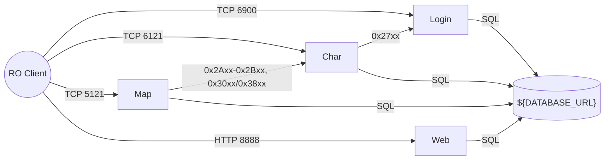

# rAthena — Reimagined System Specification

**System:** `rathena` (legacy source: repo root `src/`, `conf/`, `db/`, `sql-files/` @ `d4b8e7b`)
**Target vision:** Modern C++20 refactor of the whole server suite (login, char, map, web)
**Status:** HITL #1 and #2 complete; architecture approved; Phase E scaffold in `modernized/rathena-reimagined/`.
**Brief:** none (`analysis/rathena/MODERNIZATION_BRIEF.md` does not exist). No phase constraints apply.

The legacy system is the **specification source**, not the structural template. All credential values are masked. Connection details appear only as env-var placeholders.

Legacy scale (C++ lines): map 296k · common 20k · char 16k · tool 8k · login 4.5k · web 2.3k · **~350k total**.

---

## 1. Capabilities

Capabilities are derived from 191 business rules (186 extracted; BR-CHAR-050 later split into six) and the interface catalog. Each capability has an ID (`CAP-NN`) that HITL #1 and the architecture refer to.

| ID | Capability | Legacy owner | Rules | Proposed priority |
|---|---|---|---|---|
| CAP-01 | **Account authentication.** Plaintext, MD5 challenge/response, SSO and OTP logins, with a fixed order of rejection checks. | login | BR-LOGIN-001…015, 038 | P0 |
| CAP-02 | **Account administration.** Ban, unban, state, sex, e-mail, VIP lifecycle, character-slot entitlement. | login | BR-LOGIN-026…032, 035 | P0 |
| CAP-03 | **Abuse prevention at the edge.** IP ban list, auto-ban after repeated wrong passwords, DNSBL, connection-flood guard, client hash check, group gating. | login, common | BR-LOGIN-013,014,016,022…024; BR-INTER-011 | P0 |
| CAP-04 | **Session handoff.** One-time auth ticket (30 s TTL) passed login → char → map, duplicate-login kick, online-state tracking. | login, char, map | BR-LOGIN-018,019,033; BR-CHAR-025…027,031; BR-INTER-004,008 | P0 |
| CAP-05 | **Character lifecycle.** Create (name, slot, starting stats/job), list, select, timed delete with full data cleanup, rename, slot move, character ban. | char | BR-CHAR-001…018 | P0 |
| CAP-06 | **PIN code (second password).** Complexity rules, lockout after failed attempts, packet gate until the PIN is verified. | char | BR-CHAR-019…022 | P1 |
| CAP-07 | **Persistence of player aggregates.** Character, inventory/cart/storage, skills, quests, achievements, registries, status changes, cooldowns. | char (system of record) | BR-CHAR-032, 050, 054; BR-LOGIN-036; BR-INTER-015 | P0 |
| CAP-08 | **Parties.** Create/join/leave, even-share eligibility, leader rules. | char, map | BR-CHAR-033…036; BR-MAP-028 | P0 |
| CAP-09 | **Guilds.** Create, positions, levels and skills, alliances, expulsion, guild storage, emblem, castles (War of Emperium). | char, map, web | BR-CHAR-037…045; BR-MAP-027; BR-WEB-002,004…008 | P1 |
| CAP-10 | **Clans.** Seeded clans, membership, inactivity cleanup. | char | BR-CHAR-051 | P2 |
| CAP-11 | **Mail (RODEX) and auction.** Inbox, attachments, return/expiry, recipient rules. Auction is a legacy feature. | char | BR-CHAR-046…049; BR-INTER-018 | P1 (auction P2) |
| CAP-12 | **Companions.** Pet, homunculus, mercenary, elemental. | char, map | (entity model §2.A4) | P1 |
| CAP-13 | **World simulation.** Maps, spatial grid, movement, area broadcast, NPC/script engine, mob spawn and AI, instances, battlegrounds. | map | BR-MAP-059,060 (+ subsystem) | P0 |
| CAP-14 | **Combat and stat formulas.** Derived stats, hit/flee/crit, renewal and pre-renewal damage pipelines, element/size modifiers, ASPD. | map | BR-MAP-004…020 | P0 |
| CAP-15 | **Progression.** Stat/skill points, base/job level-up, experience sources, guild tax, party share, level penalty, death penalty. | map | BR-MAP-021…034 | P0 |
| CAP-16 | **Skills.** Cast time, after-cast delay, cooldowns, ground skill units. | map | BR-MAP-051…055 | P0 |
| CAP-17 | **Items and economy.** Weight, equip and use constraints, stacking, zeny invariants, drops and loot priority, NPC shops/market/barter. | map | BR-MAP-001…003, 035…037, 045…050 | P0 |
| CAP-18 | **Player-to-player trade, vending and buying stores.** Two-phase commit, tax, exclusive player states, autotrade persistence. | map | BR-MAP-038…044, 061 | P0 |
| CAP-19 | **Chat and social.** Whisper, party/guild/clan/BG chat, channels, chat rooms, friends, broadcast. | map, char | BR-MAP-057 | P1 |
| CAP-20 | **Anti-cheat and packet integrity.** Framing, state gating, obfuscation, logout lock while in combat, captcha and macro detection. | map, common | BR-MAP-056…060; BR-INTER-012,013 | P0 |
| CAP-21 | **GM and admin tooling.** @commands, GM packets, server-side authority checks. | map, char | BR-CHAR-055 | P1 |
| CAP-22 | **Web companion API.** User, character and merchant config, emblem upload/download, party booking. | web | BR-WEB-001…017 | P1 |
| CAP-23 | **Static game data.** About 49 YAML databases (item, mob, skill, job…) with renewal/pre-renewal variants and import overrides. | map | (interfaces §5) | P0 |
| CAP-24 | **Client-version compatibility.** `PACKETVER` selection, opcode shuffle, obfuscation keys. | map, common | (interfaces §1.1) | P0 |
| CAP-25 | **Audit logging.** Login log, char log, item/zeny/chat/command logs (SQL or flat file). | all | BR-LOGIN-039 | P1 |
| CAP-26 | **Ops and observability.** Config with `import:` overlays, autosave, keepalives, version reporting, LAN subnet routing, server population display. | all | BR-LOGIN-020,021; BR-INTER-010 | P1 |

### 1.1 Capability decisions (HITL #1)

Recorded 2026-10-15 from the user's answer.

**P0 (gameplay core):**
- CAP-01 to CAP-05: account authentication, account administration, abuse prevention, session handoff, character lifecycle
- CAP-07: persistence
- CAP-08: parties
- CAP-13 to CAP-18: world, combat, progression, skills, items/economy, trade/vending
- CAP-20: anti-cheat
- CAP-23: static data
- CAP-24: client-version compatibility

**P1:**
- CAP-06: PIN code
- CAP-09: guilds
- CAP-11: mail (RODEX only)
- CAP-12: companions
- CAP-19: chat/social
- CAP-21: GM tooling
- CAP-22: web API
- CAP-25: audit logging
- CAP-26: ops

**P2:** CAP-10 clans.

**Deliberately dropped:**
1. **Legacy auction and pre-RODEX mail.** The auction table, the auction packet family (0x3050–0x3055 / 0x3850–0x3855, clif Auction_*) and pre-RODEX mail packets are not rebuilt. BR-CHAR-011 (legacy delete by e-mail) is retained; the pre-RODEX branch of BR-CHAR-049 is dropped.
2. **Unauthenticated web loads.** `/userconfig/load`, `/charconfig/load` and `/MerchantStore/load` require WebToken auth. BR-WEB-010 is inverted: its acceptance test asserts a missing or invalid token → 400. A load for an unknown account does not insert a row.
3. **Plaintext/MD5 passwords at rest.** Passwords are stored with Argon2id. Existing plaintext/MD5 hashes are upgraded on the next successful login. The MD5 challenge/response (BR-LOGIN-003) stays only as a wire-compatibility shim for old clients, which needs a plaintext-equivalent secret. Accounts on that path keep a separate challenge secret until their client is upgraded. `use_MD5_passwords` (BR-LOGIN-004) is removed.

**Retained:** pre-renewal mode stays supported. Both formula pipelines (BR-MAP-006/011/015/020/051) are in scope.

---

## 2. Domain Model

### 2.1 Ownership
- **login** owns `login`, `global_acc_reg_*` and `ipbanlist`.
- **char** is the system of record for every player aggregate.
- **map** owns all runtime state and the static YAML data. It also writes a small set of commerce/world tables directly: vendings, buyingstores, market, barter, sales, party_bookings, db_roulette, mapreg and guild_storage_log.
- **web** reads `login`, `char`, `guild` and `party`, and writes the `*_configs`, `guild_emblems` and `party_bookings` tables.
- Variable scopes:
  - `##` → login, stored in `global_acc_reg_*`
  - `#` → char, stored in `acc_reg_*`
  - plain → char, stored in `char_reg_*`
  - `$` → map, stored in `mapreg`

### 2.2 Entity classes
| Class | Entities |
|---|---|
| (a) Persistent aggregates | Account, AccountRegistry, AccountStorage, Character (+ Inventory, Cart, Skill, Quest, Achievement, Memo, Hotkey, Friend, SavedStatus, Cooldown, BonusScript, CharRegistry), Party, Guild (+ Member, Position, Skill, Alliance, Expulsion, Storage, StorageLog, Castle), Clan, Pet, Homunculus, Mercenary (+ MercenaryOwner), Elemental, Mail (+ Attachment), Auction, Vending (+ Items), BuyingStore (+ Items), Market/Barter/Sales stock, MapRegistry |
| (b) Static reference data | Item, Monster, Skill, SkillTree, Job (stats/exp/aspd), StatusChange, Quest, Achievement, Pet/Homun/Merc/Elemental class data, Castle, Refine, ItemCombo, ItemGroup, RandomOption, Instance, Battleground, SizeFix, AttrFix, LevelPenalty … (~49) |
| (c) Runtime only | BlockList (spatial base), PlayerSession, MobInstance, NpcInstance, companion instances, FloorItem, SkillUnit, ChatRoom, StatusChangeSet, DerivedStatus, MapData (cells/flags/grid), InstanceData, BattlegroundData, id indexes |

**Shared value type:** `Item` (`nameid`, `amount`, `equip`, `refine`, `card[4]`, `option[5]`, `bound`, `unique_id`, `enchantgrade`, …). Six tables repeat it: inventory, cart_inventory, storage, guild_storage, mail_attachments and auction. The target should model it as **one value type with one persistence mapping**.

### 2.3 ER diagram (core persistent model)

```mermaid
erDiagram
    LOGIN { int account_id PK
        string userid
        string sex
        int group_id
        int character_slots
        int vip_time }
    GLOBAL_ACC_REG { int account_id PK
        string key PK
        int index PK }
    ACC_REG { int account_id PK
        string key PK
        int index PK }
    STORAGE { int id PK
        int account_id FK
        int nameid
        int amount }
    CHAR { int char_id PK
        int account_id FK
        int char_num
        string name UK
        int class
        int base_level
        int zeny
        int party_id FK
        int guild_id FK
        int clan_id FK }
    CHAR_REG { int char_id PK
        string key PK }
    INVENTORY { int id PK
        int char_id FK
        int nameid
        int amount
        bigint unique_id }
    CART_INVENTORY { int id PK
        int char_id FK }
    SKILL { int char_id PK
        int id PK
        int lv }
    QUEST { int char_id PK
        int quest_id PK
        enum state }
    ACHIEVEMENT { int char_id PK
        bigint id PK }
    FRIENDS { int char_id PK
        int friend_id PK }
    SC_DATA { int char_id PK
        int type PK
        bigint tick }
    PARTY { int party_id PK
        string name
        int leader_char FK }
    GUILD { int guild_id PK
        int char_id FK
        string name
        int guild_lv }
    GUILD_MEMBER { int guild_id PK
        int char_id PK
        int position FK }
    GUILD_POSITION { int guild_id PK
        int position PK
        int mode }
    GUILD_ALLIANCE { int guild_id PK
        int alliance_id PK
        int opposition }
    GUILD_STORAGE { int id PK
        int guild_id FK }
    GUILD_CASTLE { int castle_id PK
        int guild_id FK }
    CLAN { int clan_id PK
        string name }
    PET { int pet_id PK
        int account_id FK
        int char_id FK
        int class }
    HOMUNCULUS { int homun_id PK
        int char_id FK
        int class }
    MERCENARY { int mer_id PK
        int char_id FK }
    MERCENARY_OWNER { int char_id PK
        int merc_id FK }
    ELEMENTAL { int ele_id PK
        int char_id FK }
    MAIL { bigint id PK
        int send_id FK
        int dest_id FK }
    MAIL_ATTACHMENTS { bigint id PK
        int index PK }
    AUCTION { bigint auction_id PK
        int seller_id FK }
    VENDINGS { int id PK
        int char_id FK }
    VENDING_ITEMS { int vending_id PK
        int index PK
        int cartinventory_id FK }

    LOGIN ||--o{ CHAR : has
    LOGIN ||--o{ GLOBAL_ACC_REG : "## vars"
    LOGIN ||--o{ ACC_REG : "# vars"
    LOGIN ||--o{ STORAGE : "account storage"
    LOGIN ||--o{ PET : owns
    CHAR ||--o{ CHAR_REG : vars
    CHAR ||--o{ INVENTORY : carries
    CHAR ||--o{ CART_INVENTORY : cart
    CHAR ||--o{ SKILL : learned
    CHAR ||--o{ QUEST : log
    CHAR ||--o{ ACHIEVEMENT : progress
    CHAR ||--o{ SC_DATA : "saved buffs"
    CHAR ||--o{ FRIENDS : lists
    PARTY ||--o{ CHAR : "char.party_id"
    GUILD ||--o{ CHAR : "char.guild_id"
    CLAN ||--o{ CHAR : "char.clan_id"
    GUILD ||--|{ GUILD_MEMBER : members
    GUILD ||--|{ GUILD_POSITION : ranks
    GUILD_POSITION ||--o{ GUILD_MEMBER : assigned
    GUILD ||--o{ GUILD_ALLIANCE : "ally/enemy"
    GUILD ||--o{ GUILD_STORAGE : items
    GUILD ||--o{ GUILD_CASTLE : holds
    CHAR ||--o| PET : "pet_id"
    CHAR ||--o| HOMUNCULUS : "homun_id"
    CHAR ||--o| ELEMENTAL : "elemental_id"
    CHAR ||--o| MERCENARY_OWNER : ranks
    MERCENARY_OWNER ||--o| MERCENARY : merc_id
    CHAR ||--o{ MAIL : "sends/receives"
    MAIL ||--o{ MAIL_ATTACHMENTS : "only real FK"
    CHAR ||--o{ AUCTION : "seller/buyer"
    CHAR ||--o| VENDINGS : autotrade
    VENDINGS ||--|{ VENDING_ITEMS : lists
    CART_INVENTORY ||--o| VENDING_ITEMS : cartinventory_id
```



### 2.4 Legacy model defects the rebuild must fix (not port)
| # | Defect | Evidence |
|---|---|---|
| D1 | MyISAM everywhere. Mail attachments is the only real FK, so referential integrity lives only in code. | `sql-files/main.sql:855-858` |
| D2 | Default table-name bug: `clan_table` is overwritten with `"clan_alliance"`, `clan_alliance_table` is left empty, and there is no default for `elemental_db`. | `src/char/char.cpp:2726` |
| D3 | C++/SQL type mismatches: zeny is int32 in C++ vs unsigned in SQL; item amount is int16 vs int/smallint; homun_id signedness differs. | `mmo.hpp:316,571`; `main.sql:219,660,720,1094` |
| D4 | The mercenary link lives outside `char` (`mercenary_owner`). | `main.sql:918-928` |
| D5 | Names are copied into guild, alliance, mail and auction rows, so a rename has to update several tables. | entity analysis §Findings 5 |
| D6 | The item schema is repeated in 6 tables, so every new attribute needs 6 migrations. | `mmo.hpp:313` |

---

## 3. Interface Contracts

### 3.1 Topology


**Hard compatibility constraint:** the client wire protocol must stay **byte-compatible**. Unmodified game clients (selected by `PACKETVER`, default `20211103`) are the main external consumer and cannot be changed. The inter-server protocols are internal and can be redesigned.

### 3.2 Client wire protocol (AsyncAPI fragment)

Framing: little-endian binary `cmd:u16 [len:u16] payload`. Variable-length packets must be 4–32768 bytes. Opcodes may be shuffled per client date and XOR-obfuscated with a rolling key.

```yaml
asyncapi: 2.6.0
info: { title: rAthena client protocol, version: "PACKETVER-20211103" }
servers:
  login: { url: "${LOGIN_BIND}:6900", protocol: tcp }
  char:  { url: "${CHAR_BIND}:6121",  protocol: tcp }
  map:   { url: "${MAP_BIND}:5121",   protocol: tcp }
channels:
  login/auth:
    subscribe: { message: { oneOf: [ {name: CA_LOGIN}, {name: CA_LOGIN2}, {name: CA_LOGIN3}, {name: CA_LOGIN4}, {name: CA_SSO_LOGIN_REQ}, {name: CA_REQ_HASH}, {name: CT_AUTH}, {name: CA_EXE_HASHCHECK}, {name: CA_CONNECT_INFO_CHANGED} ] } }
    publish:   { message: { oneOf: [ {name: AC_ACCEPT_LOGIN, summary: "login_id1/2, sex, server list, web token"}, {name: AC_REFUSE_LOGIN}, {name: SC_NOTIFY_BAN}, {name: AC_ACK_HASH}, {name: TC_RESULT} ] } }
  char/session:
    subscribe: { message: { oneOf: [ {name: CH_ENTER, payload: "0x65 aid, login_id1, login_id2, sex"}, {name: CH_CHARLIST_REQ}, {name: CH_SELECT_CHAR}, {name: CH_MAKE_CHAR}, {name: CH_DELETE_CHAR3_RESERVED}, {name: CH_DELETE_CHAR3}, {name: CH_DELETE_CHAR3_CANCEL}, {name: CH_REQ_CHANGE_CHARNAME}, {name: CH_REQ_CHANGE_CHARACTER_SLOT}, {name: CH_SECOND_PASSWD_ACK}, {name: CH_MAKE_SECOND_PASSWD}, {name: CH_EDIT_SECOND_PASSWD}, {name: HEADER_PING} ] } }
  map/world:
    description: "290 parse handlers in 20 families (connection, movement, chat, items/storage, skills/stats, NPC/shops, economy, party/guild/clan/BG, mail/auction, companions, progression UI, anti-bot, GM). Outbound ZC_* broadcast by area."
    x-source: src/map/clif_packetdb.hpp (1,384 entries, 774 parseable)
```

The packet DB (struct layouts in `src/map/packets.hpp`, `packets_struct.hpp`, `src/common/packets.hpp`) is part of this contract and is **carried over verbatim as data**, not re-derived.

### 3.3 Inter-server protocols (AsyncAPI fragment, internal; may be redesigned)
```yaml
channels:
  login<->char:
    x-handshake: "0x2710 {userid:24, passwd:24, ip:u32, port:u16, name:20, type:u16, new:u16} using ${INTER_SERVER_USER}/${INTER_SERVER_PASS} -> 0x2711"
    x-families: [auth-verify 2712/2713, account-data 2716/2717, ping 2719/2718, accinfo 2720/2721, email 2722, state 2724, ban/unban 2725/272a/2731, sex 2727/2723, global-reg 2728/272e/2726, online 272b/272c/272d/2737, kick 2734, ip-sync 2735/2736, pin 2738/2739, vip 2742/2743]
    x-timing: { reconnect: 10s, online_sync: 1h, user_count: 5s, link_drop: "2 x stall_time" }
  char<->map (chrif):
    x-handshake: "0x2af8 using ${INTER_SERVER_USER}/${INTER_SERVER_PASS} -> 0x2af9"
    x-families: [registration/maplists, auth-handoff 2b26->2afd/2b27, persistence 2b01->2b21, status/cooldown/bonus-script, presence, account-ops, social/fame, keepalive 2b23/2b24]
    x-timing: { reconnect: 10s, auth_cleanup: 30s, user_count: 10s, autosave: 300s }
  char<->map (intif):
    x-families: [broadcast/whisper 3000-3009/3800-3809, registry, storage, party 3020-302A, guild 3030-3042, mail 3048-304e, auction 3050-3055, quest/achievement, mercenary/elemental, pet, homunculus, clan]
```

### 3.4 Web HTTP API (OpenAPI fragment)
```yaml
openapi: 3.0.3
info: { title: rAthena web API, version: legacy }
servers: [ { url: "http://${WEB_BIND}:8888" } ]
components:
  securitySchemes:
    WebToken: { type: apiKey, in: formData, name: AuthToken, description: "Paired with AID; must equal login.web_auth_token with web_auth_token_enabled=1" }
  schemas:
    Error: { type: string, example: "Error" }
paths:
  /userconfig/load:   { post: { security: [ { WebToken: [] } ], summary: "auth required (BR-WEB-010 inverted, HITL #1); legacy was unauthenticated", requestBody: { content: { multipart/form-data: { schema: { properties: { AID: {type: integer}, WorldName: {type: string} } } } } }, responses: { "200": { description: JSON config } , "400": { $ref: "#/components/schemas/Error" } } } }
  /userconfig/save:   { post: { security: [ { WebToken: [] } ], summary: "merge; null deletes (BR-WEB-009)" } }
  /charconfig/load:   { post: { security: [ { WebToken: [] } ], summary: "auth required (HITL #1)" } }
  /charconfig/save:   { post: { security: [ { WebToken: [] } ], summary: "merge; null preserves (BR-WEB-011)" } }
  /MerchantStore/load: { post: { security: [ { WebToken: [] } ], summary: "auth required (HITL #1)" } }
  /MerchantStore/save: { post: { security: [ { WebToken: [] } ] } }
  /emblem/download:   { post: { security: [ { WebToken: [] } ], responses: { "200": { content: { image/bmp: {}, image/gif: {} } }, "404": {} } } }
  /emblem/upload:     { post: { security: [ { WebToken: [] } ], summary: "guild master only; BMP/GIF <= 50,000 bytes; version++" } }
  /party/add:    { post: { security: [ { WebToken: [] } ] } }
  /party/del:    { post: { security: [ { WebToken: [] } ] } }
  /party/get:    { post: { security: [ { WebToken: [] } ] } }
  /party/info:   { post: { security: [ { WebToken: [] } ] } }
  /party/list:   { post: { security: [ { WebToken: [] } ], responses: { "200": { description: '{"Type":1,"totalPage":n,"data":[...]}' } } } }
  /party/search: { post: { security: [ { WebToken: [] } ] } }
```
The game client calls these routes, so the request/response shapes stay compatible. Per HITL #1 the `*/load` routes now require WebToken (legacy left them unauthenticated).

### 3.5 Persistence, config and outbound
- **Database:** MySQL, one logical DB plus an optional log DB. Connections: `${LOGIN_DB_URL}`, `${CHAR_DB_URL}`, `${MAP_DB_URL}`, `${WEB_DB_URL}`, `${LOG_DB_URL}` (each defaults to `${DATABASE_URL}`). 66 tables across `main.sql`, `logs.sql` and `web.sql`. Table names can be overridden.
- **Inbound config:** `conf/*.conf` (`key: value` with `import:` overlays), `conf/battle/*.conf` (18 files), `conf/*.yml` (groups, atcommands, inter_server), `db/{re,pre-re,import}/*.yml` (about 49 DBs, `Header/Body/Footer.Imports`), and `npc/` scripts.
- **Binary assets:** GRF archives, map cache `.dat`, captcha BMPs, `GeoIP.dat`.
- **Outbound:** SQL or flat-file logs (`log_athena.conf`), console log, `save/packet.txt` unknown-packet dumps. There are **no third-party network calls**; besides the listeners, the only outbound traffic is DNS.

---

## 4. Non-functional requirements (inferred)

| NFR | Legacy value | Source |
|---|---|---|
| Session idle kill | `stall_time` 60 s (minimum 3) | `socket.cpp:235` |
| Client ping (map) | every 30 s, timeout 20 s | `conf/battle/client.conf:136-139` |
| Auth ticket TTL | 30 s | `login.hpp:150`, `char.hpp:222` |
| Server reconnect | 10 s (char→login, map→char) | `char_logif.cpp:848`, `chrif.cpp:1965` |
| Player autosave | 300 s, plus save on logout/map change | `map_athena.conf:91` |
| Mapreg autosave | 300 s | `mapreg.cpp:28` |
| Simulation ticks | skill units 100 ms; natural heal 500 ms; NPC clock 1 s; mob AI `MIN_MOBTHINKTIME` (lazy ×10) | `skill.cpp:55`, `map.hpp:75`, `mob.cpp:7363` |
| Party/guild/BG position push | configurable; guild 5 s | `guild.cpp:49` |
| Connection flood guard | 5 connections / 3000 ms, then lock for 600 s | `packet_athena.conf` |
| Packet size | 4–32768 bytes (variable-length) | `clif.cpp:~25764` |
| Capacity | up to `MAX_SERVERS` = 5 char servers per login; `max_connect_user` configurable | `login.hpp:62` |
| Background jobs | IP-ban purge 60 s; online cleanup 10 min; mail return/delete 1 min; clan cleanup 60 min; login online sync 1 h | multiple |
| Platforms | Linux (gcc/clang/CMake), Windows (MSVC); CI builds all four | `.github/workflows` |
| Threading | Single-threaded event loop per server; web server runs its own thread | `core.cpp`, `web.cpp:479` |
| Determinism | Combat RNG must follow the legacy distributions (rnd%1000 crits, etc.) | `battle.cpp` |

### 4.1 Security NFRs (new, from findings)
- **S1:** No credential literal is shipped in config. Inter-server and DB credentials come from env or a secret store (`${INTER_SERVER_USER}`, `${INTER_SERVER_PASS}`, `${*_DB_URL}`).
- **S2:** Web auth tokens are never logged (fixes `auth.cpp:48,79`).
- **S3:** All JSON is produced by a serializer; no string concatenation (fixes `partybooking_controller.cpp:48-62`).
- **S4:** Every parsed packet checks `declared_len ≥ header_len` (fixes a potential login-server stall from a length-0 SSO packet, `packets.hpp:732-747`).
- **S5:** A session with no auth data never reaches the char packet handlers (fixes the null-pointer dereference at `char_clif.cpp:1707`).
- **S6:** Passwords at rest use a modern KDF, with a migration path from plaintext/MD5. The legacy MD5 challenge stays available only as a client-compatibility shim.

---

## 5. Behavior Contract (acceptance tests)

These 191 rules are the acceptance tests for the rebuild. Each row is a Given/When/Then (or a rule with a worked example). `src` paths are relative to `src/` unless noted. Rules marked **[DEFECT]** record legacy behavior that the rebuild should *correct*; the test asserts the corrected behavior, and HITL #1 confirms the correction.

### 5.1 Login (39)
| ID | Rule (Given → When → Then) | Source | P |
|---|---|---|---|
| BR-LOGIN-001 | Login checks run in a fixed order and the first failure wins: DNSBL(3) → `_M/_F` auto-create → unknown(0) → server account(0) → bad password(1) → expired(2) → banned(6) → state≠0 (code state−1) → client hash(5) → OK. *Given* correct password and future `unban_time` → code 6. | login/login.cpp:296-434 | P0 |
| BR-LOGIN-002 | Plaintext compare is case-sensitive: "secret1" is accepted, "Secret1" is rejected. | login.cpp:444-447 | P0 |
| BR-LOGIN-003 | MD5 challenge: accept md5(salt‖pass) **or** md5(pass‖salt) (passwdenc=3). | login.cpp:449-482 | P0 |
| BR-LOGIN-004 | With `use_MD5_passwords=yes`, raw/SSO passwords are hashed before compare, and challenge logins are refused (3). | loginclif.cpp:279-347 | P0 |
| BR-LOGIN-005 | Challenge salt: bytes in 1..255, never NUL. | loginclif.cpp:378-387 | P2 |
| BR-LOGIN-006 | `new_account=yes`: logging in as `bob123_M` with password `pass12` creates account `bob123` (sex M) and then authenticates. Encrypted password → 0; too short or already exists → 1; flood → 3. | login.cpp:224-343 | P1 |
| BR-LOGIN-007 | Registration flood limit: `allowed_regs` per `time_allowed` seconds, server-wide. | login.cpp:230-277 | P1 |
| BR-LOGIN-008 | New account ID = max+1, at least 2,000,000; 0 or >100,000,000 is refused. | login/account.cpp:297-332 | P1 |
| BR-LOGIN-009 | A sex-'S' (server) account logging in from a game client → code 0. | login.cpp:350-353 | P0 |
| BR-LOGIN-010 | `expiration_time` in the past → code 2; 0 = never expires. | login.cpp:360-363 | P0 |
| BR-LOGIN-011 | `unban_time` in the future → code 6 plus the formatted unblock date. | login.cpp:365-370 | P0 |
| BR-LOGIN-012 | state≠0 → refusal code state−1 (state 5 → code 4). | login.cpp:372-375 | P0 |
| BR-LOGIN-013 | Client hash check: needs a node with group ≤ account group whose hash is "disabled" or equals the client MD5; otherwise 5. | login.cpp:377-407 | P1 |
| BR-LOGIN-014 | DNSBL: any blacklist resolution → 3. | login.cpp:303-319 | P2 |
| BR-LOGIN-015 | On success: new random login_id1/2, lastlogin, last_ip, unban_time cleared to 0, logincount+1, new web token. | login.cpp:409-433 | P0 |
| BR-LOGIN-016 | Group gating: `group_id_to_connect` / `min_group_id_to_connect` → "Server closed" (1). | loginclif.cpp:61-69 | P1 |
| BR-LOGIN-017 | No char server connected → code 1. | loginclif.cpp:71-81 | P1 |
| BR-LOGIN-018 | Duplicate login: kick (0x2734) sent to all char servers; the client gets code 8; the online entry is force-cleared after 30 s. | loginclif.cpp:83-109 | P0 |
| BR-LOGIN-019 | Auth ticket {aid, id1, id2, sex}, 30 s TTL, single use. A char-side verify with a wrong id2 → refused. | loginchrif.cpp:72-124 | P0 |
| BR-LOGIN-020 | LAN subnet: a client in a configured subnet is sent the LAN char IP. | login.cpp:537-583 | P2 |
| BR-LOGIN-021 | Population colour: ≤200 green, ≤500 yellow, ≤1000 red, >1000 purple; display can be disabled (4). | login.cpp:484-500 | P2 |
| BR-LOGIN-022 | IP ban: a matching a/ab/abc/abcd mask with `rtime > now` → 3. Fails closed on SQL error. | login/ipban.cpp:40-64 | P0 |
| BR-LOGIN-023 | 7 password failures from one IP in 5 min → ban `a.b.c.*` for 5 min. **[DEFECT]** Never fires when `log_login` is off; the rebuild counts failures independently of the log. | ipban.cpp:71-87 | P0 |
| BR-LOGIN-024 | Expired IP bans are purged every 60 s. | ipban.cpp:205-225 | P2 |
| BR-LOGIN-025 | Char-server registration: sex-'S' account with id < MAX_SERVERS (5) and a free slot. Credentials `${INTER_SERVER_USER}` / `${INTER_SERVER_PASS}`. | loginclif.cpp:397-461 | P0 |
| BR-LOGIN-026 | Ban extends from max(now, current unban). Result ≤ now → ignored. Broadcast 0x2731. | loginchrif.cpp:356-400 | P0 |
| BR-LOGIN-027 | Unban sets `unban_time` to 0. | loginchrif.cpp:474-495 | P1 |
| BR-LOGIN-028 | State change is applied if different, and broadcast if non-zero. | loginchrif.cpp:311-346 | P1 |
| BR-LOGIN-029 | Sex toggles M↔F; S is excluded; broadcast. | loginchrif.cpp:409-441 | P1 |
| BR-LOGIN-030 | E-mail change: both addresses valid, new ≠ a@a.com, current matches (case-insensitive). | loginchrif.cpp:269-301 | P1 |
| BR-LOGIN-031 | Slots = account slots if >0, else `chars_per_account`; VIP adds `vip_char_increase`. With MAX_CHARS 15 and VIP 6: non-VIP 9, VIP 15. | loginchrif.cpp:153-205 | P1 |
| BR-LOGIN-032 | VIP: group 5 while active, old group restored on expiry, ±slots; group > 5 is untouched. | loginchrif.cpp:656-719 | P1 |
| BR-LOGIN-033 | Online state: −1 at login, ≥0 on a char server, −2 when that server is lost; −2 entries purged every 10 min. | login.cpp:83-210 | P1 |
| BR-LOGIN-034 | Web token: 16 chars, unique, enabled while online, disabled 10 s after logout, all wiped at startup. **[DEFECT]** The retry loop never increments its counter; the rebuild caps it at 20 attempts. | login/account.cpp:651-712 | P0 |
| BR-LOGIN-035 | PIN update stores pin and change time; max PIN tries → account offline. | loginchrif.cpp:603-644 | P1 |
| BR-LOGIN-036 | `##` registry is owned by login and relayed to all char servers. | loginchrif.cpp:450-567 | P1 |
| BR-LOGIN-037 | Account deletion (row + `##` regs) is atomic. | account.cpp:345-361 | P2 |
| BR-LOGIN-038 | userid lookup is BINARY if `case_sensitive`; more than one match → deny. | account.cpp:396-418 | P1 |
| BR-LOGIN-039 | Every attempt is logged with its result code; IP-banned attempts are logged as −3. | loginclif.cpp:208-221,525 | P2 |

### 5.2 Char (55; BR-CHAR-050 split into 050–055 per critique)
| ID | Rule | Source | P |
|---|---|---|---|
| BR-CHAR-001 | Name: trimmed; rejected if shorter than 4, contains control chars, starts with `#`, equals "Server" (−1), breaks the letter policy (−2), or already exists (−1). "Bob!" with an allow-list policy → −2. | char/char.cpp:1334-1414 | P0 |
| BR-CHAR-002 | Slot ≥ `char_slots` → −4; occupied slot → −2. | char.cpp:1418-1478 | P0 |
| BR-CHAR-003 | Character count must be < slots (non-VIP build) or < MAX_CHARS (VIP build). | char.cpp:1463-1472 | P0 |
| BR-CHAR-004 | PACKETVER ≥ 20151001: client-chosen M/F; older clients: account sex. | char.cpp:1423-1434 | P1 |
| BR-CHAR-005 | Old clients: stats sum to 30, each 1..9, with STR+INT, AGI+LUK and VIT+DEX each equal to 10. New clients: all 1 with 48 points. | char.cpp:1436-1461 | P0 |
| BR-CHAR-006 | Allowed starting jobs: Novice if flag&1, Summoner if flag&2. | char.cpp:1488-1501 | P1 |
| BR-CHAR-007 | Initial HP = 40×(100+VIT)/100 and SP = 11×(100+INT)/100. VIT 1 / INT 1 → 40 / 11. Start zeny, start point and start items come from config. | char.cpp:1504-1521 | P1 |
| BR-CHAR-008 | `char_new=no` refuses all creation. Error code mapping −1→0x00, −2→0xFF, −3→0x01, −4→0x03. | char_clif.cpp:1208-1255 | P2 |
| BR-CHAR-009 | Delete request queues `delete_date = now + char_del_delay` (86400 s). Blocked by guild (4) or party (5) per restriction setting. | char_clif.cpp:588-663 | P0 |
| BR-CHAR-010 | Delete confirmation: the YYMMDD code must equal the stored birthdate; otherwise 5. | char_clif.cpp:672-750 | P0 |
| BR-CHAR-011 | Legacy delete by e-mail/birthdate per `char_del_option`. | char_clif.cpp:1356-1391 | P1 |
| BR-CHAR-012 | Delete gate: ownership, level limit (`char_del_level`), guild/party, and the delay has elapsed. | char.cpp:1555-1613 | P0 |
| BR-CHAR-013 | Delete cleans up all related data: divorce, de-adopt, party, companions, friends (both directions), items, regs, skills, mail, SC, quests, achievements, guild break or leave. | char.cpp:1615-1751 | P0 |
| BR-CHAR-014 | Cancel deletion: owner sets `delete_date` to 0. | char_clif.cpp:753-780 | P1 |
| BR-CHAR-015 | A character queued for deletion cannot be selected. | char_clif.cpp:1086-1098 | P1 |
| BR-CHAR-016 | Character ban: `unban_time > now` blocks selection. Bans adjust from max(now, current); a result below now → 0; an active ban kicks the player. | char_mapif.cpp:1183-1248 | P0 |
| BR-CHAR-017 | Rename: counter > 0, must not be in a party/guild (configurable), name rules apply, counter−1. | char.cpp:1267-1332 | P1 |
| BR-CHAR-018 | Slot move: enabled, moves > 0, target valid; swap if `char_movetoused`. | char_clif.cpp:72-144 | P1 |
| BR-CHAR-019 | PIN state machine: disabled → OK; no PIN → NEW (forced) or PASSED; PIN set → ASK or PASSED; expired → EXPIRED. | char_logif.cpp:52-84 | P0 |
| BR-CHAR-020 | PIN is exactly 4 digits. "1234", "8901", "3210" and "1111" are illegal; "1357" is accepted. | char_clif.cpp:230-295 | P0 |
| BR-CHAR-021 | 3 wrong PINs → login is notified and the account goes offline; success resets the counter. | char.cpp:2138-2188 | P0 |
| BR-CHAR-022 | Until the PIN is verified, only connect, ping, PIN and charlist packets are accepted; anything else disconnects. | char_clif.cpp:1655-1700 | P0 |
| BR-CHAR-023 | Capacity/maintenance gate: group < `gm_allow_group` is refused when full or in maintenance. | char_logif.cpp:356-367 | P1 |
| BR-CHAR-024 | Slots > MAX_CHARS → MAX_CHARS; 0 → MIN_CHARS. | char_logif.cpp:343-348 | P1 |
| BR-CHAR-025 | Duplicate char session: kick plus code 8; offline after 30 s. | char.cpp:1976-2006 | P0 |
| BR-CHAR-026 | Char auth: reuse the local ticket (returning from map, PIN counts as entered), otherwise verify with login; no login server → reject. | char_clif.cpp:821-891 | P0 |
| BR-CHAR-027 | Online state model; the user count never goes below 0. | char.cpp:97-247 | P1 |
| BR-CHAR-028 | On startup, all characters are set offline. | char.cpp:249-255 | P2 |
| BR-CHAR-029 | Stale online cleanup. **[DEFECT]** Stops at the first still-connected entry; the rebuild skips that entry and continues. | char.cpp:2206-2229 | P2 |
| BR-CHAR-030 | Map-server registration needs `${INTER_SERVER_USER}` / `${INTER_SERVER_PASS}` and a free slot. | char_clif.cpp:786-818 | P0 |
| BR-CHAR-031 | Map → char player auth: ticket matches aid, char_id and id1 (+sex on old clients); single use. | char_mapif.cpp:1004-1090 | P0 |
| BR-CHAR-032 | A save is accepted only if the character is online on that server (or final/restore), and the payload size matches. | char_mapif.cpp:408-446 | P1 |
| BR-CHAR-033 | Party: unique name, letter policy, max 12 members. | char/int_party.cpp:505-609 | P1 |
| BR-CHAR-034 | Even share allowed if fewer than 2 online, or the level gap ≤ `party_share_level` (15), or a family exception. Levels 90 & 106 → off; 90 & 105 → on. | int_party.cpp:43-115 | P0 |
| BR-CHAR-035 | If the leader leaves, the party is dissolved. | int_party.cpp:658-683 | P1 |
| BR-CHAR-036 | Orphaned parties are cleaned up. | int_party.cpp:266-270 | P2 |
| BR-CHAR-037 | Guild creation: unique name, default positions, max 16 members. | char/int_guild.cpp:1185-1258 | P1 |
| BR-CHAR-038 | Guild capacity = 16 + 6×Extension level (Extension 10 → 76). | int_guild.cpp:887-893 | P1 |
| BR-CHAR-039 | Guild level-up while exp ≥ next and level < 50; +1 skill point. | int_guild.cpp:871-885 | P1 |
| BR-CHAR-040 | Guild skill up needs points > 0 and level < max. | int_guild.cpp:1679-1701 | P1 |
| BR-CHAR-041 | Expulsion list max 32 (FIFO); an empty guild is broken. | int_guild.cpp:1307-1363 | P1 |
| BR-CHAR-042 | Guild break deletes all guild data and clears members' guild_id. | int_guild.cpp:1420-1467 | P0 |
| BR-CHAR-043 | Alliance is bidirectional, opposition unidirectional, max 16. | int_guild.cpp:1730-1781 | P1 |
| BR-CHAR-044 | Master transfer swaps slot 0 and records the time. | int_guild.cpp:1861-1899 | P1 |
| BR-CHAR-045 | Guild storage = 100 + 100×skill level (official mode), otherwise 600. | int_guild.cpp:543-562 | P1 |
| BR-CHAR-046 | Inbox loads at most 30; NEW → UNREAD on load. | char/int_mail.cpp:27-80 | P1 |
| BR-CHAR-047 | Mail older than `mail_return_days` is returned as "RE:"; returned mail is deleted after `mail_delete_days`. | int_mail.cpp:247-578 | P1 |
| BR-CHAR-048 | Attachment retrieval zeroes zeny and items **before** release (no duplication). | int_mail.cpp:371-433 | P0 |
| BR-CHAR-049 | Recipient rules (pre-RODEX vs RODEX); an unknown recipient means the mail is not saved. | int_mail.cpp:599-658 | P1 |
| BR-CHAR-050 | Registry scopes: `##` → login, `#` → account (char), plain → character; a 0 or empty value deletes the entry. | char/inter.cpp:601-650 | P1 |
| BR-CHAR-051 | Clan membership is cleared after 14 days offline. | char.cpp:2231-2240 | P2 |
| BR-CHAR-052 | Sex change swaps gendered classes, unequips everything and clears the look. | char_logif.cpp:392-552 | P1 |
| BR-CHAR-053 | Fame lists keep the top N (≤ 10). | char.cpp:2008-2064 | P2 |
| BR-CHAR-054 | At most 20 cooldowns persisted; restored once on load. | char_mapif.cpp:510-587 | P1 |
| BR-CHAR-055 | GM ops (block → state 5, ban, unblock, sex, VIP). **[DEFECT]** The char server does not re-check the requester's authority; the rebuild does. | char_mapif.cpp:748-852 | P1 |

### 5.3 Web (17)
| ID | Rule | Source | P |
|---|---|---|---|
| BR-WEB-001 | AuthToken + AID must match an enabled token; logged out for 15 s → rejected. | web/auth.cpp:16-56 | P0 |
| BR-WEB-002 | Guild-leader authorization through GDID → `guild.char_id` ∈ AID's characters. | auth.cpp:58-84 | P0 |
| BR-WEB-003 | Token is valid between login and about 10 s after logout. | login/account.cpp:651-712 | P0 |
| BR-WEB-004 | Emblem upload is guild-master only. | web/emblem_controller.cpp:117-122 | P0 |
| BR-WEB-005 | Emblem: BMP/GIF, ≤ 50,000 bytes, header checks. A 60,000-byte BMP → 400. | emblem_controller.cpp:155-203 | P1 |
| BR-WEB-006 | BMP transparency limit. **[DEFECT]** The config key is applied to the wrong variable, so the limit never takes effect; the rebuild applies it. | web.cpp:213-216 | P1 |
| BR-WEB-007 | Emblem version starts at 1 and increments per upload. | emblem_controller.cpp:241-278 | P1 |
| BR-WEB-008 | Emblem download: any authenticated user; 404 if absent. | emblem_controller.cpp:22-114 | P2 |
| BR-WEB-009 | User config save merges; null deletes. `{"a":1,"b":2}` + `{"b":null,"c":3}` → `{"a":1,"c":3}`. | userconfig_controller.cpp:18-88 | P1 |
| BR-WEB-010 | **[DEFECT — decision needed]** The three `*/load` endpoints are unauthenticated and insert default rows. | userconfig_controller.cpp:90-164 | P0 |
| BR-WEB-011 | Char config save: null preserves; GID ownership is not verified (SME). | charconfig_controller.cpp:18-90 | P1 |
| BR-WEB-012 | Merchant store config upsert per (AID, GID, World, Type). | merchantstore_controller.cpp:18-95 | P2 |
| BR-WEB-013 | Party booking: leader only; field length limits; one booking per (world, AID, GID). | partybooking_controller.cpp:111-236 | P1 |
| BR-WEB-014 | Booking search: exact level match (SME: should this be an overlap?), roles OR-ed, memo substring, newest first. | partybooking_controller.cpp:400-566 | P1 |
| BR-WEB-015 | Booking delete/get/info/list. | partybooking_controller.cpp:238-398 | P1 |
| BR-WEB-016 | CORS headers only for the exact configured origin; POST only. | web.cpp:166-187 | P1 |
| BR-WEB-017 | **[DEFECT]** Failed auth logs the raw token; the rebuild never logs tokens (S2). | auth.cpp:48,79 | P0 |

### 5.4 Map (61, subsystem level)
| ID | Rule | Source | P |
|---|---|---|---|
| BR-MAP-001 | Max weight = job base + STR×300 + modifiers. Base 20000, STR 50, Enlarge Weight Lv5 → 45000. | map/status.cpp:3655-3690 | P1 |
| BR-MAP-002 | Weight ≥ 70% (RE) / 50% (pre-RE) → WEIGHT50; ≥ 90% → WEIGHT90. | pc.cpp:3012-3051 | P0 |
| BR-MAP-003 | Opening boxes is blocked at ≥ 90% weight (RE) or ≤ 10 free slots. | pc.cpp:6392-6416 | P1 |
| BR-MAP-004 | MaxHP = base[lv]×(1+VIT/100)×class mod + bonuses, at least 1. Base 5000, VIT 80, transcendent → 11250. | status.cpp:3511-3553 | P0 |
| BR-MAP-005 | RE base ATK = STR + DEX/5 + LUK/3 + Lv/4 + 5×POW. STR 100, DEX 50, LUK 30, Lv 150 → 157. | status.cpp:2424-2496 | P0 |
| BR-MAP-006 | RE MATK = INT + INT/2 + DEX/5 + LUK/3 + Lv/4 + 5×SPL; pre-RE uses the min/max formulas. | status.cpp:2510-2592 | P0 |
| BR-MAP-007 | RE HIT = 175 + Lv + DEX + LUK/3 + 2×CON. Lv 99, DEX 90, LUK 30 → 374. RE FLEE = 100 + Lv + AGI + LUK/5 + 2×CON. | status.cpp:2638-2711 | P0 |
| BR-MAP-008 | RE soft DEF = (Lv+VIT)/2 + AGI/5; soft MDEF = INT + Lv/4 + (DEX+VIT)/5. | status.cpp:2649-2719 | P0 |
| BR-MAP-009 | RE CRI = 10 + 3×LUK + Lv/10. LUK 30, Lv 99 → 109. | status.cpp:2722-2740 | P0 |
| BR-MAP-010 | Crit chance = CRI − target LUK×2 (×3 for a non-player vs a player), ×2 vs a sleeping target. CRI 109 vs LUK 10 → 8.9%. | battle.cpp:3017-3155 | P0 |
| BR-MAP-011 | Hit chance = (80 pre-RE / 0 RE) + HIT − FLEE, clamped to [5, 100]%. RE 374 vs 300 → 74%. | battle.cpp:3228-3318 | P0 |
| BR-MAP-012 | Crowd penalty: with ≥ 3 attackers, FLEE × (100 − (n−2)×10)%. 5 attackers, FLEE 300 → 210. | battle.cpp:3265-3276 | P1 |
| BR-MAP-013 | Crowd DEF penalty: −5% per extra attacker. | battle.cpp:4780-4798 | P1 |
| BR-MAP-014 | RE defense: dmg × (4000+DEF)/(4000+10×DEF) − softDEF. 1000 dmg, DEF 100, softDEF 50 → 770. | battle.cpp:4855-4870 | P0 |
| BR-MAP-015 | Pre-RE defense: dmg × (100−DEF)% − VIT def (randomised). | battle.cpp:4805-4882 | P0 |
| BR-MAP-016 | Ignore-DEF bonuses are capped at 100%. | battle.cpp:4734-4756 | P1 |
| BR-MAP-017 | Element table: Water vs Fire Lv1 → 150%; Neutral vs Ghost Lv1 → 90%. | battle.cpp:511-527; db/re/attr_fix.yml | P0 |
| BR-MAP-018 | Size modifier: Knuckle vs Large → 75%. | db/re/size_fix.yml | P0 |
| BR-MAP-019 | RE ASPD formula, capped at 190 (193 for 3rd jobs). | status.cpp:2355-2399 | P0 |
| BR-MAP-020 | Pre-RE attack delay: 600 base, AGI 90, DEX 50 → 354. | status.cpp:2400-2414 | P1 |
| BR-MAP-021 | RE stat cost: x<100 → 2+(x−1)/10; x≥100 → 16+4×((x−100)/5). 10→11 costs 2; 11→12 costs 3. | pc.cpp:8798-8831 | P0 |
| BR-MAP-022 | Stat raise: positive amount, ≤ job max (99 / 130), enough points. | pc.cpp:8841-8920 | P0 |
| BR-MAP-023 | Status points per level come from the statpoint table. | db/re/statpoint.yml | P1 |
| BR-MAP-024 | Base level-up: overflow capped unless `multi_level_up`; full heal; over-level equipment removed. | pc.cpp:8244-8315 | P0 |
| BR-MAP-025 | Job level-up: +1 skill point. | pc.cpp:8317-8358 | P1 |
| BR-MAP-026 | No exp when dead or off-map; guild tax first; bonuses; cap; max-level clamp. | pc.cpp:8366-8533 | P0 |
| BR-MAP-027 | Guild tax: 1,000 exp at 10% → 900 to the player, 100 to the guild. | guild.cpp:1681-1705 | P1 |
| BR-MAP-028 | Even share: 3,000 exp, 3 members → 1,000 each. | party.cpp:1238-1290 | P0 |
| BR-MAP-029 | RE level-difference exp/drop penalty (level_penalty.yml buckets). | pc.cpp:13325-13356 | P0 |
| BR-MAP-030 | Death penalty type 1 at 1%: next level needs 1,000,000 → −10,000 exp. Novices, GvG and insurance are exempt. | pc.cpp:9998-10057 | P0 |
| BR-MAP-031 | Super Novice angel at ≥ 99% exp, once per level. | pc.cpp:9777-9793 | P1 |
| BR-MAP-032 | Mob levels up on a kill (when enabled). | pc.cpp:9922-9935 | P2 |
| BR-MAP-033 | Skull drop on PK. | pc.cpp:9981-9993 | P2 |
| BR-MAP-034 | Nightmare item drop. | pc.cpp:10059-10110 | P1 |
| BR-MAP-035 | Global drop-rate scaling, linear or logarithmic, clamped. | mob.cpp:4808-4821 | P0 |
| BR-MAP-036 | Drop modifiers: bonuses capped at 90%, final cap 100%, floor 0.01%. 1% base with +100% → 2%. | mob.cpp:2818-2890 | P0 |
| BR-MAP-037 | Loot priority windows 3 s/2 s/2 s (MVP 10 s); pickup range 2 cells. | pc.cpp:6197-6245 | P1 |
| BR-MAP-038 | Trade request preconditions (distance, state, group). | trade.cpp:24-90 | P0 |
| BR-MAP-039 | Trade acceptance flow. | trade.cpp:108-166 | P1 |
| BR-MAP-040 | Untradeable/bound items and zeny limits enforced. | trade.cpp:351-490 | P0 |
| BR-MAP-041 | Trade is a two-phase commit: both lock, both confirm, then an atomic swap. | trade.cpp:181-686 | P0 |
| BR-MAP-042 | Vending: needs MC_VENDING and a cart; up to 2+skill level items; price cap. | vending.cpp:298-367 | P0 |
| BR-MAP-043 | Buying from a vendor: stock, zeny and weight checks. | vending.cpp:123-214 | P0 |
| BR-MAP-044 | Vending tax 5% on sales ≥ 100,000,000. | vending.cpp:106-219 | P1 |
| BR-MAP-045 | Zeny never goes negative; credits clamp at 2,147,483,647. | pc.cpp:5795-5856 | P0 |
| BR-MAP-046 | Stack limit 30,000. | pc.cpp:5729-5764 | P1 |
| BR-MAP-047 | NPC price Discount/Overcharge. | pc.cpp:5689-5719 | P1 |
| BR-MAP-048 | Equip requirements (job, level, sex, location). | pc.cpp:1850-1939 | P0 |
| BR-MAP-049 | Consumable use requirements. | pc.cpp:6276-6442 | P0 |
| BR-MAP-050 | Personal storage 300, VIP 600. | chrif.cpp:1565-1580 | P1 |
| BR-MAP-051 | Pre-RE cast time. | skill.cpp:10122-10181 | P0 |
| BR-MAP-052 | RE cast time: 20% fixed + variable reduced by DEX/INT. | skill.cpp:10253-10379 | P0 |
| BR-MAP-053 | After-cast delay. | skill.cpp:10385-10495 | P1 |
| BR-MAP-054 | Up to 20 concurrent cooldowns. **[DEFECT]** When the list is full, a new cooldown is silently skipped; the rebuild must never let a skill bypass its cooldown. | skill.cpp:13915-13931 | P0 |
| BR-MAP-055 | Natural regeneration cadence. | battle.cpp:8387-8389 | P2 |
| BR-MAP-056 | Combat logout lock. **[DEFECT]** Hardcoded 10,000 ms; the rebuild uses `prevent_logout`. | clif.cpp:2138-2150 | P1 |
| BR-MAP-057 | Chat speaker-name integrity (no spoofing). | clif.cpp:10442-10551 | P0 |
| BR-MAP-058 | Detect name requests for hidden GMs. | clif.cpp:11488-11499 | P2 |
| BR-MAP-059 | Packet framing and state gating (packets before load-end are rejected). | clif.cpp:25667-25806 | P0 |
| BR-MAP-060 | Map connect packet sanity checks. | clif.cpp:10615-10689 | P0 |
| BR-MAP-061 | Vending, trading and buying-store states are mutually exclusive. | vending.cpp:304; trade.cpp:153-361 | P1 |

### 5.5 Inter-server (19)
| ID | Rule | Source | P |
|---|---|---|---|
| BR-INTER-001 | Char → login handshake (0x2710 / 0x2711). | login/loginclif.cpp:397-461 | P0 |
| BR-INTER-002 | Unknown packet from a char server → disconnect. | loginchrif.cpp:776-834 | P0 |
| BR-INTER-003 | Account-data packet invariants. **[DEFECT]** group_id is sent as 1 byte (truncated above 255); the rebuild widens it. | loginchrif.cpp:148-205 | P1 |
| BR-INTER-004 | Online sync protocol (full list marks a server's users −2 first). | loginchrif.cpp:504-595 | P0 |
| BR-INTER-005 | Ban/state changes propagate to all char servers. | loginchrif.cpp:335-395 | P0 |
| BR-INTER-006 | IP re-sync. | loginchrif.cpp:52-58 | P2 |
| BR-INTER-007 | Map → char inter packet framing (length table). | char/inter.cpp:58-70 | P0 |
| BR-INTER-008 | Auth ticket TTL 30 s. | login.hpp:150; char.hpp:222 | P0 |
| BR-INTER-009 | ID ranges and name lengths (account ≥ 2,000,000; char ≥ 150,000; name 24). | common/mmo.hpp:121-178 | P0 |
| BR-INTER-010 | Stall timeout. | common/socket.cpp:235 | P1 |
| BR-INTER-011 | Connection flood guard. | socket.cpp:1076-1210 | P0 |
| BR-INTER-012 | Buffer/packet size limits. | socket.cpp:243-263 | P1 |
| BR-INTER-013 | Login/char packet length validation. **[DEFECT]** A declared length of 0 is accepted (S4). | common/packets.hpp:701-750 | P0 |
| BR-INTER-014 | Server-count limits (MAX_SERVERS 5). | login.hpp:62 | P2 |
| BR-INTER-015 | Global-registry routing by prefix. | char/inter.cpp:610-615 | P1 |
| BR-INTER-016 | Inter-server shared secret comes from `${INTER_SERVER_PASS}`, never a literal. | conf/char_athena.conf:8-9 | P0 |
| BR-INTER-017 | VIP propagation login → char → map. | loginchrif.cpp:214-227 | P1 |
| BR-INTER-018 | Mail and storage authority sits with the char server. | int_mail.cpp:371-433 | P1 |
| BR-INTER-019 | Char → map ban notification. | char_logif.cpp:565-575 | P1 |

### 5.6 Config drift (code default vs shipped)
The rebuild uses **one source of defaults**: shipped config values become the code defaults.

| Setting | Code default | Shipped |
|---|---|---|
| `max_third_parameter` | 135 | 130 |
| `vending_max_value` | 10,000,000 | 1,000,000,000 |
| `vending_tax` | 0 | 500 |
| `party_share_level` | 10 | 15 |
| `mail_return_days` / `mail_delete_days` | 14 | 15 |
| `new_account` | yes | no |
| `death_penalty_type` / `base` / `job` | 0 | 1 / 100 / 100 |

---

## 6. Open SME questions
1. Is the web server meant to be internet-facing? Are the unauthenticated `*/load` routes intentional (the client may not send a token on load)?
2. Should the registration flood limit be per IP instead of server-wide?
3. Should a party survive its leader leaving (the code TODO says official servers allow leaderless parties)?
4. Should party-booking level search use range overlap?
5. Are auction, the legacy pre-RODEX mail and `GeoIP.dat` still in use?
6. Is the pre-renewal mode still a supported target, or renewal only?
7. Are there orphan rows from MyISAM deletes in production data, which would affect migration?
