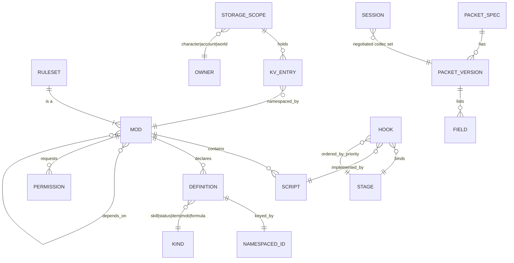

# rAthena — Engine + Luau Mods: Specification Delta

**System:** `rathena` (legacy source: repo root, HEAD `d2c5a95`)
**Target vision:** A moddable Ragnarok Online server. The native core is an engine with no game rules. The game lives in a Luau scripting layer that mods build on.
**Status:** Phase A done. HITL #1 answered. Architecture in `REIMAGINED_ARCHITECTURE_ENGINE.md` awaits HITL #2.
**Relationship to the earlier run:** `AI_NATIVE_SPEC.md` (191 rules, BR-LOGIN/CHAR/MAP/INTER/WEB, 26 capabilities, entity model, interface catalog) is **inherited unchanged** as the base spec. It was written for a different vision (in-place C++20 refactor). This file adds only what the engine + Luau vision needs. Where the two disagree, this file wins for the new system.
**Brief:** none (`analysis/rathena/MODERNIZATION_BRIEF.md` does not exist). No phase constraints apply.

Credentials are masked everywhere. Connection details appear as env-var placeholders.

---

## 1. HITL #1 decisions (recorded 2026-10-18)

- **Reuse the existing spec, fork the outputs.** Old artifacts under `analysis/rathena/` and `modernized/rathena-reimagined/` stay untouched. New outputs go to `*_ENGINE.md` and `modernized/rathena-engine/`.
- **P0 = both rulesets.** The first milestone ships the engine, the Luau runtime, the mod system, the legacy `.txt` NPC runtime, the test harness, the YAML migrator, **and both the renewal and pre-renewal packages.**
- Scope for everything else follows the user's default: pre-existing P1s (guilds, mail, web API, chat, GM tools) stay P1. Auction and battlegrounds were offered as drops in the default; the user chose "Both rulesets are P0", which was a variant of that default, so they are **dropped from the first milestone** (recorded as an assumption in §8, Q-A).

## 2. New and changed capabilities

| ID | Capability | Priority |
|---|---|---|
| CAP-E01 | **Rule-free engine core.** Entity store, map grid, spatial queries, pathfinding, tick loop, timers, sessions, persistence. No reference to any skill, item, status, job or formula. | P0 |
| CAP-E02 | **Generated packet codecs.** Wire formats come from a machine-readable spec keyed by semantic name, version and client flavour. | P0 |
| CAP-E03 | **Luau runtime.** Ordered, cancellable, prioritized event bus; coroutine dialogue; hot reload; instruction budgets; sandbox; typed API definitions. | P0 |
| CAP-E04 | **Namespaced persistent storage.** Per-mod storage on character, account and world scopes. Replaces sigil variables. | P0 |
| CAP-E05 | **Mod system.** `mods/` packages with manifest (name, version, dependencies, load order, permissions) and namespaced IDs. | P0 |
| CAP-E06 | **Ruleset packages.** `ruleset.renewal` and `ruleset.prerenewal` as two separate script packages. Damage pipeline of named stages. Declarative status contributions. | P0 |
| CAP-E07 | **Native fast paths.** Mob AI and default damage calculation, used only when no script hooks that stage. | P0 |
| CAP-E08 | **Legacy NPC script compatibility.** Runs existing `.txt` scripts against the new API. | P0 |
| CAP-E09 | **Headless test harness.** Simulated players cast skills and assert outcomes. | P0 |
| CAP-E10 | **YAML database migrator.** Converts `db/{re,pre-re,import}` to ruleset package data. | P0 |
| CAP-E11 | **Topology simplification.** Replaces the login/char/map split if the evidence supports it (see §7). | P0 |

Inherited capabilities CAP-01…CAP-26 keep their meaning. Their *implementation home* changes: rules move out of C++ into packages. See the traceability map in the architecture.

## 3. Behavior contract additions

**119 rules `BR-RULESET-001…119`** were mined from `battle.cpp`, `status.cpp`, `skill.cpp`, `pc.cpp` and `script.cpp`. They are the acceptance tests for the two ruleset packages. The full text with citations, renewal/pre-renewal flags and worked examples E-1…E-10 is preserved verbatim in **`analysis/rathena/BR_RULESET.md`** (written alongside this file). Summary:

| Range | Subject | Count | Native or script |
|---|---|---|---|
| 001–050 | Damage pipeline: weapon, magic and misc paths; card fix; element; RES/MDEF; reflection; map-mode rates; skill-damage DB | 50 | stage tables native, formulas and per-skill hooks script |
| 051–077 | Status effects: record schema, start gating, resistance (PRE vs RE), stacking, strip, end semantics, stat contributions, periodic ticks | 27 | declarative script data |
| 078–097 | Skills: `skill_db` fields, dispatch, cast lifecycle, requirements, delay/cooldown, ground units, combos | 20 | script |
| 098–110 | Items: `bonus` vocabulary (~506 `SP_*` cases), equip parse order, refine, combos, consume, heal | 13 | script |
| 111–119 | Native/script contract: fast paths, numeric fidelity, effect queue, hook surface, package manifest, golden-trace verification | 9 | contract |

### Findings that shape the architecture

1. **Renewal is not one switch.** `src/config/renewal.hpp:37-74` has six independent sub-flags (CAST, DROP, EXP, LVDMG, ASPD, STAT). Databases are separate sets: `skill_db` 1,228 (pre-re) vs 1,635 (re); `status` 699 vs 1,018; items 6,169 vs 29,356. The ruleset manifest must carry sub-flags, not a boolean.
2. **Stage order differs between renewal and pre-renewal**, not just constants (BR-RULESET-018 vs 019). A single pipeline with different stage *registration order* per package is therefore needed. Fixed-order with constant tables is not enough.
3. **Hook points already exist** in legacy: nine `SkillImpl` virtuals (`src/map/skills/skill_impl.hpp:7-62`) and `ScriptHost` as the single VM entry for item/equip/combo scripts. `status.yml` already has a declarative schema. About 120 `rules::` call sites already separate pure rule functions.
4. **Side effects inside calculation** (Magma Flow, Reject Sword, Poison React, Aeterna consumption). Scripts must **return an ordered effect queue** that native code applies after the result is final. Scripts never mutate the world during calculation (BR-RULESET-116).
5. **Numeric fidelity.** Legacy math is int64 with float32 steps and fixed RNG draw counts. Luau numbers are doubles. The runtime must supply integer-division, float32-rounding and int64 helpers (BR-RULESET-115).
6. **Possible legacy defects to decide, not copy blindly:** Burnt +666% inside the Dark Crow block (`battle.cpp:1803`); `rnd()%(max-min)` never returns max; always-true condition at `battle.cpp:5137`; several `!TODO: Confirm` formulas.

## 4. Engine interface contracts (new)

### 4.1 Packet specification (`netproto`)

Legacy has five unsynchronised artifacts (`clif_packetdb.hpp` 1,376 definitions; `clif_shuffle.hpp` 4,134 definitions in 155 per-build blocks; two typed-struct headers; hand-written `RFIFO*/WFIFO*` in `clif.cpp`). 1,910 `#if PACKETVER` lines across 50 files. `PACKETVER` is compile-time, one client per binary.

The spec must capture, per packet:

| Aspect | Requirement |
|---|---|
| Identity | Stable semantic name (`CZ_REQUEST_MOVE`), direction (CZ, ZC, inter), category |
| Opcode | Per (date, flavour) pair. One name maps to several opcodes, and one opcode to several names across versions (`0x0072` is WantToConnection, DropItem and UseItem at different times) |
| Version axis | `(date, flavour)` where flavour ∈ {main, re, zero}. Conditions like `MAIN>=X \|\| RE>=Y \|\| ZERO>=Z` |
| Fields | name, offset, type, width, array length, presence condition. Widths change by version (weapon u16→u32; nameid u16/u32) |
| Length | fixed, or variable with length-prefix offset and repeat group |
| Sub-encodings | packed 3-byte x/y/dir; 6-byte src/dst |
| Obfuscation | rolling opcode XOR key per session. Decoding is **stateful**, not pure |
| Gating | session-phase rules: pre-session only `WantToConnection`; pre-map-load only `LoadEndAck`; unknown opcode disconnects; 3 packets per socket per cycle |

Runtime shape: one process serves **many client versions at once** by loading the codec table for each session's negotiated `(date, flavour)`. Legacy's one-binary-per-client is dropped.

### 4.2 Spatial and pathing semantics to preserve

- **Grid:** cell flags (terrain walkable/shootable/water; dynamic: npc, basilica, landprotector, novending, nochat, maelstrom, icewall…). Last row and column count as solid (`map.cpp` edge quirk). 8×8 block buckets. Mobs in a separate bucket array.
- **Area iteration:** snapshot-then-call (list copied, callback skipped if the object was removed). Non-mobs first, then mobs. LIFO order within bucket. Square (Chebyshev) range. Optional wall-check via `path_search_long`.
- **A\*:** Manhattan×10 heuristic (inadmissible on purpose, matches the client), diagonal 14, no corner-cutting, fixed neighbor order. Limits `MAX_WALKPATH 32`, hash collision fails the search (legacy FIXME). Official walkpath rule: `path_len>14` also needs `path_search_long`.
- **Distances:** Chebyshev for rules, `floor(sqrt(dx²+dy²)-0.1)` for client-visible range.
- **Timers:** single-thread min-heap, 20 ms floor, 1000 ms ceiling poll, late-timer catch-up rules. Walk is one timer per cell (~6.7 firings/s per moving unit).
- **Rules inside spatial primitives:** `map_moveblock` embeds skill and status handling. The engine needs an **on-move hook** instead.

### 4.3 Script host interface (compatibility layer)

| Item | Fact |
|---|---|
| Corpus | 1,138 `.txt` files, 807,612 lines. Renewal loads 835 files (721,592 lines). Pre-renewal loads 527 (383,587) |
| Commands | 671 script-visible names. 388 appear in `npc/`; 283 never do |
| Declarations | 9,986 `script`, 11,788 `duplicate`, 10,365 `monster`, 4,695 `warp`, 6,138 `mapflag`, 469 shops, 195 `function`. Barters are YAML |
| Yielding commands | `next`, `close2`, `menu`, `select`, `prompt`, `input`, `sleep`, `sleep2`, `progressbar`, `progressbar_npc`. `close` ends the script. `mes`, `callshop`, `waitingroom` do not yield |
| Variables | `name` char/persist, `@` char/temp, `$` world/persist, `$@` world/temp, `#` account (char-server scope), `##` account (login-wide), `.` NPC, `.@` call frame, `'` instance. Arrays are sparse, 32-bit index. Key < 33 chars, string value < 255 |
| Param variables | `Zeny`, `BaseLevel`, etc. are not variables: read/write through `pc_readparam` / `pc_setparam` |
| Dynamic dispatch | Computed event names (`donpcevent` ~1,380 uses); `getd`/`setd` (560 uses); `getvariableofnpc` (75) shows `.` vars are not private; `unloadnpc` (157); `attachrid` (19); `atcommand` (19); `query_sql` (4, custom only); `freeloop` (34) |
| Safety | `check_cmdcount = 65535` plus `check_gotocount = 2048`; `freeloop` is the escape |
| Events | 9 engine-fired player events, touch events, shop events, timer/clock events (`OnTimer<ms>`, `OnClock<hhmm>`…), WoE/agit, instance, whisper, `bindatcmd`. User-defined labels for mob death, idle, walk-end, chat room, battleground. Player queue holds 2 events with a 100 ms dequeue |
| Zero use in corpus | `eval`, dynamic `callfunc`/`callsub` targets, `charcommand`, `cmdothernpc`, script-level `rerun` |

The `ScriptHost` facade and the headless buildin corpus in `tools/ci/script_corpus/` already exist and can seed the compatibility work.

### 4.4 Data (YAML) migration inputs

- `db/*.yml` are stubs (`Header`, optional `Body`, `Footer.Imports`). Data is in `db/re/` and `db/pre-re/`; overrides in `db/import/` (created at install from `db/import-tmpl/`).
- Override semantics are **per-field "last file wins"** inside each DB's `parseBodyNode`, not in the loader. Lists may use an `Index` key. CSV-style DBs go through `sv_readdb`. The migrator must reproduce field-merge semantics. Only the mob DB was read in detail; the item, skill, status and quest DBs may have special cases (see Q-D).
- Embedded script strings in the data: `Script` 29,585, `UnEquipScript` 384, `EquipScript` 20, achievement `Condition` 183. All are rAthena script, not Luau, so the migrator **translates or wraps** them through the same compatibility layer as NPC scripts.
- Sizes (re / pre-re): items 29,356 / 6,169; mobs 2,675 / 1,004; skills 1,635 / 1,228; statuses 1,018 / 699; quests 4,821 / 2,879; item groups 2,996 / 62; combos 5,114 / 105. `mob_skill_db.txt` 14,514 / 5,494 rows.

## 5. Non-functional requirements (inferred)

| NFR | Basis |
|---|---|
| Single map process handles ≥ 1,000 CCU | `PERFORMANCE.md`: legacy at 1,000 CCU is 0.7 ms p99 tick spread, 7.9 ms in a 31×31 crowd (no combat, skills or NPCs). Target: no regression |
| Tick floor 20 ms, poll ceiling 1,000 ms | `timer.cpp:24-25` |
| Mob AI hard tick 100 ms, lazy 1,000 ms | `mob.cpp:7020-7021` |
| Script budget | Legacy: 65,535 commands per run. New: per-script instruction budget with a `freeloop`-equivalent opt-out requiring a permission |
| Mass logout | A one-off 670 ms iteration at 1,000 simultaneous saves must not stall the tick: persistence runs off the tick thread |
| Hot reload | A script change takes effect without disconnecting players |
| Determinism | Seeded replay must match legacy golden traces (`RATHENA_GOLDEN_TRACE`) for both rulesets, including float32 steps and RNG draw counts |
| Socket limit | Default build caps at 1,024 fds (`select`). New engine uses epoll/io_uring/IOCP |

## 6. Domain model additions

Inherited entities stay. New entities:

## 7. Topology evidence (login / char / map)

- ~280 hand-framed inter-server message types: login↔char 31 ids, map→char ~111, char→map ~101. The largest payload is a raw `memcpy` of `struct mmo_charstatus` (ABI-coupled).
- `MAX_MAP_SERVERS` is **2** by default. No repo evidence of more than one map process.
- Map already writes 46 SQL call sites directly, so "char owns persistence" is already crossed.
- With one map process, parties/guilds/whispers/ticket/online tracking are loopback. Real remaining work: character select, ticket auth, persistence, cross-player aggregates (guild 1,966 lines, party 957, mail 756, storage 539, auction 514).
- Login is stateless apart from accounts and an online table. It is the weakest case for a separate process.
- The 3-port redirect (login→char→map IP/port in client packets) is client-protocol-driven but a merged process can answer with its own address.

## 8. Open questions (carried into the architecture as explicit decisions)

| ID | Question | Source |
|---|---|---|
| Q-A | Confirm auction and battlegrounds are out of the first milestone | HITL #1 variant |
| Q-B | Bit-exact legacy parity (float32, RNG draw counts) or statistical parity? | BR-RULESET-115 |
| Q-C | Must the six renewal sub-flags be independently selectable? | BR-RULESET-118 |
| Q-D | Do any DBs besides mobs have custom merge rules? **ANSWERED**: all per-field patching, differing in key, mandatory nodes and list handling (table in `tooling/migrate/README.md`) | engine report |
| Q-E | Is mob AI scriptable at all, or native with only mob-skill conditions scripted? | BR-RULESET-113 |
| Q-F | Can status `val1..val4` become named fields (save-format migration)? | BR-RULESET-051 |
| Q-G | Ship legacy defects (Burnt, `rnd%(max-min)`) as-is behind a `legacy_quirks` flag, or fix? | BR-RULESET §0 |
| Q-H | Are `.` NPC variables shared by `duplicate()` clones? **ANSWERED yes**: clones share the script object (`npc.cpp:4602`; `.` registry in `script_code::local`, `script.cpp:2734`) | script report |
| Q-I | Does any operator rely on the 283 never-used commands, `query_sql`, `atcommand`, `setunitdata`? | script report |
| Q-J | Is the exact 2-slot event-queue drop and 100 ms dequeue a contract? **ANSWERED from source**: third event dropped (`npc.cpp:1751-1759`, `MAX_EVENTQUEUE` 2 at `map.hpp:73`); queued event runs via a 100 ms player timer (`npc.cpp:1176-1204`); kept behind a compat flag | script report |
| Q-K | Does a deployment run more than one map process? | topology |
| Q-L | Does the earlier architecture's decision K2 (keep the legacy NPC VM) stay superseded? This vision replaces it with Luau + a compat layer | rules report Q9 |

## 9. Provenance and data-handling notes

All three mining agents reported no instruction-shaped text aimed at automated analysis in the files they read. No credentials were encountered. The `// BR-MAP-0xx (map-rules)` comments in legacy source are provenance only; rules were confirmed against code.
