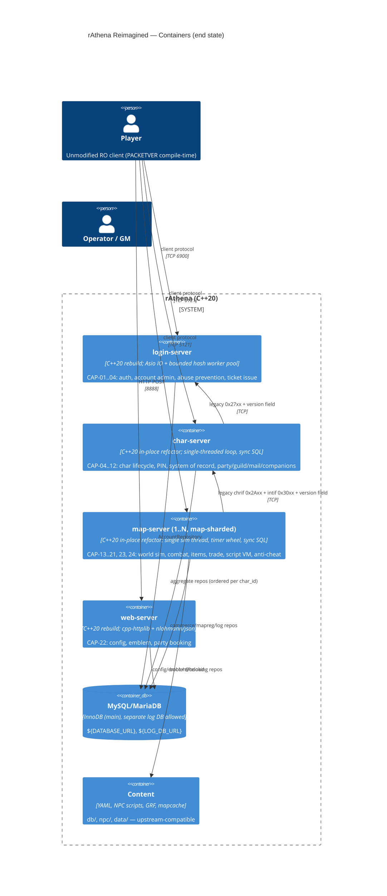

# rAthena Reimagined — Target Architecture (Modern C++20)

**Status:** v3. Architecture-critic review incorporated (§9). **Approved at HITL #2 on 2026-10-15.** The user also confirmed both deferrals: `use_sql_db` is dropped, and the D4/D5/D6 schema fixes are deferred until after M3b.
**Spec:** `analysis/rathena/AI_NATIVE_SPEC.md`: 26 capabilities (`CAP-NN`), **191** behavior-contract rules (`BR-*`), HITL #1 decisions in §1.1.
**Vision:** Modern C++20 refactor of the whole suite. Same language and contributor base; rebuilt into clean modules with dependency injection and executable tests.

## 0. Constraints and the chosen approach

| # | Constraint | Consequence |
|---|---|---|
| K1 | Unmodified game clients must keep working (CAP-24). | The client wire protocol is byte-compatible. Packet layouts stay **compile-time `#if PACKETVER` C++ headers, kept verbatim** (429 branches in `packets_struct.hpp`, 169 in `clif_packetdb.hpp`). They are not converted to data. |
| K2 | About 807k lines of NPC script (`npc/`) and about 49 YAML DBs (`db/`) are the game's content; 606 script buildins are their API. | The script language, buildin semantics (including synchronous `query_sql`) and YAML schemas stay compatible with upstream. New buildins and fields from upstream can be added, so the formats are **not frozen**. |
| K3 | Operators run 4 processes and shard maps across N map servers. | The 4-process, map-sharded topology is kept, with no new infrastructure. |
| K4 | Contributors use MSVC, gcc, clang and macOS. | Portable C++20 only, one CMake build. |
| K5 | ~350k lines; the map server is 296k and `map_session_data` is touched from 38 files. | **No big-bang rewrite and no per-process big-bang cut-over for char/map.** Every step leaves a releasable server. |
| **K6** | Upstream rAthena is active (content, rebalances, its own `src/map/skills/` SkillFactory refactor). | Changes must keep merging upstream. Prefer refactoring **in place, in `src/`**, in upstream's direction. |

### 0.1 Chosen approach: a hybrid

- **login-server (4.5k lines) and web-server (2.3k lines)** are rebuilt as clean C++20 processes. They are drop-in binaries that speak the legacy client protocol and the **legacy inter-server framing**. They are small enough to rewrite and fully test, and they carry most of the security fixes (S1–S6, the drop decisions).
- **char-server and map-server** are refactored **in place**. Pure rules are extracted into new C++20 libraries; the legacy call sites delegate to them; acceptance tests pin each rule. The binary stays shippable after every extraction.
- **Shared libraries** (`core`, `netproto`, `persistence`) are new code, consumed by the rebuilt processes and adopted gradually by char and map.

Alternatives considered:
- **Strangler per process into a new tree** (v2) was rejected: the map cut-over becomes a big bang, and it forks from upstream.
- **Pure in-place refactor everywhere** was rejected for login and web: those are small enough that a clean rewrite is cheaper than untangling them, and it delivers the security fixes sooner.

## 1. C4 Container diagram



## 2. Code structure

**End state** (inside `src/`, so upstream merges keep working):
```
src/
  core/          NEW  config (+import overlays), secrets from env (BR-INTER-016), injectable Rng, typed BattleConfig,
                      logging with a redaction filter (S2), timer wheel (sim) and Asio (IO edges only)
  netproto/      NEW  framing + length validation (S4, BR-INTER-012/013), obfuscation, legacy inter-server codec
                      with version field and widened group_id (BR-INTER-003). Packet layouts: the existing headers, verbatim.
  domain/        NEW  pure value types: Item (one type, one persistence mapping), Zeny (checked, ≥0, ≤INT32_MAX), ids, Stats
  rules/         NEW  pure, IO-free rule functions grouped by capability. Inputs: domain values + BattleConfig + Rng&.
  persistence/   NEW  repositories (concrete MySQL classes; interfaces only where a test fake exists), rathena-migrate tool
  login/         REBUILT on core/netproto/rules/persistence
  web/           REBUILT
  char/          LEGACY, refactored in place: handlers delegate to rules/ and persistence/
  map/           LEGACY, refactored in place: modules below; script VM kept, wrapped first
  common/        LEGACY, shrinks as core/netproto take over
tests/           GoogleTest acceptance tests, one file per rule group, BR-ID in each test name
```

**Scaffold staging area** (Phase E): new libraries and the rebuilt processes are scaffolded first under `modernized/rathena-reimagined/<unit>/` with their acceptance tests. Each moves into `src/` once its tests are green and it builds on all four CI toolchains.

**Dependency rule** (enforced by CMake target visibility and a CI check): `rules → domain, core/{Rng, BattleConfig}` only. Rules never touch sockets, SQL or globals. `BattleConfig` is an immutable typed value covering the 581 `battle_config` knobs, generated from the conf schema, with the **shipped values as code defaults** (fixes spec §5.6 drift). It is passed explicitly to rules.

## 3. Service boundaries

| Process | Owns rules | Writes entities | Threading / persistence model |
|---|---|---|---|
| **login-server** (rebuilt) | BR-LOGIN-* (38 active), BR-INTER-001…006, 014, 017 | Account, GlobalAccReg, IpBan, LoginLog, WebAuthToken | Asio IO thread. Argon2id verify runs on a **bounded worker pool** with queue-depth back-pressure (queue full → refuse code 3); the per-IP failure counter does not depend on the log (BR-LOGIN-023 fix). |
| **web-server** (rebuilt) | BR-WEB-* | UserConfig, CharConfig, MerchantConfig, GuildEmblem, PartyBooking | httplib thread pool. Reads Account (token) and Guild (master) through read-only repositories. |
| **char-server** (in place) | BR-CHAR-*, BR-INTER-007…009, 015, 018, 019 | Character + all child tables, AccountStorage, AccReg, Party, Guild*, Clan, companions, Mail (RODEX) | **Single-threaded, synchronous SQL, unchanged.** Persistence is ordered per `char_id`: a save (0x2b01) is committed before an auth for the same char (2b26) is answered. This is a load-after-save barrier, made explicit and tested. |
| **map-server** (in place, 1..N) | BR-MAP-*, BR-INTER-010…013 | Runtime state, plus direct writes to Vending/BuyingStore, Market/Barter/Sales stock, MapReg, PartyBooking, logs | **Single sim thread, timer wheel, synchronous SQL, unchanged.** Coroutines are not used in the sim (dangling-session risk). `query_sql` stays synchronous. |

**Cross-shard shared state.** Map servers are sharded (each owns a disjoint map set) and are not stateless.

| Shared state | Writer | Policy |
|---|---|---|
| `mapreg` (`$` vars) | each map server, autosaved every 300 s | Legacy last-writer-wins is **accepted and documented**. A single-writer move through char is a P2 follow-up. |
| market/barter/sales stock | the map server hosting the NPC | Single writer by construction (one NPC is on one shard). |
| party_bookings | map + web | Row-per-(world, AID, GID) upsert; last-writer-wins is accepted. |

### 3.1 Map-server modules: every `src/map/*.cpp` has exactly one owner (CI-enforced manifest)

| Module | Capabilities | Legacy files |
|---|---|---|
| `script` (**first**) | content API | script.cpp, npc.cpp, npc_chat.cpp, mapreg.cpp |
| `proto` | CAP-24 | clif.cpp, clif_*.hpp, packets*.hpp (encode/decode; layouts verbatim) |
| `world` | CAP-13 | map.cpp, unit.cpp, path.cpp, navi.cpp, instance.cpp, battleground.cpp, duel.cpp |
| `mobai` | CAP-13 | mob.cpp (AI/spawn) |
| `combat` | CAP-14 | battle.cpp, status.cpp |
| `progression` | CAP-15 | pc.cpp (exp/level/stat), achievement.cpp, quest.cpp |
| `skills` | CAP-16 | skill.cpp, skills/* (upstream SkillFactory, adopted rather than replaced) |
| `items` | CAP-17 | itemdb.cpp, storage.cpp, pc.cpp (inventory), mob.cpp (drops), cashshop.cpp |
| `trade` | CAP-18 | trade.cpp, vending.cpp, buyingstore.cpp, searchstore.cpp |
| `social` | CAP-08/09/10/11/19 | party.cpp, guild.cpp, clan.cpp, mail.cpp, chat.cpp, channel.cpp |
| `companions` | CAP-12 | pet.cpp, homunculus.cpp, mercenary.cpp, elemental.cpp |
| `anticheat` | CAP-20 | clif.cpp gating, captcha/macro detection (`pc_macro_captcha_register`) |
| `gm` | CAP-21 | atcommand.cpp, pc_groups.cpp |
| `ops` | CAP-25/26 | log.cpp, chrif.cpp, intif.cpp, map.cpp (boot/config) |

The full file → module manifest is generated in Phase E and checked in CI. Any new upstream file fails CI until it is assigned.

### 3.2 In-place extraction loop (per rule group)

1. **Pin.** Golden-vector tests capture legacy outputs for the rule, using an instrumented legacy build with the injectable `Rng` seeded.
2. **Extract.** A pure function in `rules/` takes domain values + `BattleConfig` + `Rng&`.
3. **Delegate.** The legacy call site, e.g. `battle_calc_defense`, calls the rule.
4. **Prove.** Golden vectors pass. **[DEFECT]** rules differ only where the allowlist (keyed by BR-ID) says they should.
5. **Ship** in the normal build. An upstream merge conflict only touches the delegate line.

**Order inside the map server**, revised because combat depends on item scripts (`status_calc_pc` → `run_script`, `status.cpp:3922-4035`):
1. Groundwork in `core`: injectable Rng and typed BattleConfig.
2. `script`: wrap the legacy VM behind `ScriptHost`. Define the API from the 606-buildin inventory; buildin corpus tests.
3. `combat` + `progression`: pure formula rules.
4. `items` + `trade`: Zeny/Item value types, two-phase trade.
5. `skills` (on upstream SkillFactory) + `mobai`.
6. `world`, `social`, `companions`, `anticheat`, `gm`, `ops`.

## 4. Technology choices

| Choice | Justification |
|---|---|
| **C++20** (CMake; MSVC 19.30+, gcc 11+, clang 14+), bump from C++17 at `CMakeLists.txt:31` | The vision. Concepts for rule signatures; `std::span`; `fmt` fallback where `std::format` is missing. |
| **Standalone Asio** at the IO edges of the rebuilt login/web only | Replaces select/epoll for new processes. The char/map sim keeps the legacy loop and timer wheel (determinism). |
| **Existing 3rdparty kept**: rapidyaml/yaml-cpp, nlohmann/json, httplib, libconfig, zlib, pcre, MySQL client | Already vendored. nlohmann/json fixes S3. |
| **spdlog + fmt** | Redaction filter for tokens and passwords (S2). |
| **GoogleTest + rapidcheck** | Acceptance tests per BR-ID; property tests (zeny ∈ [0, INT32_MAX], hit ∈ [5,100]%). |
| **libsodium Argon2id**, bounded worker pool | Password-at-rest drop decision; back-pressure prevents login CPU exhaustion. |
| **Legacy inter-server framing kept** + version field in the 0x2710/0x2af8 handshake | A schema-generated v2 is deferred until after the map refactor, and only if still needed. The `group_id` width (BR-INTER-003) and S4 are fixed in place. |
| **Secrets from env** (`${INTER_SERVER_USER}`, `${INTER_SERVER_PASS}`, `${*_DB_URL}`) | S1 / BR-INTER-016: startup refuses the shipped default inter-server credential. |
| No Boost, no gRPC, no broker | K3/K4. |

## 5. Data migration

The migration is in place, forward-only and idempotent. The `rathena-migrate` tool records applied versions in `schema_migrations`.

| Step | Phase | What | Gate |
|---|---|---|---|
| M0 | 1 | Baseline by **schema fingerprint** (73 files in `sql-files/upgrades/`, with no applied-upgrade tracking). Unknown drift means refuse to run. | — |
| M1 | 1, then recurring | Orphan report (child rows with no parent). Run as a **scheduled integrity check** until M3b. | — |
| M6 | **1** (login) | `login.pass_hash`, `pass_scheme ∈ {plain, md5, argon2id}`. Lazy rehash on successful plaintext/SSO login. | — |
| M6b | 1 | MD5 challenge shim (BR-LOGIN-003) is **opt-in, default off**. When off, accounts that still have plaintext and never log in again are **disabled after N days and need an operator/GM reset**. There is no self-service reset flow; this is a documented operator-visible change. When on, a `challenge_secret` is kept (a documented residual risk). | operator setting |
| M7 | 3 | Archive `auction` to `_archive_auction`, then drop it. | char refactor reaches mail |
| M2 | 3 | Main-DB tables → InnoDB. **`logs.sql` tables excluded** (they may live in a separate DB). | — |
| M4 | 3 | Type fixes. Zeny stays signed INT with `CHECK (zeny >= 0)` (no BIGINT rewrite). Item amount `INT UNSIGNED`. homun_id signedness aligned. | — |
| M5 | 3 | Code fix for clan/elemental table-name defaults (D2). | — |
| M3a | **after map direct-write paths are on `persistence/`** | Convert `0`-as-none to NULL for `party_id`, `guild_id`, `pet_id`, `homun_id`, `elemental_id`, `clan_id`, `partner_id`… | no legacy binary still writes those tables |
| M3b | after M3a | Add FKs. Cascade order is verified against the BR-CHAR-013 cleanup-sequence test. | M1 report is clean |
| D4/D5/D6 | **deferred (confirmed at HITL #2)** | `mercenary_owner` link, denormalized names, item schema repeated in six tables. Handled in code through the one `Item` mapping and rename propagation. Schema consolidation is deferred until after M3b. | — |
| `use_sql_db` | — | The SQL mirror of item/mob DBs (`inter_athena.conf:176`) is **dropped**; YAML is the single source (CAP-23). | confirmed at HITL #2 |

## 6. Verification strategy

- **Rebuilt processes (login/web):**
  - Dual-run against **separate DB snapshots**.
  - Diffs are made at the **decoded-packet level**, with random fields masked (login_id1/2, web token).
  - An expected-diff allowlist is keyed by BR-ID ([DEFECT] fixes, dropped capabilities).
  - A client-capture test confirms what real clients send on `*/load` before the inverted BR-WEB-010 ships (risk to CAP-24).
- **In-place char/map:** golden-vector tests captured from an instrumented legacy build. An injectable `Rng` is added to `src/common/random.hpp` first; it is a small patch that could go upstream. Linked differential execution is not used.
- **Determinism:** each rule receives `Rng&` explicitly, so tests seed per call site rather than depending on global stream order.

## 7. NFRs and failure modes

| NFR | Budget |
|---|---|
| Map sim tick | p99 ≤ 50 ms at 1,000 CCU per map server (legacy parity, to be measured in Phase E) |
| Packet → area broadcast | p99 ≤ 1 sim tick |
| Login | p99 ≤ 300 ms at 50 logins/s; Argon2id pool sized to cores; back-pressure at queue 256 |
| Autosave lag | ≤ `autosave_time` (300 s); worst-case progress loss on a crash = 1 autosave interval |
| Ops (CAP-26) | `/metrics` (Prometheus text) and `/healthz` on the web-server and on a debug port per process (P1) |

| Failure | Player-visible behavior | Data-loss bound |
|---|---|---|
| char-server down | Players on map keep playing; saves are queued in memory; new logins and map changes are refused; reconnect every 10 s (legacy). | Queued saves are lost if the map server also crashes (≤ 1 autosave interval). |
| login-server down | Existing sessions unaffected; new logins refused. | None |
| DB down or slow | char/map log errors and keep the in-memory state; saves retry; the login fails closed (BR-LOGIN-022). | ≤ 1 autosave interval |
| A map-server disconnects | Its players are marked offline (−2) and cleaned up (BR-CHAR-027/029 fixed). | Since the last save |

## 8. Rule → home traceability

| Group | Count | Home | Tests |
|---|---|---|---|
| BR-LOGIN-* | 39 (004 removed → 38 active; 003 shim opt-in) | `src/login` + `rules/auth`, `rules/account` | `tests/login/` |
| BR-CHAR-* | 55 (049 pre-RODEX branch dropped) | `rules/charlife` (001–032), `rules/party` (033–036), `rules/guild` (037–045), `rules/mail` (046–049), `rules/registry` (050, 054), `rules/clan` (051), `rules/charlife` (052, 053), `rules/gm` (055) | `tests/char/` |
| BR-WEB-* | 17 (010 inverted) | `src/web` + `rules/webapi` | `tests/web/` |
| BR-MAP-* | 61 | `rules/combat` (004–020), `rules/progression` (021–034), `rules/economy` (001–003, 035–050), `rules/skills` (051–055), `rules/anticheat` (056–061) | `tests/map/` |
| BR-INTER-* | 19 | `netproto` (001, 002, 007, 010–013), `rules/session` (003–006, 008, 009, 014, 015, 017–019), **`core/secrets` (016)** | `tests/inter/` |
| Server registration | BR-LOGIN-025, BR-CHAR-030 | `netproto` (handshake) + `core/secrets` | `tests/inter/` |

**Total: 191 rules; 191 have a home.** One is removed (BR-LOGIN-004), one is inverted (BR-WEB-010), and one is partly dropped (BR-CHAR-049). Phase E generates a per-rule manifest (`BR-ID → module → test`), and CI fails on any rule without a test, whether passing or pending.

## 9. Architecture-critic review: incorporated

| # | Critique | Severity | Resolution |
|---|---|---|---|
| B1 | A per-process strangler makes the map cut-over a big bang. | Blocker | §0.1: in-place extraction for char/map; a releasable binary at every step (§3.2). |
| B2 | Module order is backwards: combat depends on the script VM. | Blocker | §3.2: `script` is wrapped first, after the Rng/BattleConfig groundwork. |
| B3 | The rule count was wrong (186, not 167) and BR-INTER-016 had no home. | Blocker | Spec fixed (now 191 after splitting BR-CHAR-050); §8 gives every rule a home; BR-INTER-016 goes to `core/secrets`; per-rule manifest is generated. |
| B4 | FKs can't be added over `0` = none while legacy writers are live. | Blocker | §5: M3a (0 → NULL) and M3b (FKs) are gated on the map write paths moving; recurring orphan check; logs excluded. |
| M1 | Duplicates upstream's refactor and forks the content. | Major | K6 added; end state lives in `src/`; formats are upstream-compatible, not frozen; SkillFactory is adopted. |
| M2 | Async DB breaks synchronous semantics. | Major | char/map keep synchronous SQL; explicit per-char save→auth barrier; `query_sql` kept synchronous. |
| M3 | Byte-identical dual-run is impossible. | Major | §6: decoded diffs, masked random fields, DB snapshots, BR-keyed allowlist, injectable Rng, golden vectors. |
| M4 | Argon2 CPU exhaustion; the MD5 shim keeps plaintext; forced reset has no flow. | Major | Bounded pool with back-pressure; shim opt-in and off by default; disable plus operator reset. |
| M5 | Inter-server v2 adds cost with no payoff. | Major | Legacy framing kept with a version field; v2 deferred. |
| M6 | "Stateless / scale-out" is false. | Major | Map-sharded; cross-shard state table with named writers. |
| M7 | NFRs and failure modes missing. | Major | §7. |
| M8 | Map subsystems without a home. | Major | §3.1: complete module table, CI-enforced manifest. |
| M9 | The packet DB is code, not data. | Major | K1: headers kept verbatim; no extraction project. |
| M10 | 581 config knobs ignored by the purity rule. | Major | Typed immutable `BattleConfig`, shipped defaults, passed explicitly. |
| m1 | D4/D5/D6 have no migration step. | Minor | Deferred explicitly, with HITL confirmation (§5). |
| m2 | Zeny BIGINT rewrite for no gain. | Minor | INT + CHECK. |
| m3 | M6 scheduled after the login phase. | Minor | M6 moved to phase 1. |
| m4 | No upgrade tracking for the baseline. | Minor | Schema fingerprint; refuse on drift. |
| m5 | `use_sql_db` unaddressed. | Minor | Dropped (confirmed at HITL #2). |
| m6 | Interfaces with a single implementation. | Minor | Concrete classes unless a test fake exists. |
| m7 | Coroutines in the sim risk dangling sessions. | Minor | Timer wheel in the sim; coroutines only at IO edges. |
| m8 | BR-WEB-010 inversion may break clients. | Minor | Client-capture test before phase 2. |
| m9 | Status line claimed the critique was incorporated. | Minor | Now true. |

## 10. Delivery phases and Phase E scaffold units

| Phase | Scope | Exit criteria |
|---|---|---|
| 1 | `core`, `netproto`, `persistence` (M0, M1, M6), **login-server rebuild** | BR-LOGIN + BR-INTER login-side acceptance tests green; decoded-diff dual-run clean except allowlisted diffs; 4 CI toolchains green |
| 2 | **web-server rebuild** | BR-WEB green; client-capture test for `*/load` passes |
| 3 | **char in place** (`rules/charlife/party/guild/mail/registry/clan/gm`); M2, M4, M5, M7 | BR-CHAR green; save→auth barrier test passes |
| 4 | **map in place**, in the §3.2 order; M3a, M3b at the end | BR-MAP green per module; golden vectors pass; sim-tick NFR met |

**Phase E scaffolds 7 units** under `modernized/rathena-reimagined/`:

| Unit | Contents |
|---|---|
| `core` | config, secrets, Rng, BattleConfig, logging redaction |
| `netproto` | framing/length validation, legacy inter-server codec |
| `persistence` | repositories, `rathena-migrate` skeleton |
| `login-server` | full rebuild skeleton |
| `web-server` | full rebuild skeleton |
| `char-rules` | pure char rules + BR-CHAR tests |
| `map-rules` | pure combat/progression/economy/skills/anticheat rules + BR-MAP tests |

Each unit gets executable acceptance tests for its BR-IDs. Unimplemented rules are marked pending with their rule ID.
