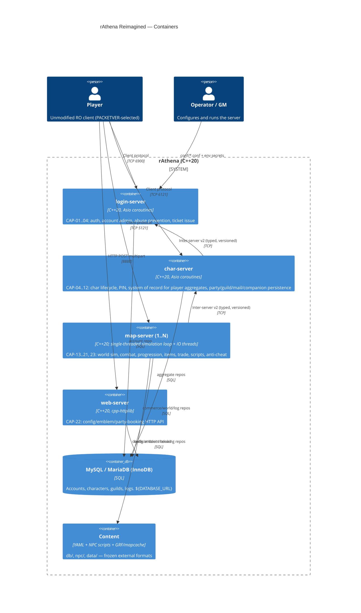

# rAthena Reimagined — Target Architecture (Modern C++20)

**Status:** DRAFT v2 (critic feedback incorporated). Awaiting HITL checkpoint #2. Nothing is scaffolded until it is approved.
**Spec:** `analysis/rathena/AI_NATIVE_SPEC.md` (capability IDs `CAP-NN`, rules `BR-*`)
**Vision:** Modern C++20 refactor of the whole suite. Same language and contributor base; rebuilt as clean modules with dependency injection and executable tests.

## 0. Constraints that shape everything

| # | Constraint | Consequence |
|---|---|---|
| K1 | Unmodified game clients must keep working (CAP-24). | The client wire protocol, including per-`PACKETVER` layouts, opcode shuffle and obfuscation, is byte-compatible. The packet DB is **data carried over**, not redesigned. |
| K2 | About 807k lines of NPC script under `npc/` and about 49 YAML DBs under `db/` are the game's **content**. | The script language and the YAML schemas are frozen external contracts. The interpreter is re-hosted behind an interface; scripts are not rewritten. |
| K3 | Server operators deploy 4 processes (login/char/map/web), sometimes several map servers. | The 4-process topology is kept. No new infrastructure (brokers, service mesh) is required to run a server. |
| K4 | The contributor base is C++ hobbyists building on Windows (MSVC), Linux (gcc/clang) and macOS. | Only portable C++20: coroutines, concepts, `std::span`, `std::format` where available (otherwise `fmt`). No exotic dependencies. CMake is the one build system. |
| K5 | The legacy code is ~350k lines and the map server alone is 296k. | A big-bang rewrite is not viable. Delivery is **strangler-style per process**: login → web → char → map, behind the unchanged wire protocol. |

## 1. C4 Container diagram



## 2. Code structure: libraries and processes

The single biggest change is **separating pure domain logic from IO**. Legacy rules live inside packet handlers that read sockets and write SQL inline. In the rebuild every BR-* rule lives in a pure, IO-free library that can be unit tested.

```
modernized/rathena-reimagined/
  libs/
    core/          ← runtime: Asio io_context, coroutine tasks, timers, logging, config (+import overlays), secrets from env
    netproto/      ← framing, packet-length validation (S4), obfuscation, opcode shuffle; packet DB generated per PACKETVER
    domain/        ← pure value types: Item, AccountId, CharId, Zeny (checked, clamped int64), Stats … NO IO
    rules/         ← pure rule functions/classes grouped by capability (auth, charlife, party, combat, progression, economy …)
    persistence/   ← repository interfaces + MySQL impl; one Item mapping; migrations
    interproto/    ← inter-server v2 message schema + codec (login↔char, char↔map)
    gamedata/      ← typed YAML loaders (rapidyaml/yaml-cpp), renewal/pre-renewal selection, import overlays
    script/        ← NPC script VM re-hosted behind IScriptHost (frozen language)
  services/
    login-server/  ← composition root + handlers (thin: decode → rules → repo → encode)
    char-server/
    map-server/    ← modules: world, combat, items, trade, skills, party, guild, mail, companions, chat, gm, anticheat
    web-server/
  tests/ (per service) ← acceptance tests, one per BR-* rule
```

Dependency rule, enforced with CMake target visibility: `rules → domain` only. `services → rules, persistence, netproto, interproto, core`. Nothing depends on `services`.

## 3. Service boundaries with rationale

| Service | Owns rules | Owns entities (write) | Rationale |
|---|---|---|---|
| **login-server** | BR-LOGIN-*, BR-INTER-001…006, 014, 017 | Account, GlobalAccReg, IpBan, LoginLog, WebAuthToken | Unchanged authority boundary. Small (4.5k lines), so it is the **pilot** that proves the libs. |
| **char-server** | BR-CHAR-*, BR-INTER-007…009, 015, 018, 019 | Character + all child tables, AccountStorage, AccReg, Party, Guild*, Clan, Pet/Homun/Merc/Elemental, Mail (RODEX) | Remains the system of record for player aggregates (CAP-07). Map servers stay stateless with respect to persistence and can scale out. |
| **map-server** | BR-MAP-*, BR-INTER-010…013 | Runtime state only. Directly writes: Vending/BuyingStore (autotrade), Market/Barter/Sales stock, MapReg, PartyBooking (shared with web), item/zeny/chat logs | Keeps legacy's direct writes for high-frequency commerce state; routing these through char adds latency and gains nothing. |
| **web-server** | BR-WEB-* | UserConfig, CharConfig, MerchantConfig, GuildEmblem, PartyBooking | Reads Account (token) and Guild (master) **through read-only repositories**, never through raw SQL from other contexts. |

### 3.1 Inside the map-server (the 296k-line problem)

The map server stays **one process with one simulation thread**. That preserves deterministic ordering, which combat and script semantics depend on. Network IO and DB IO run on separate threads and talk to the sim thread through queues. Inside the process it is split into **modules with explicit interfaces**, replacing the legacy cross-file global access (`map_session_data` touched from 40+ files):

| Module | Capabilities | Legacy origin |
|---|---|---|
| `world` | CAP-13 maps, grid, movement, area broadcast, instances, BG | map.cpp, unit.cpp, path.cpp, instance.cpp, battleground.cpp |
| `combat` | CAP-14 | battle.cpp, status.cpp (calc) |
| `progression` | CAP-15 | pc.cpp (exp/level/stat), party.cpp (share) |
| `skills` | CAP-16 | skill.cpp |
| `items` | CAP-17 | pc.cpp (inventory), itemdb.cpp, storage.cpp, mob.cpp (drops) |
| `trade` | CAP-18 | trade.cpp, vending.cpp, buyingstore.cpp |
| `script` | (content) | script.cpp, npc.cpp |
| `social` | CAP-08/09/11/19 client side | party.cpp, guild.cpp, mail.cpp, chat.cpp, channel.cpp |
| `companions` | CAP-12 | pet.cpp, homunculus.cpp, mercenary.cpp, elemental.cpp |
| `anticheat` / `gm` | CAP-20/21 | clif.cpp (gating), atcommand.cpp |

**Status-change effects (~1,000 SCs) and skill implementations (~2,000 skills) are the long tail.** They move as data-driven tables plus per-skill handler functions registered in a table. They are **not** hand-rewritten up front; they are ported module by module behind the `skills` interface.

## 4. Technology choices

| Choice | Justification |
|---|---|
| **C++20** (CMake, MSVC 19.3x / gcc 11+ / clang 14+) | The vision; keeps contributors. Coroutines replace callback timers; concepts make repository/rule interfaces checkable at compile time. |
| **Standalone Asio** (header-only) with C++20 coroutines | Replaces the hand-written `socket.cpp` select/epoll loop. Portable, battle-tested, no Boost. |
| **Existing 3rdparty kept:** rapidyaml/yaml-cpp, nlohmann/json, cpp-httplib, libconfig, zlib, pcre, MySQL client | They are already vendored and known; there is no reason to churn them. nlohmann/json fixes S3 (no hand-built JSON). |
| **fmt** (or `std::format` where supported) + **spdlog** | Structured logging with a redaction filter for tokens and passwords (S2). |
| **GoogleTest** + **rapidcheck** (property tests for formulas) | Acceptance tests per BR-*; property tests pin formula invariants (zeny never < 0, hit ∈ [5,100]%). |
| **libsodium** (Argon2id) | Password hashing at rest (dropped capability: plaintext/MD5). Small, portable, vcpkg/Conan-available. |
| **MySQL/MariaDB with InnoDB** | Same database operators already run; InnoDB gives transactions and foreign keys (fixes D1). |
| **Inter-server v2: the existing length-prefixed TCP framing, carrying typed messages generated from one schema file** (C++ codegen script) | Internal protocol, so it can change. A schema gives versioning and generated encode/decode with no hand byte-offsets, and fixes the 1-byte `group_id` truncation (BR-INTER-003). gRPC was rejected: heavy build dependency on MSVC, and it adds nothing over 3 point-to-point links. |
| **Secrets from environment** (`${INTER_SERVER_USER}`, `${INTER_SERVER_PASS}`, `${*_DB_URL}`) with conf fallback that refuses known defaults | S1: the server refuses to start with the default inter-server credential. |
| **No container orchestration required** | K3. Dockerfiles and compose are provided as an optional convenience only. |

## 5. Data migration approach

Strategy: **in-place, forward-only schema migrations on the same MySQL database**, run by a `rathena-migrate` tool (part of `persistence/`). It is versioned and idempotent, and records applied migrations in a `schema_migrations` table that supersedes `sql-files/upgrades/`.

| Step | What | Rule / defect |
|---|---|---|
| M0 | Baseline: detect the legacy schema (`main.sql` @ d4b8e7b plus applied upgrades) and stamp it as version 0. | — |
| M1 | Orphan report (dry run): list child rows whose `char_id` / `guild_id` / `account_id` has no parent. The operator chooses delete or quarantine (into `_orphans_*` tables). | D1 |
| M2 | `ALTER TABLE … ENGINE=InnoDB` for every table, in batches, online where possible. | D1 |
| M3 | Add foreign keys (`ON DELETE CASCADE` for owned children per BR-CHAR-013, `RESTRICT` elsewhere). | D1 |
| M4 | Column type fixes: zeny → `BIGINT` (domain clamps to INT32_MAX per BR-MAP-045 for client compatibility), item amount → `INT UNSIGNED`, homun_id signedness, and `group_id` widened in the protocol only. | D3 |
| M5 | Fix the clan/elemental table-name defaults in code; no data change. | D2 |
| M6 | `login.user_pass` → add `pass_hash VARCHAR(128)`, `pass_scheme ENUM('plain','md5','argon2id')`; rehash lazily on successful login. A separate `challenge_secret` is kept only for accounts that still log in via MD5 challenge. After N days the operator can force a reset of the remaining plaintext accounts. | dropped capability |
| M7 | Drop `auction` (archived to `_archive_auction` first). Legacy mail rows are preserved; RODEX reads them. | dropped capability |
| M8 | Web: no schema change. Auth is enforced on load routes in code. | dropped capability |

**Cut-over per process (strangler):** each new process is a drop-in binary that speaks the same client protocol and connects to the same DB. Inter-server v2 has a **compatibility adapter** that speaks legacy `0x27xx`/`0x2Axx`/`0x30xx`, so a new login-server works with a legacy char-server and vice versa during the transition. The adapter is deleted once all four processes are migrated.

**Verification:** for each process, a **shadow / dual-run harness** replays captured client packet streams against legacy and new binaries and diffs the server→client bytes and the DB writes. Combat formulas use differential tests: the same inputs and RNG seed are run through legacy `battle.cpp` (built as a test library) and the new `rules/combat`.

## 6. Rule → home traceability (summary)

| Rule group | Count | Home |
|---|---|---|
| BR-LOGIN-* | 39 (BR-LOGIN-004 removed by the drop decision → 38 active) | login-server (`rules/auth`, `rules/account`) |
| BR-CHAR-* | 50 (BR-CHAR-049 pre-RODEX branch dropped) | char-server (`rules/charlife`, `rules/party`, `rules/guild`, `rules/mail`) |
| BR-WEB-* | 17 (BR-WEB-010 inverted) | web-server (`rules/webapi`) |
| BR-MAP-* | 61 | map-server (`rules/combat`, `rules/progression`, `rules/economy`, `rules/skills`, `rules/anticheat`) |
| BR-INTER-* | 19 | split: 001–006, 014, 017 → login; 007–009, 015, 018, 019 → char; 010–013 → `libs/netproto` (shared, tested within login-server) |

**Every one of the 167 rules has a home** (1 removed and 1 partly dropped by the HITL #1 decisions).

## 7. Critique incorporated (architecture-critic review)

| Critique | Response |
|---|---|
| _Filled in after review._ | |

## 8. Delivery phases (proposed)

1. **Libs + login-server** (pilot): core, netproto, domain, rules/auth, persistence (Account), inter-server v2 with legacy adapter. Exit: login dual-run is byte-identical on the captured corpus; BR-LOGIN acceptance tests are green.
2. **web-server**: small; fixes S2/S3 and the inverted BR-WEB-010.
3. **char-server**: migrations M1–M6 run here (the char server owns most tables).
4. **map-server**, in module order: world → items → combat/progression → trade → skills (long tail) → script host → companions/social.
